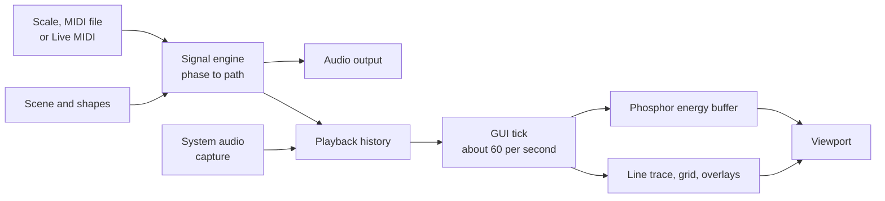
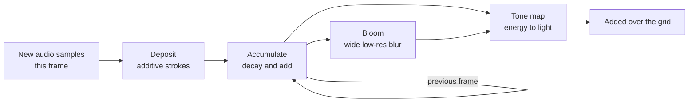

# phosphor

**phosphor** turns sound into pictures on an X–Y oscilloscope, and pictures into
sound. Stereo audio drives the two axes of the beam: left is X and right is Y. The
app shapes music and live MIDI so the beam traces wireframe solids, vector text,
3D models, SVG drawings and shapes you draw yourself, then shows the result on a
simulated phosphor screen. It runs on **macOS (Metal)** and **Windows (Direct3D 11)**.

phosphor is free software under the [GNU GPL v3](LICENSE). Download a ready-made
app from [Releases](../../releases), or build it yourself from this source.

## Contents

- [Key features](#key-features)
- [Download](#download) · [Run from source](#run-from-source) · [Build the apps](#build-the-apps)
- [Try the app](#try-the-app)
- [How the program is structured](#how-the-program-is-structured)
- [How shapes are drawn and generated](#how-shapes-are-drawn-and-generated)
- [How the phosphor screen is simulated](#how-the-phosphor-screen-is-simulated)
- [Troubleshooting](#troubleshooting) · [Validation](#validation) · [License and credits](#license-and-credits)

## Key features

### Shapes

- **Built-in objects:** the five Platonic solids, a 2D triangle, square and pentagon,
  a tilting circle and an octant sphere.
- **Multi-object scenes:** each object has its own position, size, X/Y/Z view angles
  and X/Y/Z spin (up to ±10 rev/s). Objects start still and can deliberately extend
  past the output range and clip.
- **Vector text:** up to 64 characters of letters, digits and punctuation, traced
  through the same geometry engine. Lowercase is drawn as capitals.
- **Imports:** Wavefront OBJ models (**File → Import 3D model…**, reduced to at most
  256 feature edges) and SVG artwork (**File → Import SVG…**), which becomes a normal
  editable drawing.
- **Shape builder:** lines, polylines, three-point arcs, semicircles, circles and
  interpolating splines, with snap-and-join, node editing, Undo/Redo, box selection,
  clipboard tools and construction axes. Drawings save as reusable `.shape.json` files.
- **Text, bold and extrude in the builder:** a Text tool places typed letters as
  ordinary strokes. Per selected shape, **Bold width** traces the outline of the
  strokes fattened to that width, and **Extrude depth** adds front and back copies
  along Z joined at the corners, which shows when the shape turns.
- **Motion paths:** inside the builder, mark a path as a guide and assign follower
  shapes to it, with velocity, loop, bounce or stop, and optional direction following.
  Guides are never heard or drawn in the output. Timeline editing is deferred.

### Sound

- **Sources:** a built-in C-major scale, or the melody of any MIDI file you open.
  phosphor ships no music; bring your own `.mid` files.
- **Function plots:** play and draw two expressions, x(t) and y(t), in Python maths
  syntax, with up to 8 variables on sliders. Only maths is accepted, so scene and
  preset files cannot run code. Built-in presets, and your own saved presets.
- **Live MIDI:** eight voices, 12 synth presets, velocity, pitch bend, sustain,
  sostenuto and CC1 octave alternation, with sample-aligned WAV, MIDI and JSON
  performance recording.
- **Device-rate audio:** playback and Live MIDI run at the output device's own rate
  (96 kHz included), so the system doesn't resample the X/Y signal.
- **Low-latency output:** Live MIDI uses WASAPI exclusive mode on Windows and a Core
  Audio callback stream on macOS, with 128-frame blocks up to 48 kHz and about 5 ms
  blocks above that. See [audio output paths](#audio-output-paths).
- **Listening modes:** original source, fully shaped audio, or a blend of the two.
- **Signal preferences:** hardware corner dwell (0–500 µs, capped at 25% of a cycle)
  experimental shape redraw (1–32 passes per shape, off by default) and **route
  minimizing** (Off, Shortest jumps, or Shortest total path, the default). These change
  generated X/Y samples and are stored separately from scenes and appearance.
- **WAV export:** source or processed audio at 48 kHz, 16-bit stereo.

### Display

- **Simulated phosphor screen:** a GPU energy buffer that builds up light where the
  beam lingers and fades it over time, on by default, with a Gaussian or hard-edged
  beam and bloom glow that stays continuous around sharp corners. See
  [how it works](#how-the-phosphor-screen-is-simulated).
- **Phosphor profiles:** Palette colour, P31, P1 and P7 presets, plus a saved Custom
  profile. Preferences shows each decay as an intensity-against-time plot, filled with
  the emitted colour; drag it or type values to edit, and a changed preset becomes Custom.
- **Phosphor grain and beam shimmer:** optional screen-fixed grain and per-frame
  variation of new light, both off by default.
- **Video input:** play a video file with its sound, drawn as a 60 Hz monochrome
  scanline raster on the phosphor screen, using Qt Multimedia's FFmpeg backend.
- **Phosphor brightness:** a slider under the scope, shared with Phosphor intensity in
  Preferences and hidden in the trace-only view.
- **Line trace:** the phosphor display can be turned off for a crisp vector trace
  with optional beam-speed brightness and glow.
- **Palettes:** Green monochrome, Amber, Cyan and OLED white, each with a matching logo.
- **System-audio visualization:** Core Audio taps on macOS and WASAPI loopback on
  Windows, at the device's rate. Input-only: captured audio stays in memory and is
  never played back, recorded, shaped or exported.
- **X(t), Y(t) sweep:** system audio can also be drawn against time on the phosphor
  display, with X, Y or independent triggers on either edge, adjustable trace
  separation and a 0.1–2000 ms scan window.
- **Views:** fullscreen and a trace-only immersive view (Escape restores the controls).
- **Layout:** a resizable control panel to the right of the viewport that fits the
  1000×700 minimum window size.

Appearance settings only change the preview. They never alter audio, scene files or
exports.

Travel between objects and text strokes stays visible, because stereo X–Y output has
no third channel to blank the beam. Complex shapes and long text share the samples
available in each musical cycle, so high notes can lose geometric detail.

## Download

Each [release](../../releases) has a macOS disk image and a Windows zip, built from
the tagged source by [GitHub Actions](.github/workflows/release.yml).

| | macOS | Windows |
| --- | --- | --- |
| File | `phosphor-<version>-macos-arm64.dmg` | `phosphor-<version>-windows-x64.zip` |
| Needs | Apple Silicon (M1 or later), macOS 15 or later | 64-bit Windows 10 or 11, Direct3D 11 graphics |
| Install | Open the DMG, drag phosphor to Applications | Extract the zip, run `phosphor.exe` inside the folder |

The apps aren't signed by Apple or Microsoft, so each system asks once before the
first launch:

- **macOS:** open phosphor, dismiss the warning, then go to **System Settings →
  Privacy & Security** and click **Open Anyway**. (Or, in Terminal:
  `xattr -dr com.apple.quarantine /Applications/phosphor.app`.) System-audio
  monitoring asks for its own permission the first time you use it (macOS 14.2+).
- **Windows:** SmartScreen shows "Windows protected your PC". Click **More info**,
  then **Run anyway**.

If you'd rather not bypass these checks, [build the apps](#build-the-apps) yourself.

## Run from source

Use **Python 3.12** (64-bit). On macOS, install Xcode Command Line Tools
(`xcode-select --install`); the app compiles its small system-audio capture helper
locally the first time you use it.

macOS:

```sh
git clone https://github.com/le10726433/phosphor.git
cd phosphor
python3.12 -m venv .venv
.venv/bin/python -m pip install -r requirements/requirements-macos.lock.txt
./LaunchMac.command
```

Windows (PowerShell):

```powershell
git clone https://github.com/le10726433/phosphor.git
cd phosphor
py -3.12 -m venv .venv
.\.venv\Scripts\python -m pip install -r requirements.txt
.\.venv\Scripts\python app.py
```

Later, launch with `./LaunchMac.command` or `LaunchQt.bat`. See the
[macOS development guide](docs/MACOS_DEVELOPMENT.md) for permissions and diagnostics.

## Build the apps

Both builds use PyInstaller and run on the platform they target.

macOS (Apple Silicon, from the source folder with the environment above):

```sh
.venv/bin/python -m pip install -r requirements/requirements-macos-build.txt
.venv/bin/python tools/build_macos_app.py --dmg
```

Output: `.mac-build/dist/phosphor.app` and a DMG. The app is signed ad hoc.

Windows:

```powershell
.\.venv\Scripts\python -m pip install -r requirements/requirements-windows-build.txt
.\.venv\Scripts\python tools/build_windows_app.py
```

Output: `.win-build/dist/phosphor/phosphor.exe` and a zip of that folder.

Both scripts remove Qt modules the app never loads, then fail if anything left still
links one. Pushing a `v*` tag runs the same scripts in
[CI](.github/workflows/release.yml) and attaches the results to a draft release.

## Try the app

### Music and shapes

1. Leave **Monitor input** on **Generated scene / MIDI**. Use the built-in
   C-major scale and **Tempo = 120 BPM** for a first test. To play a melody, choose
   **Source → MIDI file** and pick a `.mid` file; phosphor plays its top line.
2. Open **SCENE → Objects** and select Cube. Drag its center to move it, or its corner
   handle to resize it. **Add shape** and **Duplicate** create more shapes.
3. Set your computer's listening volume low, then click **PLAY AUDIO**. Geometry
   shaping changes the sound, so the result can be harsher than the source tone.
4. In **MIX**, compare **Original audio**, **Fully shaped audio**, and
   **Processed output**. The preview follows the selected listening mode.
5. Stop playback when finished. Use **File → Save scene** to save your
   configuration as a `.scene.json` file. Reopening a scene does not start audio.

Generated playback uses your default stereo output at that device's own rate. You can
export source or processed WAV files from **File**; these are always 48 kHz. Wait for
export to finish before closing. Left audio represents X and right audio represents Y.

### Visualize music playing on your computer

1. In **INPUT → Monitor input**, choose **System audio (visualization)**.
2. Select the playback device used by your browser or music player.
3. Click **START VISUALIZATION**, then play music in that other application.
4. Adjust **Input gain** if the trace is too small. This changes only the preview,
   leaving playback volume and captured samples unchanged.
5. To see the waveforms against time, set **Display** to **X(t), Y(t) sweep**.
   **Separation** moves X up and Y down, and **Window** sets the sweep length.
   **Trigger** picks X, Y or Both, and Rising or Falling. Both gives each trace its
   own sweep so unrelated waveforms stand still, but X and Y then no longer share a
   time base. On short-persistence phosphors a slow sweep shows as a moving spot; use
   P7 or a long Custom afterglow to see all of it.
6. Click **STOP VISUALIZATION** before changing devices. Switch back to
   **Generated scene / MIDI** to edit shapes again.

System-audio mode only displays the incoming stereo waveform. It does not impose
shapes on that audio, play it a second time, record it, or export it.

### Plot functions

1. In **INPUT → Monitor input**, choose **Function x(t), y(t)**.
2. Pick a preset or type two expressions in the **X(t), Y(t)** tab. `t` is time in
   seconds and `s` is the 0–1 position in a cycle at the chosen frequency; add
   variables to get sliders for them.
3. Click **PLAY AUDIO**. Output above ±1 is clipped; **MIX → Output level** scales it.
   Scenes save the functions; **Save as preset…** keeps them for any scene.

### Play a video

1. In **INPUT → Monitor input**, choose **Video file (phosphor CRT)** and open a file.
2. Play, seek, loop and set the volume and raster lines there. The picture is drawn
   as scanlines on the phosphor screen, so the phosphor profile and glow apply; with
   the phosphor display off it uses the palette colour.

### Play a MIDI controller

1. Connect your controller before launching the app, or click **Refresh** in INPUT → Live MIDI.
2. In generated mode, select the MIDI source under **INPUT → Source**.
3. Under **INPUT → Live MIDI**, select your **MIDI input device**, click **Connect**, and choose a **Synth preset**.
4. Click **PLAY AUDIO**, then play notes. MIDI sends note/control messages; the
   app synthesizes the sound through your computer's default output.
5. Adjust **MIDI gain before shaping** for shape size; polyphony shares available
   level among voices. Reduce gain if the trace clips. **Panic** releases stuck notes.

Live MIDI takes exclusive use of the output device on Windows for the lowest
delay, so other apps go silent on that device until you stop audio.

Use **Record…** / **Stop recording** for MIDI performance capture. See the
[application guide](GUIDE.md#live-midi-controller-mode) for
controller mappings and recording details.

### Appearance and saved work

**Preferences → Appearance** controls the palette, grid lines (which can be turned
off), scanlines, trace thickness, glow, beam-speed brightness, display interpolation,
beam profile, **Phosphor display** profile and **Phosphor intensity** (0.1–64, default
5). **Glow decay time** applies only to the line trace and is greyed out otherwise.
**Apply/OK** saves preferences; **Cancel** restores the last applied values. The
**Phosphor brightness** slider under the scope saves as soon as you stop moving it.
Double-click a slider thumb to reset its default.

Scene files store your shapes and musical settings, and the path of any MIDI file they
play. They do not store appearance preferences. Scenes are saved as version 10; version 8
and 9 files, including those from phosphor 0.32.6, still open.
Files saved by phosphor 0.31.0 are rejected rather than converted, because
seconds-per-revolution rotation was removed. Preferences are saved separately in `.user/preferences.json` when
running from source, or in your per-user app data folder for a packaged app.

## How the program is structured

The app is Python, NumPy and PySide6. All audio and geometry math runs on the CPU in
NumPy. The GPU only draws: Qt Quick's rendering layer selects Direct3D 11 on Windows
and Metal on macOS from the same scene-graph code and compiled shaders.



### Modules

| Area | Files | Responsibility |
| --- | --- | --- |
| Entry and editor | `app.py`, `phosphor/editor/qt_app.py`, `phosphor/editor/qt_platform.py`, `phosphor/storage/app_paths.py` | Launch routing, the Qt editor window, menus, preferences, scene lifecycle, the viewport tick and graphics API selection |
| Scene state and files | `phosphor/editor/qt_scene.py`, `phosphor/storage/app_files.py`, `phosphor/storage/signal_preferences.py` | Immutable editing state, versioned scene and shape files, validated appearance and signal preferences, atomic writes |
| Signal engine | `phosphor/engine/signal_engine.py`, `phosphor/engine/scene_path.py`, `phosphor/engine/route_plan.py`, `phosphor/engine/corner_dwell.py` | Turning audio phase into X/Y samples, poses, scene routes, route minimizing, travel strategies and dwell |
| Geometry | `phosphor/engine/solids.py`, `phosphor/engine/vector_text.py`, `phosphor/engine/custom_shape.py`, `phosphor/engine/stroke_style.py`, `phosphor/engine/curve_geometry.py`, `phosphor/engine/model_object.py`, `phosphor/engine/svg_import.py` | Built-in wireframes, the stroke alphabet, builder drawings, bounded curve tessellation and OBJ/SVG import; bold outlines and extrusion |
| Motion | `phosphor/engine/motion_path.py`, `phosphor/engine/drawing_motion.py`, `phosphor/editor/motion_dialog.py`, `phosphor/editor/drawing_motion_dialog.py` | Guide routes, follower assignment and pose evaluation |
| Shape builder | `phosphor/editor/shape_builder.py`, `phosphor/editor/builder_selection.py` | The in-window drawing canvas and its selection tools |
| Sources and synthesis | `phosphor/audio/score_source.py`, `phosphor/engine/function_plot.py`, `phosphor/editor/function_panel.py`, `phosphor/audio/midi_synth.py`, `phosphor/audio/live_midi.py` | The scale, the melody line of a MIDI file, function plots and their presets, eight-voice synthesis, MIDI input and performance capture |
| Audio I/O | `phosphor/audio/audio_preview.py`, `phosphor/audio/playback_history.py`, `phosphor/audio/system_audio.py`, `phosphor/audio/macos_system_audio.py`, `native/macos_capture/` | Output streams, the clocked preview history, and input-only system capture |
| Rendering | `phosphor/display/qt_scope.py`, `phosphor/display/qt_geometry.py`, `phosphor/display/glow_trail.py`, `phosphor/display/trace_interpolation.py`, `phosphor/display/time_sweep.py`, `phosphor/editor/video_player.py` | Viewport geometry, stroke tessellation, afterimages, display interpolation, the triggered sweep and the video raster |
| Phosphor | `phosphor/display/phosphor.py`, `phosphor/display/qt_phosphor.py`, `phosphor/editor/phosphor_editor.py`, `phosphor/assets/shaders/` | The Qt-free energy model and decay profiles, the GPU feedback and bloom layers, their shaders, and the decay editor |
| Look and text | `phosphor/display/crt_theme.py`, `phosphor/display/branding.py`, `phosphor/editor/audio_help.py`, `phosphor/storage/build_info.py` | Palettes, logos, in-app help, version and instructions |
| Retained CPU edition | `phosphor/legacy_tk/desktop_ui.py`, `phosphor/legacy_tk/viewport.py`, `phosphor/legacy_tk/slider_input.py` | The Tk fallback launched by `python app.py --cpu` |

### Threads

| Thread | Work | Rule |
| --- | --- | --- |
| GUI and render | Editor, the viewport tick, scene-graph updates | Qt's `basic` render loop keeps Python scene-graph callbacks on this thread |
| Audio | A PortAudio callback for Live MIDI, or a blocking worker for built-in playback | Synthesizes in small blocks; never touches widgets |
| MIDI input | RtMidi delivers messages | Only queues them; the audio thread applies them at block boundaries |
| Workers | WAV export, device discovery, MIDI port health checks, system capture | Keep slow work off the GUI thread |

Settings cross threads as immutable snapshots. An edit replaces the audio thread's
settings only when it is complete and valid, so a half-finished drawing can't corrupt
the last playable state.

### Audio output paths

| Source | Windows | macOS |
| --- | --- | --- |
| Live MIDI, first choice | WASAPI exclusive callback | Core Audio callback |
| Live MIDI, fallback | WASAPI shared, then the system default | Core Audio blocking |
| Built-in playback | System default, 512 frames | System default, 512 frames |

Every stream opens at the output device's own rate, falling back to 48 kHz if that
can't be read. Windows takes the rate from the default WASAPI output, because MME
reports 44.1 kHz whatever the device runs at. Live MIDI blocks are 128 frames up to
48 kHz and about 5 ms above it (512 frames at 96 kHz): smaller blocks at 96 kHz fell
behind real time with chords held, while reporting no underruns.

Measured on the development machines at 96 kHz, driver-reported output latency for
Live MIDI was 8.3 ms on Windows (AudioBox USB 96) and 22.1 ms on macOS (External
Headphones). These are stream-reported figures, not key-to-sound measurements.
Exclusive mode holds the output device, so other apps can't play through it while Live
MIDI audio runs. The status line shows the mode in use.

## How shapes are drawn and generated

A scope draws by moving a single point, so every image has to become one continuous
path. The central idea is **phase-driven traversal**: one cycle of the musical source
walks the beam once around the whole scene. Pitch sets how often the shape is drawn,
and the note's envelope sets how large it is.

```text
position  = frac(source_phase(t)) × total_path_length
drawing   = envelope(t) × local_point(position) + object_center(position)
output    = output_level × ((1 − blend) × drawing + blend × original)
```

The final output is hard-clipped to ±1. There's no automatic rescaling, so an object
pushed past the edge flattens against it, in both the sound and the picture.

### From object to samples

1. **Geometry.** Each object is a graph of vertices and edges.
   - Solids and polygons come from exact coordinates in `phosphor/engine/solids.py`, normalized by
     bounding-sphere radius so a rotating solid doesn't appear to breathe.
   - The tilting circle has 128 segments. The octant sphere is three 96-segment rings
     whose shared poles are merged into junctions.
   - Text uses a stroke alphabet in `phosphor/engine/vector_text.py`.
   - Builder drawings compile from stored nodes and curves (below).
2. **Route.** The graph becomes a closed walk the beam can follow without lifting.
   - Polygons follow their perimeter.
   - If every vertex has even degree, a Hierholzer walk traces each edge exactly once.
   - Otherwise edges are duplicated so such a walk exists. The cube doubles just a
     perfect matching of four edges; other solids double every edge. Retraced edges
     get more beam time, so they can look brighter and change the timbre.
3. **Pose.** Vertices are rotated and projected orthographically to 2D.
   - 3D solids rest under a fixed forward tilt of 0.40 radians.
   - Each object's X, Y and Z view angle and spin then apply about the screen axes,
     in that order. Given a Y spin, the tilting circle passes through an ellipse to a
     line. Pose is held for each rotation-update interval (60 Hz by default), so
     rotation can't change pitch.
4. **Scene route.** All objects join into one path in `plan_scene`. Because stereo
   can't blank the beam, the moves between objects are real, visible lines. Four travel
   modes trade these off:

   | Mode | Behaviour |
   | --- | --- |
   | No changes | List order, constant speed including connecting moves |
   | Faster travel | Same route, connecting moves 1–64× faster |
   | Nearest-shape ordering | Greedy nearest-entry order, kept only if it shortens travel |
   | Retrace existing edges | Enters and exits at the closest vertices and returns along real edges |

5. **Sampling.** Cumulative segment lengths make the walk constant-speed. For each
   sample, `frac(phase) × total_length` is located by binary search and interpolated
   along its segment. The envelope scales only the shape around its own center, so a
   note's attack and release grow the shape in place.

Summing two shapes' signals would produce a different figure rather than showing both,
which is why a scene is always one sequential path.

### Where the phase comes from

- **Scale and score:** synthesized from known note timing, so no pitch detection is
  involved.
- **Live MIDI:** each held voice traces the entire scene at its own pitch, then the
  voices are mixed with a fixed 1/8 of the level reserved for each. Chords therefore
  distort the figure by design.
- **System audio:** only displayed as raw X/Y samples. It's never used to drive shapes.

### Sample budget

At 48 kHz, C3 gives about 367 samples per traversal and C6 only about 46; a 96 kHz
output device doubles that during playback, while WAV exports stay at 48 kHz. When a route
has more corners than a note has samples, the beam cuts across them and detail is lost.
The engine deliberately adds no output filtering, corner smoothing or oversampling.

### Builder drawings

A `Drawing` is an immutable snapshot of node IDs, line edges and curve definitions.
Curves are saved by their **defining points**, never their tessellation, so they stay
exact and editable.

- **Arcs, semicircles and circles** are solved analytically and subdivided so chord
  error stays within 0.0015 local units and each step is at most 5°.
- **Splines** are centripetal Catmull–Rom curves through your points, converted to
  Bézier segments and adaptively split with de Casteljau subdivision.
- **Limits** are 128 nodes, 256 segments and 4096 derived curve points. Tessellation
  never depends on zoom, so editing the view can't change the sound.
- **Routing** uses an Euler walk when a component allows one and a depth-first retrace
  when it branches. Disconnected pieces are linked by explicit straight return trips.

### Motion and signal options

- **Motion paths** sample position by distance along a guide. Rigid groups keep their
  offsets from the guide's start, and with direction following the heading change
  rotates the group and its offset. Playback and export share the same evaluator.
- **Corner dwell** warps phase so the beam pauses at sharp corners, speeding the other
  travel so cycle timing is preserved. Smooth curve subdivisions don't count as corners.
- **Shape redraw** repeats each drawable shape's route before traveling to the next,
  inside the same phase cycle, so note timing is unchanged.

## How the phosphor screen is simulated

On a real tube, the beam deposits energy into a phosphor coating, which glows and then
fades. A fast-moving beam leaves little energy per point, a slow one leaves a lot, and
repeated passes add up. A normal line drawing can't show any of that, so the Phosphor
display models **energy on the screen** rather than drawing a line.



The model lives in `phosphor/display/phosphor.py`, which has no Qt dependency and is unit-tested. The
GPU side is in `phosphor/display/qt_phosphor.py` and `phosphor/assets/shaders/`. It's only a display: nothing here
touches audio, scene files or exports.

### 1. Only new samples are deposited

The viewport receives a 40 ms window of samples on every tick of about 16 ms, so the
windows overlap. Drawing a whole window each frame would count most samples several
times. `new_sample_count` deposits only what has arrived since the last tick: the change
in playback position during audio, or elapsed time × sample rate otherwise.

### 2. Each sample deposits a fixed amount of energy

Every sample represents the same slice of time, so it carries the same energy, spread
over the area it covers. For a segment `L` pixels long drawn at width `W`:

```text
level = clip( round( scale × 150 / max(L, W)^beam_speed ), 0, 255 )
```

Doubling the beam's speed halves the energy per pixel, which is why fast travel lines
fade and slow turnarounds glow. It also makes brightness largely independent of how
many times a figure repeats per frame: a higher note moves the beam faster but passes
over the same spot more often. The *Beam-speed brightness* slider sets the exponent,
and 0 gives an even trace.

With the **Gaussian** beam profile, the default, a thin core carries the energy of the
full trace thickness and is blurred to a Gaussian cross-section with that thickness as
its full width at half maximum. **Hard edge** skips the blur.

### 3. Light adds, without a custom blend mode

The strokes use Qt's stock vertex-colour material, which blends premultiplied colour:

```text
result = source + destination × (1 − source_alpha)
```

Writing energy into the colour channels with **alpha set to 0** turns this into pure
addition, so overlapping strokes sum as light does. Energy goes into red and green, one
copy for each decay channel. Each frame's deposit is capped at 1.0 by its 8-bit layer.

### 4. Energy accumulates and decays

A feedback shader combines the previous frame's energy, read through a plain copy layer
because recursive layers crash on resize under Direct3D 11, with the new deposit. Real
phosphors fade with both a quick flash and a longer tail, so two channels run side by
side:

```text
fast = max(0, fast × fast_keep + deposit − step)
slow = max(0, slow × slow_keep + deposit − step)
keep = exp(−elapsed / time_constant)
```

Accumulated light therefore restarts when the window is resized. Using the measured
`elapsed` keeps decay correct at any tick length. The small `step`
removes faint residue so tails reach true black. Energy can build up to 64, far above a
single frame's deposit, which is what allows real over-bright regions.

Two implementation details matter:

- **The buffer is packed into 8-bit layers.** Floating-point layers render empty in a
  multisampled Direct3D 11 window, and the app needs 4× multisampling for its line art.
  So each energy value is stored as 16-bit fixed point across two 8-bit channels: fast
  in red and green, slow in blue and alpha.
- **The buffer advances once per tick.** Its layers are `live: false` and are scheduled
  explicitly. A live layer would run at the display's refresh rate and apply decay too
  many times on displays above 60 Hz. Fitted P7 decay is 0.79 s on a 144 Hz Windows
  display and 0.73 s on a 120 Hz Mac, against a 0.7 s preset.

### 5. Energy becomes light

A display shader turns energy into colour with an exponential curve, the way film or an
eye saturates:

```text
fast_light = 1 − exp(−fast × exposure)
slow_light = 1 − exp(−slow × exposure × slow_gain)
light      = fast_colour × fast_light + slow_colour × slow_light
```

Very hot regions then shift up to 70% of the way toward white, like an overdriven
phosphor. The result is written with alpha 0, so it adds to the grid beneath it.
Exposure is 1.2 × *Phosphor intensity*. A preset's slow gain is scaled by
`min(1, 0.05 / slow)`, because a long decay piles up more energy and would otherwise
saturate; a Custom profile's afterglow level is used as entered.

**Glow is bloom of the energy buffer.** Before tone mapping, the energy is box-averaged
into a texture up to 8× smaller, blurred with a wide Gaussian (sigma is half the *Glow
size*), and added back. Because it spreads the energy rather than drawing extra strokes,
it stays continuous around corners and fades with the phosphor, and its cost barely
depends on glow size. *Glow intensity* sets its peak beside the trace (6% of the trace's
energy at 1×).

### Phosphor presets

| Preset | Fast decay | Slow decay | Slow gain | Colour |
| --- | --- | --- | --- | --- |
| Palette colour | 8 ms | 50 ms | 0.20 | Follows the palette |
| P31 green | 8 ms | 50 ms | 0.20 | Green |
| P1 yellow-green | 15 ms | 120 ms | 0.35 | Yellow-green |
| P7 blue / long yellow | 20 ms | 700 ms | 0.25 | Blue flash, yellow afterglow |

These are approximate visual presets for each phosphor family, not measured tube data.
**Custom** has the same five settings: flash time (1 ms–1 s), afterglow time (1 ms–5 s),
afterglow level (0–1) and the two colours.

### The line trace

With Phosphor display set to Off, the app draws conventional GPU strokes. Beam-speed
brightness still applies: each segment's opacity is set from its length relative to the
slower quarter of the trace, with a floor so fast moves stay faintly visible. Glow is two
wider translucent strokes, and positive Glow decay adds up to eight fading snapshots.
The shape builder's output preview always uses the line trace.

### Limits of the simulation

- Each frame's deposit is capped at full level, so added corner dwell stops brightening
  a spot after a few held samples at typical trace widths.
- Glass scatter isn't modelled.
- DAC reconstruction, analog bandwidth, AC coupling and channel mismatch aren't
  modelled. *Display interpolation* can smooth between samples, but it adds display
  points only.
- Brightness and decay are tuned by eye, not calibrated against a physical scope.

If the shaders can't load, the app keeps the line trace.

## Troubleshooting

| Problem | What to try |
| --- | --- |
| `py` or `python` is not recognized, or opens the Microsoft Store | Reopen the terminal after installing Python. Run the Python installer again and enable its PATH option if needed. Use `py -3.12` when another Python is also installed. |
| `No suitable Python runtime found` | Install the 64-bit Python 3.12 runtime from step 1; having the launcher alone is insufficient. |
| `requirements.txt` or `app.py` cannot be found | Open PowerShell inside the source folder. Run `dir` and check those files are listed. |
| `No module named ...` | Repeat the package installation command, then launch using `.\.venv\Scripts\python.exe app.py` so installation and launch use the same environment. |
| Package download fails | Check internet access and read the final pip error. Retry installation. If asking for help, include the command and error text. |
| Launcher closes or no window appears | Run the terminal launch command from step 5 to see the error. Confirm Python is 64-bit 3.12. For graphics errors, check your graphics driver supports Direct3D 11. |
| No generated sound | Check Windows volume, the default output device, PLAY AUDIO, and MIX output level. Close other software that may have exclusive use of the device. For MIDI, also check the source, connection, channel, and MIDI gain. |
| System trace stays blank | Confirm music is playing and the selected endpoint matches its actual output. Refresh the device list; stop/restart capture after changing devices or the Windows default. |
| Trace looks unexpectedly distorted or differs between devices | Check that endpoint's Windows audio enhancements/effects and spatial sound. They can change the captured waveform. See **About → Audio troubleshooting** for steps and measured examples. |
| Other apps go silent during Live MIDI | This is WASAPI exclusive mode on Windows. Stop audio to release the device. |
| Trace is too dim or too bright | Adjust **Phosphor brightness** under the scope, or set **Phosphor display** to Off for the line trace. |
| A scene won't open | Scene files from builds before version 8 (phosphor 0.31.0) are rejected. Rebuild the scene in this build. |
| Preview is slow | Try interpolation Off, shorter/zero glow decay, lower glow size, or fewer shapes. These appearance changes do not alter playback samples. |

On the development PC, turning off Realtek audio effects restored waveform
fidelity while measured preview frame rate stayed approximately the same. This
is a finding from that setup, not a guarantee about every device. The app does
not change Windows sound settings for you.

A source checkout can also run the retained CPU interface with `python app.py --cpu`.
It requires Tkinter, is not included in the packaged apps, and does not render
every newer Qt visual effect.

## Validation

Run from the source folder in the environment above:

```sh
python -m unittest discover -s tests/unit -t .
python tools/check_core.py
python tests/smoke/smoke_qt_editor.py
python tests/smoke/smoke_responsive_text.py
python tests/smoke/smoke_view_modes.py
python tests/smoke/smoke_shape_builder.py
python tests/smoke/smoke_curve_builder.py
python tests/smoke/smoke_builder_selection.py
python tests/smoke/smoke_motion_paths.py
python tests/smoke/smoke_drawing_motion.py
python tests/smoke/smoke_signal_output.py
python tests/smoke/smoke_phosphor.py
python tests/smoke/smoke_time_sweep.py
python tests/smoke/smoke_builder_quit.py
```

Judge smokes by exit code, not their last line: a shutdown crash comes after the pass
message. Run them in a normal desktop session: most also accept `--headless`, but
offscreen runs don't prove native rendering or input. CI runs the core tests on macOS
and Windows before building the apps.

See [performance measurements](docs/PERFORMANCE.md) for exact conditions and limits, the
[change history](CHANGELOG.md), the [full application guide](GUIDE.md) and the
[macOS development guide](docs/MACOS_DEVELOPMENT.md).

## License and credits

phosphor is free software: you can redistribute it and/or modify it under the terms
of the [GNU General Public License, version 3](LICENSE) or (at your option) any later
version. It comes with no warranty.

The packaged apps include third-party software under its own licenses; see
[NOTICE.md](NOTICE.md). Qt and PySide6 are used under the LGPL v3 and ship as
separate, replaceable libraries. The JetBrains Mono font is under the
[SIL Open Font License](phosphor/assets/fonts/OFL.txt).

phosphor bundles no music. MIDI files you open are read from your own disk; scenes
store only their path.

Created by Mike Le, with AI-assisted development using OpenAI Codex and Claude.
