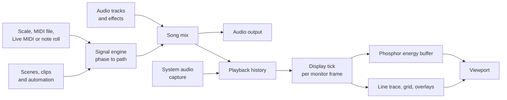
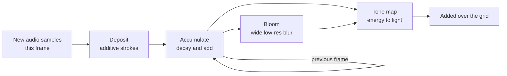

# phosphor

**phosphor** turns sound into pictures on an X–Y oscilloscope, and pictures into
sound. Stereo audio drives the two axes of the beam: left is X and right is Y. You
build scenes of wireframe solids, text, equations, drawings and 3D models, play them
from a scale, MIDI or a song arranged on a timeline, and see the result on a
simulated phosphor screen. It runs on **macOS (Metal)** and **Windows (Direct3D 11)**.

phosphor is free software under the [GNU GPL v3](LICENSE). Download a ready-made
app from [Releases](../../releases), or build it yourself from this source.

Open **Help › Manual** in the app or read the
[illustrated user manual](docs/manual/README.md) on GitHub.
It covers setup, Sandbox, Composer, transforms, signal output, export and worked examples.

## Contents

- [Key features](#key-features)
- [Download](#download) · [Run from source](#run-from-source) · [Build the apps](#build-the-apps)
- [Try the app](#try-the-app)
- [How the program is structured](#how-the-program-is-structured)
- [How shapes are drawn and generated](#how-shapes-are-drawn-and-generated)
- [How the phosphor screen is simulated](#how-the-phosphor-screen-is-simulated)
- [Troubleshooting](#troubleshooting) · [Updating](#updating-without-losing-settings) · [Validation](#validation) · [License and credits](#license-and-credits)

## Key features


### Workspaces

- **Sandbox** edits and plays a single scene from its own source: a scale, a MIDI file,
  a single tone or Live MIDI. It also visualizes system audio or a video file.
- **Composer** arranges a song. Scene clips play on a timeline, the note roll supplies
  the pitch, automation lanes change any number of a clip over time, and audio tracks
  add sound files. Save it as a project, or export audio or video.
- Both workspaces have Undo and Redo, **File › Open Recent**, and autosave with crash
  recovery every 120 seconds.

### Shapes

- **Built-in objects:** the five Platonic solids, a torus, knots, a Möbius strip, a
  tesseract, a geodesic sphere, prisms and pyramids; 2D polygons, a configurable Star and
  Gear, and curves; an animated Radar sweep and Clock; and Matrix rain.
- **Vector text:** up to 64 characters, traced through the same geometry engine.
  Lowercase is drawn as capitals.
- **Equations:** parametric x, y (and z) expressions, and recurrence equations, with
  built-in and saved presets and variables that automation can drive.
- **Imports:** 3D models in OBJ, STL, glTF and GLB (**File › Import 3D model…**), with a
  live preview, optional simplification and baked glTF animation; SVG artwork
  (**File › Import SVG…**), which becomes an editable drawing.
- **Shape builder:** lines, polylines, arcs, semicircles, circles and splines, with
  snap-and-join, node editing, Undo/Redo, box selection and clipboard tools. Drawings
  save as reusable `.shape.json` files. Inside the builder, a path can guide follower
  shapes (motion paths).
- **Transforms:** each object has an ordered stack of steps: Rotate, Spin, Translate,
  Scale, Shear, Mirror, Motion path, Perspective, Map and Noise, and copy and effect steps
  such as Gridify, Radial array, Kaleidoscope, Echo, Pointify, Subdivide, Glitch, Wave and
  Attractor. Fields take numbers, expressions or automation, objects carry up to eight
  variables of their own, and stacks can be saved and reused.
- **Quick Add** (⌘K on the Mac, Ctrl+K on Windows) searches the whole catalog of objects,
  equations, transforms and recipes and adds the one you pick.
- **Scenes:** each object has its own position, size and path window (where its trace
  starts and how much of it the beam draws). Objects can be muted or soloed, and
  **Replace** changes an object's type while keeping its place, transforms and
  automation.
- **Inspect one cycle** freezes the pose and shows one drawing cycle with its direction
  and travel, with a scrub cursor and a pinned reference to compare against.

### Composer

- **Timeline:** scene clips you can move, split, duplicate and colour; a loop; section
  markers; tempo changes and time signatures; metronome, count-in and tap tempo; zoom to
  fit; and cycle audition, which loops one trace cycle at the stopped playhead.
- **Note roll:** up to 20,000 notes, chords of up to eight voices (or last-note
  priority), velocity, glide, box selection and note tools, MIDI import and export, and
  recording from a Live MIDI controller.
- **Automation:** lanes for transform fields, equation and object variables, levels and
  On/Off switches, with linear, curved and hold segments. Muting, soloing or switching an
  object off sweeps it out of the beam path without a click.
- **Audio tracks:** up to 32 tracks and 256 clips of WAV, FLAC, OGG, MP3 or AIFF. Each
  track has gain, pan, phase (true phase or a time delay), mute and solo, with pan and
  phase lanes and a gain lane on each clip. Missing files can be located again, and
  **Collect media** copies a project's files beside it. Because left is X and right is Y, the sound moves the figure.
- **Track effects:** up to eight per track (filter, saturate, bitcrush, delay and
  compressor), each parameter with its own automation lane.
- **Library panel:** left of the scope. **Browser** finds audio files, scenes,
  equations, transforms and models, previews audio and drags files onto tracks.
  **Effects** edits the selected audio track's effects.

### Sound

- **Generated sources:** a configurable scale, a single tone, a MIDI file or Live MIDI.
- **Live MIDI:** eight voices, 12 synth presets, velocity, pitch bend, sustain,
  sostenuto and CC1 octave alternation, with sample-aligned WAV, MIDI and JSON
  performance recording.
- **Output:** choose the output device (or follow the system default as it changes) and
  the output sample rate (follow the device, or 44.1 to 192 kHz). Playback runs in 10 ms
  blocks at any rate.
- **Low-latency Live MIDI:** WASAPI exclusive mode on Windows and a Core Audio callback
  stream on macOS, with 128-frame blocks up to 48 kHz and about 5 ms blocks above that.
  See [audio output paths](#audio-output-paths).
- **Listening modes:** original source, fully shaped audio, or a blend of the two.
- **Signal output preferences:** hardware corner dwell, shape redraw, route minimizing
  and the switch sweep. These change the generated X/Y samples and are stored per
  machine, separately from scenes and appearance.
- **Export:** WAV or FLAC at 44.1 to 192 kHz, 16 or 24 bits or 32-bit float; Composer
  exports the whole song or the loop. **File › Export video…** renders the scope with
  its audio.

### Display

- **Simulated phosphor screen:** a GPU energy buffer that builds up light where the
  beam lingers and fades it over time, with a Gaussian or hard-edged beam and bloom glow
  that stays continuous around sharp corners. See
  [how it works](#how-the-phosphor-screen-is-simulated).
- **Graphics quality:** **Appearance › Quality** chooses Low, Medium, High (the default) or
  Ultra. Higher tiers add soft saturation, a long afterglow tail, a faceplate halo and a
  glass vignette; see [graphics quality](#graphics-quality). Grids can be drawn as lines
  or as a graticule.
- **Phosphor profiles:** P31 green (the default), Palette colour, P1 and P7, plus a
  saved Custom profile edited as an intensity-against-time plot.
- **Line trace:** turn the phosphor display off for a crisp vector trace with optional
  beam-speed brightness and glow.
- **Colour presets:** OLED white, Green monochrome, Amber, Cyan and macOS Graphite.
- **Styles:** **Classic** draws the controls in the scope's palette. **Modern** uses
  rounded controls, the system font and blue accents, in Dark, Light or following the
  system. **Vintage** is a warm beige hardware panel with photorealistic knobs and
  switches.
- **Display rate:** frames follow the monitor's refresh rate (or a steady 60 Hz), with
  phosphor brightness and decay normalized to look the same at any rate.
- **System-audio visualization:** Core Audio taps on macOS and WASAPI loopback on
  Windows. Input only: captured audio is never played back, recorded, shaped or exported.
- **Time view:** X(t) and Y(t) against time, with X, Y or independent triggers on
  either edge and a 0.1–2000 ms window.
- **Video input:** a video file shown as a monochrome phosphor raster.
- **Views:** full screen, a trace-only view (Escape restores the controls) and a
  pop-out monitor for a second screen.
- **3D Lab Bench** (**View › 3D Lab Bench**, ⌃⌘3 or Ctrl+Shift+3) shows the scope as a
  late-1980s bench oscilloscope in a lit 3D lab, with working knobs, coax cables and
  reflections. An optional live GPU path tracer renders the bench when its packages are
  installed (see [Run from source](#run-from-source)); T toggles it.
- **Layout:** resizable side panels and timeline; keyboard shortcuts you can change in
  **Preferences › Controls**.

Appearance settings only change the preview. They never alter audio, scene files or
exports.

Travel between objects and text strokes stays visible, because stereo X–Y output has
no third channel to blank the beam. Complex shapes and long text share the samples
available in each musical cycle, so high notes can lose geometric detail.

## Download


Each [release](../../releases) has a macOS disk image and a Windows zip, built from
the tagged source by [GitHub Actions](.github/workflows/release.yml).

| | macOS | Windows |
| --- | --- | --- |
| File | `phosphor-<version>-macos-arm64.dmg` | `phosphor-<version>-windows-x64.zip` |
| Needs | Apple Silicon (M1 or later), macOS 15 or later | 64-bit Windows 10 or 11, Direct3D 11 graphics |
| Install | Open the DMG, drag phosphor to Applications | Extract the zip, run `phosphor.exe` inside the folder |

The apps aren't signed by Apple or Microsoft, so each system asks once before the
first launch:

- **macOS:** open phosphor, dismiss the warning, then go to **System Settings →
  Privacy & Security** and click **Open Anyway**. (Or, in Terminal:
  `xattr -dr com.apple.quarantine /Applications/phosphor.app`.) System-audio
  monitoring asks for its own permission the first time you use it (macOS 14.2+).
- **Windows:** SmartScreen shows "Windows protected your PC". Click **More info**,
  then **Run anyway**.

If you'd rather not bypass these checks, [build the apps](#build-the-apps) yourself.

## Run from source


Use **Python 3.12** (64-bit). On macOS, install Xcode Command Line Tools
(`xcode-select --install`); the app compiles its small system-audio capture helper
locally the first time you use it. System-audio monitoring needs macOS 14.2 or later
and asks for System Audio Recording permission the first time.

macOS:

```sh
git clone https://github.com/le10726433/phosphor.git
cd phosphor
python3.12 -m venv .venv
.venv/bin/python -m pip install -r requirements/requirements-macos.lock.txt
./LaunchMac.command
```

Windows (PowerShell):

```powershell
git clone https://github.com/le10726433/phosphor.git
cd phosphor
py -3.12 -m venv .venv
.\.venv\Scripts\python -m pip install -r requirements.txt
.\.venv\Scripts\python app.py
```

Later, launch with `./LaunchMac.command` or `LaunchQt.bat`. See the
[macOS development guide](docs/MACOS_DEVELOPMENT.md) for permissions and diagnostics.

The 3D Lab Bench's live path tracer is optional and not part of the downloadable apps. To
use it from source, install its packages on top of the ones above:
`python -m pip install -r requirements/requirements-raytrace.txt`. Without them the bench
uses its Qt Quick 3D rendering.

## Build the apps


Both builds use PyInstaller and run on the platform they target.

macOS (Apple Silicon, from the source folder with the environment above):

```sh
.venv/bin/python -m pip install -r requirements/requirements-macos-build.txt
.venv/bin/python tools/build_macos_app.py --dmg
```

Output: `.mac-build/dist/phosphor.app` and a DMG. The app is signed ad hoc.

Windows:

```powershell
.\.venv\Scripts\python -m pip install -r requirements/requirements-windows-build.txt
.\.venv\Scripts\python tools/build_windows_app.py
```

Output: `.win-build/dist/phosphor/phosphor.exe` and a zip of that folder.

Both scripts remove Qt modules the app never loads, then fail if anything left still
links one. Pushing a `v*` tag runs the same scripts in
[CI](.github/workflows/release.yml) and attaches the results to a draft release.

## Try the app


### Built-in music and shapes

1. Click **Sandbox** at the right of the application bar.
2. Click **Scene**, then **Objects › Add object › 3D solids › Cube**. Drag its centre
   to move it, or its corner handle to resize it.
3. Click **Input**. Set **Monitor input** to **Generated scene / MIDI** and **Source**
   to **Scale** (C major, C3 to C6, at 120 BPM).
4. Set your computer's listening volume low, then click **Play**. Geometry shaping
   changes the sound, so the result can be harsher than the source tone.
5. Open **Scene › Transform** and click **Add › Spin** to turn the cube continuously.
6. In **Mix**, compare **Original audio**, **Fully shaped audio** and **Processed
   output**.
7. Click **Stop**, then **File › Save scene** to keep it as a `.scene.json` file.
   **File › Send scene to Composer** puts it into a song.

Then try **Composer**: the manual's [first song in ten minutes](docs/manual/08-composer.md#83-a-first-song-in-ten-minutes)
walks through clips, notes and automation.

### Visualize music playing on your computer

1. In **Input › Monitor input**, choose **System audio (visualization)**.
2. Select the playback device used by your browser or music player.
3. Click **Start** on the application bar, then play music in that other application.
4. To see the waveforms against time, set **Appearance › Monitor › View** to the time
   view. **Trigger** picks X, Y or Both, and Rising or Falling; **Window** sets the
   sweep length. On short-persistence phosphors a slow sweep shows as a moving spot; use
   P7 or a long Custom afterglow to see all of it.
5. Click **Stop** before changing devices. Switch back to **Generated scene / MIDI** to
   edit shapes again.

System-audio mode only displays the incoming stereo waveform. It does not impose
shapes on that audio, play it a second time, record it, or export it.

### Play a MIDI controller

1. In Sandbox, select **Input › Source › Live MIDI**.
2. Choose your **MIDI input device** (choosing it connects it; **Refresh** looks again),
   and a synth preset.
3. Click **Play**, then play notes. The app synthesizes the sound through your output.
4. Adjust **MIDI gain** for shape size; polyphony shares the level among voices.
   **Panic** releases stuck notes.

Live MIDI takes exclusive use of the output device on Windows for the lowest delay,
so other apps go silent on that device until you stop. Use **Record…** for a
performance recording, or Composer's **Record** button to record notes into the roll.

### Appearance and saved work

**Appearance** (side panel or **Preferences › Appearance…**) has **Display**, **Beam**,
**Phosphor**, **Decay** and **Monitor** tabs: style, colour preset, grid, scanlines,
trace and glow, the phosphor profile and its decay, and the monitor view. The side
panels apply as you edit; the dialogs preview and save with **Apply** or **OK**.
Double-click a slider to restore its default.

Scenes (`.scene.json`) store objects, transforms, equations, imported drawings and
models, the source and the mix. Projects (`.project.json`) store the whole song and
link to their audio files. Neither stores appearance or signal preferences, which
are saved per computer in `.user/` in the source folder (or the per-user app data folder
for a packaged app). Save documents somewhere you can find them, preferably outside
the extracted project folder.

## How the program is structured


The app is Python, NumPy and PySide6, with Numba for the recurrence and model
kernels. All audio and geometry math runs on the CPU. The GPU only draws: Qt Quick's
rendering layer selects Direct3D 11 on Windows and Metal on macOS from the same
scene-graph code and compiled shaders.



### Modules

| Area | Files | Responsibility |
| --- | --- | --- |
| Entry and editor | `app.py`, `phosphor/editor/qt_app.py`, `phosphor/editor/qt_platform.py`, `phosphor/editor/shortcuts.py` | Launch routing, the main window, menus, panels, the viewport tick, graphics API selection and the shortcut registry |
| Composer | `phosphor/engine/composition.py`, `phosphor/editor/composer_view.py`, `phosphor/engine/tempo_map.py`, `phosphor/engine/automation.py`, `phosphor/engine/note_edit.py` | Projects, the song render, the timeline and note roll, tempo and meter maps, automation lanes |
| Audio tracks | `phosphor/engine/audio_clips.py`, `phosphor/engine/track_mix.py`, `phosphor/engine/track_effects.py`, `phosphor/engine/track_chain.py`, `phosphor/editor/track_effects_window.py` | Decoded media, pan and phase, effects, the effect state carried across blocks, and the Effects page |
| Library | `phosphor/editor/browser_panel.py`, `phosphor/engine/audio_browse.py`, `phosphor/storage/browser_places.py` | The Browser and Effects pages, folder listing and search off the GUI thread |
| Documents and preferences | `phosphor/editor/qt_scene.py`, `phosphor/storage/app_files.py`, `phosphor/storage/project_files.py`, `phosphor/storage/signal_preferences.py`, `phosphor/storage/autosave.py` | Immutable editing state, versioned scene, project and shape files, preferences, atomic writes and recovery copies |
| Signal engine | `phosphor/engine/signal_engine.py`, `phosphor/engine/scene_path.py`, `phosphor/engine/route_plan.py`, `phosphor/engine/corner_dwell.py`, `phosphor/engine/switch_sweep.py` | Turning audio phase into X/Y samples: poses, scene routes, travel, dwell and switch sweeps |
| Geometry | `phosphor/engine/solids.py`, `phosphor/engine/vector_text.py`, `phosphor/engine/custom_shape.py`, `phosphor/engine/curve_geometry.py`, `phosphor/engine/function_plot.py`, `phosphor/engine/recurrence.py`, `phosphor/engine/model_object.py`, `phosphor/engine/mesh_readers.py`, `phosphor/engine/svg_import.py` | Built-in wireframes, the stroke alphabet, builder drawings, equations, models and SVG import |
| Transforms and motion | `phosphor/engine/transforms.py`, `phosphor/engine/noise_loops.py`, `phosphor/engine/motion_path.py`, `phosphor/engine/drawing_motion.py` | The transform stack, noise, guide routes and followers |
| Shape builder | `phosphor/editor/shape_builder.py`, `phosphor/editor/builder_selection.py` | The drawing canvas and its selection tools |
| Sources and synthesis | `phosphor/audio/score_source.py`, `phosphor/audio/midi_synth.py`, `phosphor/audio/live_midi.py`, `phosphor/engine/midi_recorder.py` | The scale and MIDI scores, eight-voice synthesis, MIDI input and recording |
| Audio I/O | `phosphor/audio/audio_preview.py`, `phosphor/audio/output_devices.py`, `phosphor/audio/playback_history.py`, `phosphor/audio/system_audio.py`, `phosphor/audio/macos_system_audio.py`, `native/macos_capture/` | Output streams and devices, the clocked preview history and input-only system capture |
| Rendering | `phosphor/display/qt_scope.py`, `phosphor/display/qt_geometry.py`, `phosphor/display/glow_trail.py`, `phosphor/display/trace_interpolation.py`, `phosphor/display/time_sweep.py`, `phosphor/display/video_renderer.py` | Viewport geometry, stroke tessellation, afterimages, interpolation, the time view and video frames |
| Phosphor | `phosphor/display/phosphor.py`, `phosphor/display/qt_phosphor.py`, `phosphor/editor/phosphor_editor.py`, `phosphor/assets/shaders/` | The Qt-free energy model and decay profiles, the GPU feedback and bloom layers, and the decay editor |
| Look and help | `phosphor/display/theme.py`, `phosphor/display/crt_theme.py`, `phosphor/display/branding.py`, `phosphor/editor/manual_view.py`, `phosphor/editor/audio_help.py`, `phosphor/storage/build_info.py` | Styles and palettes, logos, the bundled manual, audio troubleshooting and build metadata |

### Threads

| Thread | Work | Rule |
| --- | --- | --- |
| GUI and render | Editor, the viewport tick, scene-graph updates | Qt's `basic` render loop keeps Python scene-graph callbacks on this thread |
| Audio | A PortAudio callback for Live MIDI, or a blocking worker for playback | Renders 10 ms blocks; never touches widgets and never decodes files |
| MIDI input | RtMidi delivers messages | Only queues them; the audio thread applies them at block boundaries |
| Workers | Audio decoding, the Library browser, autosave, export, video export, model import, Numba compilation, system capture | Keep slow work off the GUI and audio threads |

Settings cross threads as immutable snapshots. An edit replaces the audio thread's
settings only when it is complete and valid, so a half-finished drawing can't corrupt
the last playable state. Before Play, the app decodes the audio clips near the playhead
and warms up the track effects, so playback starts cleanly; a clip whose file is still
loading is silent until it arrives.

### Audio output paths

| Source | Windows | macOS |
| --- | --- | --- |
| Live MIDI, first choice | WASAPI exclusive callback | Core Audio callback |
| Live MIDI, fallback | WASAPI shared, then the system default | Core Audio blocking |
| Playback (scene, Composer, previews) | The chosen output device, 10 ms blocks | The chosen output device, 10 ms blocks |

Streams open at the device's own rate unless **Signal output › Output sample rate**
chooses one; if the device refuses it, playback uses the device rate and says so.
Windows takes the rate from the WASAPI device, because MME reports 44.1 kHz whatever the
device runs at. Live MIDI blocks are 128 frames up to 48 kHz and about 5 ms above it
(512 frames at 96 kHz): smaller blocks at 96 kHz fell behind real time with chords held.
**System default** follows the system's output while playing.

Measured on the development machines at 96 kHz, driver-reported output latency for
Live MIDI was 8.3 ms on Windows (AudioBox USB 96) and 22.1 ms on macOS (External
Headphones). These are stream-reported figures, not key-to-sound measurements.
Exclusive mode holds the output device, so other apps can't play through it while Live
MIDI audio runs. The status line shows the mode in use.

## How shapes are drawn and generated


A scope draws by moving a single point, so every image has to become one continuous
path. The central idea is **phase-driven traversal**: one cycle of the musical source
walks the beam once around the whole scene. Pitch sets how often the shape is drawn,
and the note's envelope sets how large it is.

```text
position  = frac(source_phase(t)) × total_path_length
drawing   = envelope(t) × local_point(position) + object_center(position)
output    = output_level × ((1 − blend) × drawing + blend × original)
```

The final output is hard-clipped to ±1. There's no automatic rescaling, so an object
pushed past the edge flattens against it, in both the sound and the picture. In
Composer, audio tracks are added to this output after their own gain, pan, phase and
effects.

### From object to samples

1. **Geometry.** Each object is a graph of vertices and edges.
   - Solids and polygons come from exact coordinates in `phosphor/engine/solids.py`, normalized by
     bounding-sphere radius so a rotating solid doesn't appear to breathe.
   - The tilting circle has 128 segments. The octant sphere is three 96-segment rings
     whose shared poles are merged into junctions.
   - Text uses a stroke alphabet in `phosphor/engine/vector_text.py`.
   - Equations are sampled along their parameter; models are reduced to feature edges.
   - Builder drawings compile from stored nodes and curves (below).
2. **Route.** The graph becomes a closed walk the beam can follow without lifting.
   - Polygons follow their perimeter.
   - If every vertex has even degree, a Hierholzer walk traces each edge exactly once.
   - Otherwise edges are duplicated so such a walk exists. Retraced edges get more beam
     time, so they can look brighter and change the timbre. **Route minimizing** can
     replace a route with a shorter one.
3. **Pose.** The object's transform stack runs in order: rotations, spin, translation,
   scale, shear, mirror, motion paths, perspective, Map and noise, with any fields
   driven by expressions, variables or automation. New solids rest untilted, with XY
   facing the screen. The pose is held for each rotation-update interval (60 Hz by
   default), so motion can't change pitch.
4. **Path window.** Path Start and Trace choose where each object's trace begins and
   how much of it is drawn.
5. **Scene route.** All objects join into one path in `plan_scene`. Because stereo
   can't blank the beam, the moves between objects are real, visible lines. Four travel
   modes trade these off:

   | Mode | Behaviour |
   | --- | --- |
   | No changes | List order, constant speed including connecting moves |
   | Faster travel | Same route, connecting moves 1–64× faster |
   | Nearest-shape ordering | Greedy nearest-entry order, kept only if it shortens travel |
   | Retrace existing edges | Enters and exits at the closest vertices and returns along real edges |

6. **Sampling.** Cumulative segment lengths make the walk constant-speed. For each
   sample, `frac(phase) × total_length` is located by binary search and interpolated
   along its segment. The envelope scales only the shape around its own centre, so a
   note's attack and release grow the shape in place.

Summing two shapes' signals would produce a different figure rather than showing both,
which is why a scene is always one sequential path. Scene plans are cached per pose
frame, and automation lanes and baked clip settings are cached between audio blocks.

### Where the phase comes from

- **Scale, MIDI file and the note roll:** synthesized from known note timing, so no
  pitch detection is involved. In Composer, chords give each voice its own pass through
  the scene.
- **Live MIDI:** each held voice traces the entire scene at its own pitch, then the
  voices are mixed with a fixed 1/8 of the level reserved for each. Chords therefore
  distort the figure by design.
- **System audio:** only displayed as raw X/Y samples. It's never used to drive shapes.

### Sample budget

At 48 kHz, C3 gives about 367 samples per traversal and C6 only about 46; at 96 kHz
there are twice as many. When a route has more corners than a note has samples, the
beam cuts across them and detail is lost. The engine deliberately adds no output
filtering, corner smoothing or oversampling.

### Builder drawings

A `Drawing` is an immutable snapshot of node IDs, line edges and curve definitions.
Curves are saved by their **defining points**, never their tessellation, so they stay
exact and editable.

- **Arcs, semicircles and circles** are solved analytically and subdivided so chord
  error stays within 0.0015 local units and each step is at most 5°.
- **Splines** are centripetal Catmull–Rom curves through your points, converted to
  Bézier segments and adaptively split with de Casteljau subdivision.
- **Limits** are 16,384 nodes, 32,768 segments and 65,536 derived curve points.
  Tessellation never depends on zoom, so editing the view can't change the sound.
- **Routing** uses an Euler walk when a component allows one and a depth-first retrace
  when it branches. Disconnected pieces are linked by explicit straight return trips.

### Motion and signal options

- **Motion paths** sample position by distance along a guide. Rigid groups keep their
  offsets from the guide's start, and with direction following the heading change
  rotates the group and its offset. Playback and export share the same evaluator.
- **Corner dwell** warps phase so the beam pauses at sharp corners, speeding the other
  travel so cycle timing is preserved. Smooth curve subdivisions don't count as corners.
- **Shape redraw** repeats each drawable shape's route before traveling to the next,
  inside the same phase cycle, so note timing is unchanged.
- **Switch sweep** shrinks an object's trace to nothing over a few milliseconds when it
  is muted, soloed out or switched off, instead of cutting it with a click.

## How the phosphor screen is simulated


On a real tube, the beam deposits energy into a phosphor coating, which glows and then
fades. A fast-moving beam leaves little energy per point, a slow one leaves a lot, and
repeated passes add up. A normal line drawing can't show any of that, so the Phosphor
display models **energy on the screen** rather than drawing a line.



The model lives in `phosphor/display/phosphor.py`, which has no Qt dependency and is unit-tested. The
GPU side is in `phosphor/display/qt_phosphor.py` and `phosphor/assets/shaders/`. It's only a display: nothing here
touches audio, scene files or exports.

### 1. Only new samples are deposited

The viewport receives a 40 ms window of samples on every display frame, so the windows
overlap. Drawing a whole window each frame would count most samples several times.
`new_sample_count` deposits only what has arrived since the last frame: the change in
playback position during audio, or elapsed time × sample rate otherwise.

### 2. Each sample deposits a fixed amount of energy

Every sample represents the same slice of time, so it carries the same energy, spread
over the area it covers. For a segment `L` pixels long drawn at width `W`:

```text
level = clip( round( scale × 150 / max(L, W)^beam_speed ), 0, 255 )
```

Doubling the beam's speed halves the energy per pixel, which is why fast travel lines
fade and slow turnarounds glow. It also makes brightness largely independent of how
many times a figure repeats per frame: a higher note moves the beam faster but passes
over the same spot more often. The *Beam-speed brightness* slider sets the exponent,
and 0 gives an even trace.

With the **Gaussian** beam profile, the default, a thin core carries the energy of the
full trace thickness and is blurred to a Gaussian cross-section with that thickness as
its full width at half maximum. **Hard edge** skips the blur.

### 3. Light adds, without a custom blend mode

The strokes use Qt's stock vertex-colour material, which blends premultiplied colour:

```text
result = source + destination × (1 − source_alpha)
```

Writing energy into the colour channels with **alpha set to 0** turns this into pure
addition, so overlapping strokes sum as light does. Energy goes into red and green, one
copy for each decay channel. Each frame's deposit is capped at 1.0 by its 8-bit layer.

### 4. Energy accumulates and decays

A feedback shader combines the previous frame's energy, read through a plain copy layer
because recursive layers crash on resize under Direct3D 11, with the new deposit. Real
phosphors fade with both a quick flash and a longer tail, so two channels run side by
side:

```text
fast = max(0, fast × fast_keep + deposit − step)
slow = max(0, slow × slow_keep + deposit − step)
keep = exp(−elapsed / time_constant)
```

Accumulated light therefore restarts when the window is resized. Using the measured
`elapsed` keeps decay correct at any frame rate, so a 144 Hz display fades like a 60 Hz
one. The small `step`, also scaled by `elapsed`, removes faint residue so tails reach
true black. On High and Ultra a power-law tail stretches the slow channel's afterglow; it
too is scaled by each frame's length. Energy can build
up to 64, far above a single frame's deposit, which is what allows real over-bright
regions.

Two implementation details matter:

- **The buffer is packed into 8-bit layers.** Floating-point layers render empty in a
  multisampled Direct3D 11 window, and the app needs 4× multisampling for its line art.
  So each energy value is stored as 16-bit fixed point across two 8-bit channels: fast
  in red and green, slow in blue and alpha.
- **The buffer advances once per display frame.** Its layers are `live: false` and are
  scheduled explicitly, so decay is applied exactly once per frame with that frame's
  measured time.
- **Rounding is dithered.** At high refresh rates a dim pixel loses less than half a
  storage step per frame, so plain rounding would keep it lit forever. Each frame adds a
  tiny per-pixel offset before the energy is stored, so on average it decays exactly as
  the unrounded model does and dim traces fade to black at every rate.

### 5. Energy becomes light

A display shader turns energy into colour with an exponential curve, the way film or an
eye saturates:

```text
fast_light = 1 − exp(−fast × exposure)
slow_light = 1 − exp(−slow × exposure × slow_gain)
light      = fast_colour × fast_light + slow_colour × slow_light
```

Very hot regions then shift up to 70% of the way toward white, like an overdriven
phosphor. The result is written with alpha 0, so it adds to the grid beneath it.
Exposure is 1.2 × *Phosphor intensity*. A preset's slow gain is scaled by
`min(1, 0.05 / slow)`, because a long decay piles up more energy and would otherwise
saturate; a Custom profile's afterglow level is used as entered.

**Glow is bloom of the energy buffer.** Before tone mapping, the energy is box-averaged
into a texture up to 8× smaller, blurred with a wide Gaussian (sigma is half the *Glow
size*), and added back. Because it spreads the energy rather than drawing extra strokes,
it stays continuous around corners and fades with the phosphor, and its cost barely
depends on glow size. *Glow intensity* sets its peak beside the trace (6% of the trace's
energy at 1×).

### Graphics quality

**Appearance › Quality** sets how much of the simulation runs. It only changes the
preview, never audio or exports.

| Tier | Adds |
| --- | --- |
| Low | The basic model above. Glow, the graticule grid style and the Gaussian beam are off |
| Medium | Soft saturation of over-bright regions |
| High (default) | The power-law afterglow tail, P7's flash-to-afterglow cascade, tone mixing in linear light, a faceplate halo around the trace and the glass vignette |
| Ultra | A stronger, finer halo, and the trace darkened under graticule lines |

Settings a tier doesn't use are greyed out, with a tooltip naming the tier that does, and
their values are kept.

### Phosphor presets

| Preset | Fast decay | Slow decay | Slow gain | Colour |
| --- | --- | --- | --- | --- |
| Palette colour | 8 ms | 50 ms | 0.20 | Follows the palette |
| P31 green | 8 ms | 50 ms | 0.20 | Green |
| P1 yellow-green | 15 ms | 120 ms | 0.35 | Yellow-green |
| P7 blue / long yellow | 20 ms | 700 ms | 0.25 | Blue flash, yellow afterglow |

These are approximate visual presets for each phosphor family, not measured tube data.
**Custom** has the same five settings: flash time (1 ms–1 s), afterglow time (1 ms–5 s),
afterglow level (0–1) and the two colours.

### The line trace

With Phosphor display set to Off, the app draws conventional GPU strokes. Beam-speed
brightness still applies: each segment's opacity is set from its length relative to the
slower quarter of the trace, with a floor so fast moves stay faintly visible. Glow is two
wider translucent strokes, and positive Glow decay adds up to eight fading snapshots.
The shape builder's output preview always uses the line trace.

### Limits of the simulation

- Each frame's deposit is capped at full level, so added corner dwell stops brightening
  a spot after a few held samples at typical trace widths.
- Glass scatter is only approximated, by the High and Ultra halo.
- DAC reconstruction, analog bandwidth, AC coupling and channel mismatch aren't
  modelled. *Display interpolation* can smooth between samples, but it adds display
  points only.
- Brightness and decay are tuned by eye, not calibrated against a physical scope.

If the shaders can't load, the app keeps the line trace.

## Troubleshooting


| Problem | What to try |
| --- | --- |
| `py` or `python` is not recognized, or opens the Microsoft Store | Install 64-bit Python 3.12 from python.org with **Add python.exe to PATH**, then reopen the terminal. Use `py -3.12` when another Python is also installed. |
| `requirements.txt` or `app.py` cannot be found | Run the commands from the folder that contains `app.py`. |
| `No module named ...` | Repeat the package installation command, then launch using `.\.venv\Scripts\python.exe app.py` so installation and launch use the same environment. |
| Package download fails | Check internet access and read the final pip error. Retry installation. If asking for help, include the command and error text. |
| Launcher closes or no window appears | Run `app.py` from a terminal (see [Run from source](#run-from-source)) to see the error. Confirm Python is 64-bit 3.12. For graphics errors, check your graphics driver supports Direct3D 11. |
| The downloaded app won't open | The apps aren't signed by Apple or Microsoft; see [Download](#download) for the one-time steps. |
| No generated sound | Check the system volume and **Signal output › Output device**, then **Play** and **Mix › Output level**. Close other software that may have exclusive use of the device. For MIDI, also check the source, connection, channel and MIDI gain. |
| Play takes a moment to start | With many audio tracks with effects, the app decodes the clips and warms up the effects before sound starts (about 0.8 s for eight tracks with a loop). |
| An audio clip is silent or marked missing | Its file is still loading, or it has moved. Use **Locate file…** in the clip's menu or the Missing audio files dialog, and **Collect media** to keep a project's files beside it. |
| System trace stays blank | Confirm music is playing and the selected endpoint matches its actual output. Refresh the device list; stop and restart capture after changing devices or the Windows default. |
| Trace looks unexpectedly distorted or differs between devices | Check that endpoint's Windows audio enhancements/effects and spatial sound. They can change the captured waveform. See **About › Audio troubleshooting** for steps and measured examples. |
| Other apps go silent during Live MIDI | This is WASAPI exclusive mode on Windows. Stop audio to release the device. |
| Trace is too dim or too bright | Adjust **Phosphor brightness** in the status strip, or set **Phosphor display** to Off for the line trace. |
| A scene or project won't open | This build opens scene versions 11–24 and project versions 1–12. Files saved by a newer build don't open in an older one. |
| Preview is slow | Try interpolation Off, a 60 Hz display rate, shorter or zero glow decay, a smaller glow, or fewer objects. These appearance changes do not alter playback samples. |

On the development PC, turning off Realtek audio effects restored waveform
fidelity while measured preview frame rate stayed approximately the same. This
is a finding from that setup, not a guarantee about every device. The app does
not change Windows sound settings for you.

## Updating without losing settings

Close the app first. Back up your scenes, projects and recordings, and your settings
folder: `.user` in the source folder, `~/Library/Application Support/phosphor` for the
Mac app, or `%APPDATA%\phosphor` for the Windows app.

- **Downloaded app:** replace the app with the new one. Settings stay in the per-user
  folder above.
- **Git clone:** with no local source edits, run `git pull`, then run the package
  installation command again. Resolve local source changes before updating.
- **Downloaded ZIP of the source:** extract the new version into a separate folder,
  repeat the environment setup, and copy your `.user` folder across while the app is
  closed. Keep the old folder until the new one works.

Each source folder needs its own environment. Do not copy `.venv` between computers or
between Windows and macOS. Documents and preferences are separate files; they are not
backed up to GitHub automatically.

## Validation


Run from the source folder in the environment above:

```sh
python tools/check_core.py                       # fast: the Qt-free modules
python -m unittest discover -s tests/unit -t .   # the full unit suite
python tools/golden_audio.py --check             # audio stays byte-identical
python tools/run_smokes.py --scale 1 1.5         # every GUI smoke, each in a fresh process
```

`run_smokes` judges each smoke by its exit code (a shutdown crash comes after the pass
message) and fails a smoke whose drawing raised an exception. Run it in a normal
desktop session and leave the desktop alone meanwhile: `--headless` runs offscreen,
which doesn't prove native rendering or input. `--only NAME` runs one smoke.

For performance work, `tools/bench_performance.py` and `tools/measure_pacing.py`
measure render, display and playback pacing (including stress cases with 20,000 notes,
a fully automated 24-object scene and eight audio tracks with effects), and
`tools/style_snapshots.py` compares the controls' look between versions.

At 0.93.2 on Windows, 1,287 unit tests and all 122 smoke runs (61 smokes at scales 1
and 1.5) passed natively, golden audio was unchanged, and a packaged build opened the 3D
Lab Bench. CI runs `check_core` and builds
both apps on every push.

Still untested or uncalibrated: anything by ear, controller-to-speaker MIDI latency as
a measured figure, and brightness against a physical oscilloscope. The heaviest stress
cases (a fully automated complex scene) don't yet render in real time.

See [performance measurements](docs/PERFORMANCE.md) for exact conditions
and limits, the [change history](CHANGELOG.md) and the
[macOS development guide](docs/MACOS_DEVELOPMENT.md).

Local Python environments, compiled capture helpers, preferences, recordings, reports
and generated WAVs are excluded from Git. This repository publishes source and
reproducible build instructions, not local dependency directories.
## License and credits


phosphor is free software: you can redistribute it and/or modify it under the terms
of the [GNU General Public License, version 3](LICENSE) or (at your option) any later
version. It comes with no warranty.

The packaged apps include third-party software under its own licenses; see
[NOTICE.md](NOTICE.md). Qt and PySide6 are used under the LGPL v3 and ship as
separate, replaceable libraries. The JetBrains Mono font is under the
[SIL Open Font License](phosphor/assets/fonts/OFL.txt). The 3D Lab Bench's textures and
lighting come from [Poly Haven](https://polyhaven.com) under CC0.

phosphor bundles no music. MIDI and audio files you open are read from your own disk;
scenes and projects store only their paths.

Created by Mike Le, with AI-assisted development using OpenAI Codex and Claude.
