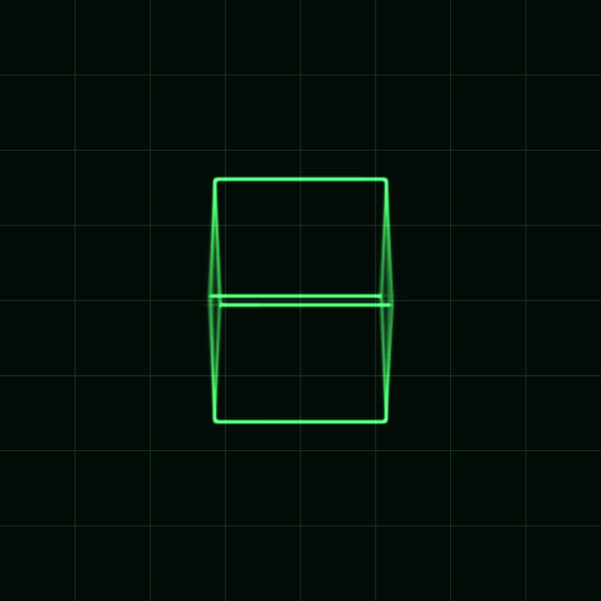
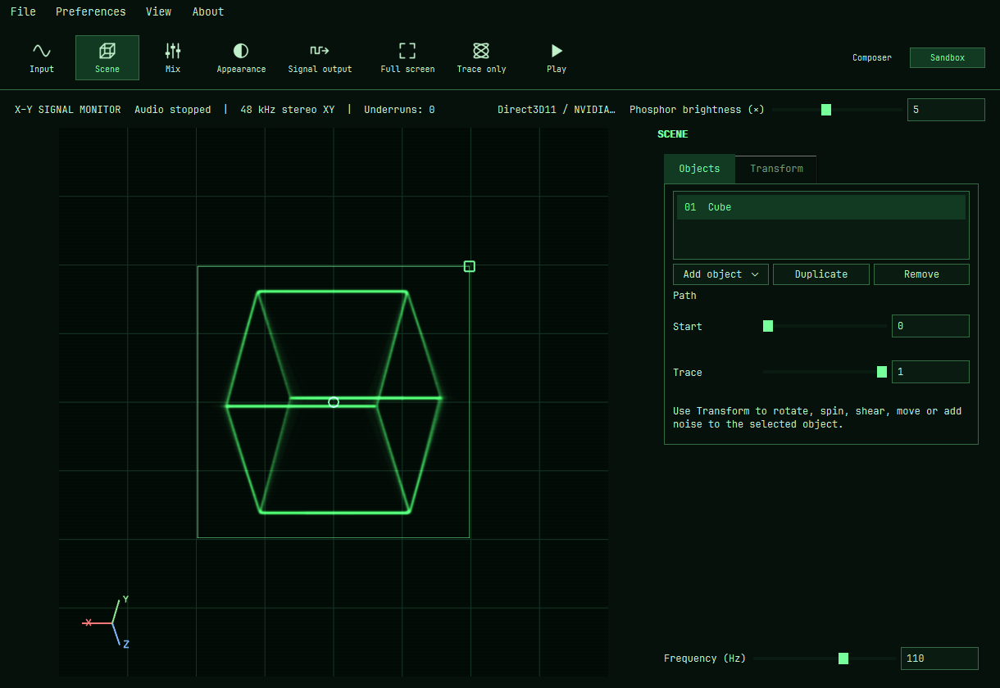

# 1. Introduction

phosphor turns drawings into stereo audio: the left channel is the horizontal X coordinate and the right channel is the vertical Y coordinate. A repeating path becomes a musical waveform. You hear the signal that draws the picture, and the built-in monitor shows that signal with a simulated phosphor display.

## 1.1 Hearing and seeing a drawing

An object supplies the path; a source supplies its pitch and envelope. At a steady pitch, the scene is traced once per source cycle. Changing the geometry changes the sound. Changing the note changes how quickly the beam draws the scene. Several objects share the cycle, including the travel between them.

The preview adds beam, colour, glow and afterglow effects. These are display settings, separate from the stereo samples. See [Display and monitor](10-display-and-monitor.md). Signal calibration that actually changes audio lives in [Mix, signal output and export](09-mix-output-and-export.md).


*The two audio channels describe a continuous path through the cube.*

## 1.2 Connecting an oscilloscope

Use an oscilloscope with an X–Y display mode. Connect the stereo output's left channel to X and its right channel to Y, then select X–Y mode on the scope. The app does not generate a separate intensity or blanking channel: connecting lines can remain visible.

Use DC coupling on the scope when you need to preserve position offsets. The output hardware must also pass DC to reproduce a translated drawing; an AC-coupled audio output can remove that offset. The preview does not model DAC filtering, analogue bandwidth or channel phase mismatch.

Set your computer's listening volume low before starting audio. **Mix › Output level** scales the generated signal; start cautiously and adjust the physical output and scope sensitivity for your equipment. Digital full scale is not a specified voltage at the scope input. Output outside ±1 is clipped.

## 1.3 Running phosphor

Run source commands from the app folder (the one with `app.py`). Use Python 3.12 and a separate virtual environment. `app.py` opens the PySide6 editor, using Direct3D 11 on Windows and Metal on macOS.

On Windows, create the environment, install the runtime requirements and launch:

```powershell
python -m venv .venv
.\.venv\Scripts\python -m pip install -r requirements.txt
.\.venv\Scripts\python app.py
```

You can also use `LaunchQt.bat`. On macOS:

```sh
python3.12 -m venv .venv
.venv/bin/python -m pip install -r requirements/requirements-macos.lock.txt
.venv/bin/python app.py
```

`LaunchMac.command` is the Mac launcher. The documented Mac setup requires Apple Silicon and macOS 15 or later for this PySide6 build. The files in `requirements/` include the Mac runtime lock file and separate Qt/build requirements. Follow [macOS development](../MACOS_DEVELOPMENT.md) for platform setup and the native system-audio helper, whose compilation needs Xcode Command Line Tools. System-audio monitoring uses Core Audio taps (available from macOS 14.2) and needs System Audio Recording permission; ordinary generated playback does not use that capture helper.

## 1.4 Choose a workspace

| Workspace | Use it for |
| --- | --- |
| **Sandbox** | One scene with its own Scale, MIDI file, Single tone or Live MIDI source. Experiment with shapes, audition a controller, or visualize system audio or a video. |
| **Composer** | A song with scene clips, a Notes track and automation. The selected clip is edited through the same Scene and Mix panels. See [Composer](08-composer.md). |

The workspace buttons are at the right end of the application bar. Each workspace retains its own document while you switch; switching stops playback. Input is available in Sandbox because Composer's Notes track supplies pitch. The app normally starts in the last workspace you used.

## 1.5 First sound in five minutes


*Sandbox combines the signal monitor with one scene's controls.*

1. Click **Sandbox** at the right of the application bar.
2. Click **Scene**, then **Objects › Add object › 3D solids › Cube**. A new scene is empty until you add an object.
3. Click **Input**. Set **Monitor input** to **Generated scene / MIDI** and **Source** to **Scale**. The initial scale is **Major**, from **C3** to **C6**, at **Tempo (BPM)** 120. For a steady sound, choose **Single tone** instead; its **Frequency (Hz)** control is at the bottom of **Scene**, initially 110 Hz.
4. Lower your computer's listening volume, then click **Play**. The button becomes **Stop**. You should hear the drawing and see its trace.
5. Open **Scene › Transform** with the Cube selected. Click **Add › Rotate** to change its orientation, or **Add › Spin** to turn it continuously. See [Transforms](07-transforms.md) for the axes and units.
6. Click **Appearance** and try its **Display**, **Beam**, **Phosphor** and **Decay** tabs. These change the preview. **Monitor** contains the X–Y/time-view controls.
7. Click **Stop**, then **File › Save scene** to keep your scene as a `.scene.json` file.

For the next step, see [Objects and scenes](04-objects-and-scenes.md) or [Sources and input](03-sources-and-input.md).
