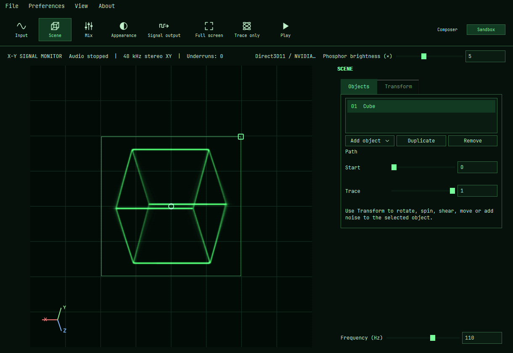
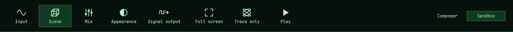
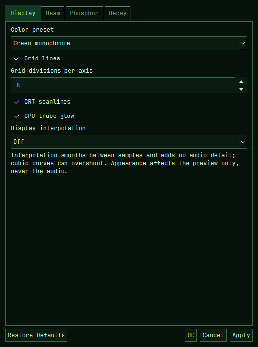

# 2. The interface

The main window places menus and the application bar above a status strip, a signal monitor and a right-hand control panel. Composer adds a transport and timeline across the bottom. Use the application bar to choose a panel, start playback or switch workspaces.

## 2.1 Main window regions

*The monitor occupies the main area; the active panel opens on the right.*

Drag the thin line beside the panel to change its width, from 280 to 900 pixels; the pointer becomes a resize cursor over it. Double-click the line to restore the default width (400). phosphor remembers the width on this computer. Fields, sliders and lists widen with the panel while text keeps one size; in a narrow panel, button rows wrap onto a second line and long captions end in … (hover to read them). Click the active panel's application-bar button again to hide it; click another panel button to replace it. In Composer, drag the thin line above the timeline to change its height. The normal monitor area is square.

The status strip contains:

| Region | Meaning |
| --- | --- |
| Heading | **X–Y SIGNAL MONITOR**, **X(t), Y(t) TIME VIEW**, or **RASTER CRT · 60 Hz**, according to the input and view. |
| Status line | Playback state, output rate, stereo XY and underruns; Live MIDI adds buffer frames, device latency and output mode. Composer adds **COMPOSER**. Capture and video have their own state information. Export progress, errors and temporary notices also appear here. |
| Backend | The active graphics backend and device information. |
| **Phosphor brightness (×)** | The same preference as **Appearance › Phosphor › Phosphor intensity** and **Appearance › Monitor › Brightness**. It affects display brightness and saves automatically. It is disabled for the line trace. |

Long status/backend text is shortened with an ellipsis; hover to read the full text.

The bottom status bar shows **phosphor** and the build version at the right. Hover for
the build date, or click to copy the version for a bug report. Full screen and Trace
only hide this bar; Escape restores it when returning to normal editing.

## 2.2 Application bar

*Panel buttons, view controls, transport and workspace selection.*

| Button | Tooltip and action |
| --- | --- |
| **Library** | Shows or hides the Browser and Effects pages to the left of the scope (§2.7). |
| **Input** | “Monitor input and the generated source”. In Composer: “Sandbox only: in Composer the Notes track drives the pitch”; the button is disabled. |
| **Scene** | “Scene objects and their transforms”. Opens **Objects** and **Transform** tabs. |
| **Mix** | “Travel, levels, listening mode and export”. |
| **Appearance** | “Preview colours, beam and phosphor (preview only)”. Opens **Display**, **Beam**, **Phosphor**, **Decay** and **Monitor**. |
| **Signal output** | “Corner dwell, shape redraw, route minimizing, switch sweep and output rate (changes audio)”. |
| **Full screen** | “Full screen” followed by the native keyboard shortcut. Toggles full-screen editing. |
| **Trace only** | “Trace only” followed by the native keyboard shortcut. Hides editing controls in full screen. |
| **Play** | “Start or stop audio (or capture/video for those inputs)”. Becomes **Stop** for audio, **Start**/**Stop** for system capture, or **Play**/**Pause** for video. |
| **Composer** | “Composer: timeline, note roll and scene clips”. |
| **Sandbox** | “Sandbox: one scene with its own source”. |

## 2.3 Menus and shortcuts

Use Command on macOS and Ctrl on Windows for the standard document shortcuts below. Items without a listed shortcut have no shortcut assigned by the main window. The keys listed here are the defaults: change them in **Preferences › Controls › Keyboard shortcuts** (section 2.5). **Help › Keyboard shortcuts** always shows the keys in use.

| Menu | Item | Shortcut | Action |
| --- | --- | --- | --- |
| **File** | **New instance…** | Command / Ctrl+N | Save prompts, then a fresh app process replaces this window after it becomes ready. |
| **File** | **New project** | — | Creates a new Composer project; visible in Composer. |
| **File** | **Open scene…** / **Open project…** | Command / Ctrl+O | Opens the current workspace's document type. |
| **File** | **Open Recent** | — | Lists the last 10 projects in Composer or scenes in Sandbox; **Clear Menu** clears that workspace's list. |
| **File** | **Save scene** / **Save project** | Command / Ctrl+S | Saves the current workspace's document. |
| **File** | **Save scene as…** / **Save project as…** | Command / Ctrl+Shift+S | Chooses a new document path. |
| **File** | **Send scene to Composer** | — | Sends the Sandbox scene to Composer; visible in Sandbox. |
| **File** | **Import 3D model…** | — | Opens the OBJ, STL, glTF or GLB import dialog with a live preview and optional simplification. |
| **File** | **Import SVG…** | — | Imports an SVG drawing. |
| **File** | **Export source WAV…** / **Export notes WAV…** | — | Exports source audio, or Composer notes. |
| **File** | **Export processed WAV…** / **Export song WAV…** | — | Exports the processed Sandbox signal, or the Composer song. |
| **File** | **Record MIDI performance…** | — | Starts recording a running Live MIDI performance. |
| **File** | **Stop recording** | — | Finalizes the active MIDI performance recording. |
| **File** | **Exit** | — | Prompts for unsaved documents and closes the app. |
| **Edit** | **Undo** / **Redo** (named after the step) | Command / Ctrl+Z; redo: macOS Shift+Command+Z, Windows Ctrl+Y or Ctrl+Shift+Z | Reverses or reapplies the last edit to the workspace's document: [Sandbox](04-objects-and-scenes.md#412-undo-and-redo), [Composer](08-composer.md#815-undo-and-redo). |
| **Preferences** | **Appearance…** | — | Opens the appearance preferences dialog. |
| **Preferences** | **Signal output…** | — | Opens the signal preferences dialog. |
| **View** | **Full screen** | macOS: Command+Control+F; Windows: F11 | Fills the screen while keeping editing controls. |
| **View** | **Trace only** | Command / Ctrl+Shift+F | Full-screen trace without menus, panels, status, editing handles or axes. |
| **View** | **Inspect one cycle** | — | Freezes the pose and shows one drawing cycle with a scrub cursor and a pinned reference ([4.12](04-objects-and-scenes.md#412-inspect-one-cycle-and-pin-a-reference)). Display only. |
| **About** | **About phosphor** | — | Opens the About tab. |
| **About** | **Audio troubleshooting** | — | Opens platform-specific audio guidance. |
| **Help** | **Keyboard shortcuts…** | — | Opens a searchable, non-modal table of keys and gestures. |
| **Help** | **Manual** | — | Opens this manual in its own window beside the main window. |

**Help** follows the other menus on both platforms. On macOS it also provides the
native menu search; **About phosphor** appears in the application menu.

**Escape** leaves Trace only and restores the previous layout. If that previous layout was full screen, press Escape again to return to a normal window. In ordinary Full screen, Escape returns directly to a normal window. The grid and configured trace effects remain visible in Trace only.

**Open Recent** updates after a successful open or save. Hover over a file name to see its full path. Missing files disappear when the submenu opens. Opening an entry uses the usual save prompt; if the file cannot be read, an error appears and the entry is removed.

**Help › Manual** opens the manual in its own window. It stays on top of the main phosphor
window without blocking it, so you can read and keep working; move and size it where you like,
and it opens there next time. Choosing **Help › Manual** again brings the open window to the
front. In the manual, follow chapter and section links, use **Back** and **Forward** to revisit
pages, or choose **Contents** to return to the chapter list. **◀ Previous chapter** and
**Next chapter ▶**, beside the search field with the open chapter's title between them, step
through the chapters in order (before chapter 1 is Contents). Press Ctrl+F (⌘F on a Mac) to search
the whole manual: results show the chapter, heading and a snippet, with heading matches
first. Choose one to open that section with every match highlighted; Enter and Shift+Enter
in the search field step forward and back through the matches in the open chapter.

The **Help & About — phosphor** dialog has **About** and **Audio troubleshooting** tabs. About
includes the version, author, project/build dates and AI transparency text.

### Autosave and recovery

Every 120 seconds, phosphor saves a recovery copy of each changed Composer project and
Sandbox scene in the user directory's `autosave/` folder. The copy is written in the
background, so editing a large project doesn't pause, and a document that hasn't changed
since its last copy isn't written again. After an unexpected exit, the
next launch lists the workspace, original file name (or Untitled) and time saved in one
dialog. Choose **Restore** to reopen the copies with unsaved changes and their original
paths, or **Discard** to remove them. Other running instances' copies are left alone.
Restoring a project or scene starts a fresh undo history. Save to keep the recovered work in its
original file, or use **Save as…** to choose another path. Saving a document removes its
recovery copy; closing normally removes both, including when you choose **Don't save**.

## 2.4 Editing in the viewport

Click or drag an object's numbered centre to select it and move it. Drag the selected object's corner handle to resize it. **Scene › Transform › Position X, Y** and **Size** offer numeric placement. Position and size apply after the object's transforms.

The handles and the selected object's dashed box show while the pointer moves over the scope,
in a dimmed accent colour so the trace stays easy to see. About 1.5 seconds after the pointer
stops they fade out; they show again as soon as it moves, and they stay while you drag.
Selecting an object in the Objects list shows them briefly too. A hidden handle still works: press
where it is and drag. The X, Y and Z orientation guides at the bottom left draw at half strength.

Handles are absent in system-audio, video, Trace only and the popped-out monitor. **Original audio** does not show object handles, and zero Output level prevents handle dragging.

Hover over the viewport's top-right corner for **Pop out** and **Full screen**. The pop-out is a separate, view-only monitor; its corner controls offer **Return** and **Full screen**. Click the main window's placeholder to bring it back. The separate **Appearance › Monitor › Full screen trace** fills one screen and lets the main editor remain usable on another. Escape leaves that monitor's full-screen mode. See [Display and monitor](10-display-and-monitor.md).

## 2.5 Preferences dialogs and side panels

*Dialogs preview edits and save them with Apply or OK.*

The **Appearance** and **Signal output** side panels apply and save changes as you edit. **Defaults** loads the factory values. **Revert** restores the values captured when that panel opened. These changes are independent of scene saving.

The corresponding **Preferences** dialogs preview edits immediately. **Apply** saves and establishes a new baseline; **OK** saves and closes. **Cancel** restores the last applied baseline. The restore-defaults button previews the factory values until you apply or accept them. The Appearance dialog has the four appearance tabs; the **Monitor** tab is in the side panel.

Slider controls also accept typed numbers. Double-click a slider to restore its default. [Display and monitor](10-display-and-monitor.md) and [Mix, signal output and export](09-mix-output-and-export.md) describe the individual preferences.

### Preferences › Controls

**Preferences › Controls…** opens the Preferences dialog at **Controls**, which has two tabs. Every tab bar in phosphor starts at the left edge of its panel.

**Keyboard shortcuts** lists every shortcut, grouped by menu (File, Edit, View, Transport, Objects list, Composer timeline). Type in the search field to filter by action or key. Select a shortcut and click **Change…** (or double-click it), then press the new keys and click OK. If another shortcut already uses those keys, phosphor names it and asks before moving the keys to the one you are changing; the other shortcut then loses them. Changed shortcuts show in bold.

| Button | Action |
| --- | --- |
| **Change…** | Press new keys for the selected shortcut. |
| **Clear** | Remove the selected shortcut's keys. |
| **Reset** | Restore the selected shortcut's default keys. |
| **Reset all** | Restore every default (after a confirmation). |
| **Export…** / **Import…** | Save your changes to a `.json` file, or load a file exported by phosphor. An import from the other platform loads with a note to check keys that use Command or Control. |

Shortcut changes apply and save at once, on this computer only (`shortcuts.json`, section 12.5); they are not part of the dialog's OK and Cancel. macOS and Windows have their own defaults. Mouse, wheel and editing keys (copy, paste, arrows, the shape builder's keys) are listed under **Fixed** and cannot be changed here. If the shortcuts file cannot be read, phosphor uses the defaults, shows the problem here and leaves the file alone until **Reset all** or **Import…** replaces it.

**Scroll & trackpad** sets **Mouse wheel sensitivity** and **Trackpad sensitivity** (0.25–4×, default 1×) and the wheel keys. phosphor tells a trackpad from a mouse wheel by its smooth (pixel) scrolling. On a trackpad, two fingers move the Composer roll both ways and follow the fingers like a touchscreen; pinch zooms time around the pointer, and Option + pinch (Alt + pinch on Windows) changes the row or block height. In the shape builder, two fingers pan the canvas the same way and pinch zooms it; the mouse wheel still zooms there. The wheel keys choose the physical modifiers for **Scroll time**, **Zoom time**, **Row / block height** and **Builder zoom**; the three Composer actions must use different modifiers. These settings, and **Metronome level**, follow the dialog's Apply, OK and Cancel.

## 2.6 Launching and user files

Run `app.py` with the configured Python environment; see [Introduction](01-introduction.md#13-running-phosphor). To select a workspace for one launch, use `app.py --workspace Sandbox` or `app.py --workspace Composer`. This command-line override does not replace your remembered workspace. `app.py --scene path/to/file.scene.json` opens a Sandbox scene.

**New instance…** asks about both workspace documents, stops audio and starts a fresh process. The current window closes only after the new one reports readiness. If startup fails, it remains open with the current scene. To run independent windows simultaneously, launch the app separately.

The user directory (`USER_DIR`) is `.user` beside `app.py` in a source checkout. A packaged Mac app uses `~/Library/Application Support/phosphor`; a packaged Windows app uses `%APPDATA%\phosphor` when APPDATA is available. `PHOSPHOR_USER_DIR` overrides the directory.

| File in the user directory | Saved information |
| --- | --- |
| `preferences.json` | Appearance preferences, including phosphor brightness. |
| `signal-preferences.json` | Machine signal calibration. |
| `function-presets.json` | User parametric-equation presets. |
| `recurrence-presets.json` | User recurrence-equation presets. |
| `workspace.json` | The last selected workspace, separate from appearance defaults. |
| `recent-files.json` | The last 10 scenes and last 10 projects, kept as separate workspace lists. |
| `monitor-window.json` | Pop-out geometry, screen and whether it was open; the app can reopen it next launch. |

Scenes and projects require **Save**; they are not automatically recovered from these preference files. Their save dialogs let you choose their location. A title-bar asterisk marks unsaved changes. Capture input/device selection is temporary, and opening a document does not start playback automatically.

## 2.7 Library panel

Click **Library** on the application bar to show the panel left of the monitor. Choose **Browser**
to find files and presets, or **Effects** to edit a Composer audio track. A file preview keeps
playing when you switch pages. Click **Library** again to hide the panel and stop the preview.
Drag the panel edge to change its width (220–640 pixels). phosphor remembers the page, the shared
width, the browser folder and whether the panel is shown. Trace only hides it with the other controls.

The browser has five tabs. Each has a box at the top that narrows the list as you type.

**Files** lists audio files (WAV, FLAC, OGG, MP3, AIFF) and folders.
- **Places** at the top lists Home, Desktop, Documents, Music and Downloads, your drives or volumes,
  your favourite folders (★) and **Recent audio**, the last 20 files you added to a project.
- **↑** (or Backspace) goes up a folder; double-click a folder to open it. **☆** keeps the folder in
  Places as a favourite; click **★** to remove it. Right-click a folder › **Add to favourites**.
- Type in the search box to find files below the folder whose names contain every word you
  typed. A search stops after 500 matches or 50,000 entries.
- The line under the list shows the selected file's length, sample rate and channels, such as
  **3.2 s · 48 kHz · stereo**.
- **▶** (or Space) previews the file from its start through the output, once; **■** stops it.
  **Auto** previews each file you select. The slider sets the preview's level only. A preview
  plays the first 30 s of a file, and the monitor draws it like any playback. **Play** stops a
  preview; previews wait while a song plays, while you record or export, and while the input is
  system audio or video.
- In Composer, drag files onto an audio track or onto the **Add track** row for a new track.
  **Add** (or Enter, or a double-click) places the selected files at the playhead, one after
  another, on the selected track; right-click › **Add to a new track** puts them on a new one.
  Either is one Undo step.

**Scenes** lists recent scenes and the scene files in the Files tab's folder; double-click one
(or **Open in Sandbox**) to open it in Sandbox. **Equations** lists the built-in and saved
equation presets (§6); double-click one to add an Equation object that uses it, as one Undo step.
**Transforms** lists your saved steps and stacks (§7); double-click one to insert it into the
selected object's stack, or right-click a stack › **Append to stack** or **Replace stack**.
**Models** lists recent models and the model files (OBJ, STL, glTF) in the Files tab's folder;
double-click one to open the import dialog for it (§4).
