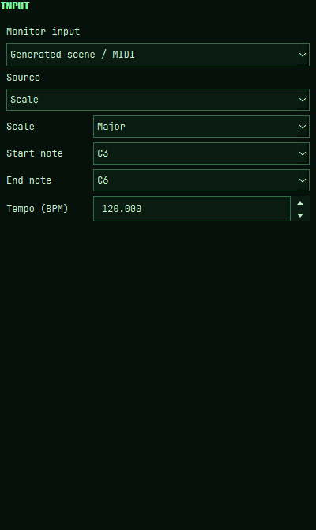
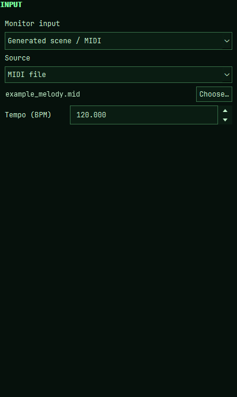
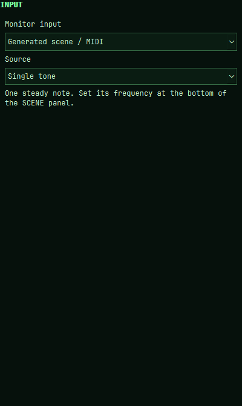
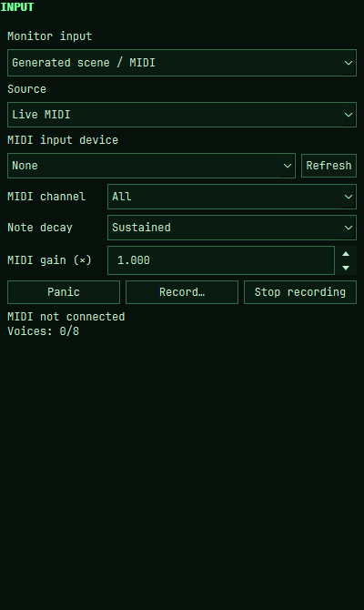
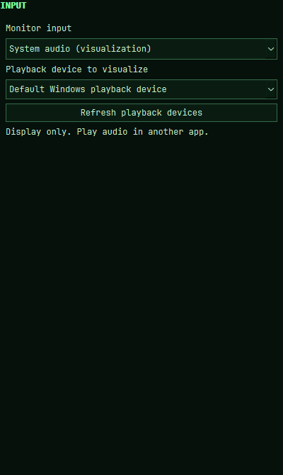
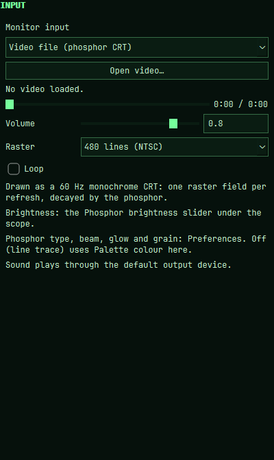

# 3. Sources and input

In Sandbox, **Input** chooses what supplies the monitor and, for a generated scene, what supplies pitch. Choose a generated source to hear your drawings, system audio to inspect another app's output, or a video file to simulate a raster CRT. Composer uses its Notes track instead of the Input panel.

## 3.1 Monitor input

| **Monitor input** | What it does |
| --- | --- |
| **Generated scene / MIDI** | Turns the scene into stereo X/Y audio using Scale, MIDI file, Single tone or Live MIDI. |
| **System audio (visualization)** | Displays captured system output. It does not process, record or play the captured audio back. |
| **Video file (phosphor CRT)** | Displays a decoded video as a monochrome phosphor raster and plays the video's sound through the default output device. It does not convert the video into scope audio. |

The X–Y / **Time: X(t), Y(t)** choice now lives in **Appearance › Monitor › View**, with display gain and time-sweep controls. See [Display and monitor](10-display-and-monitor.md). Time view works for generated and system audio, but is unavailable for video.

## 3.2 How the source drives a drawing

The source provides a phase and envelope. One source cycle traces the scene once, so a 110 Hz Single tone draws 110 scene cycles per second. All objects and their connecting travel fit into that cycle. Higher notes leave fewer samples for each trace; detailed shapes can become less faithful.

**Rotation updates (Hz)** in Mix sets how frequently the pose is evaluated, not the musical pitch or scene repetition rate. **Shape redraw (experimental)** can repeat individual shapes inside the existing cycle. These controls are described in [Mix, signal output and export](09-mix-output-and-export.md).

## 3.3 Scale

*The scale source supplies one note per beat.*

Select **Source › Scale**. Notes climb from **Start note** through the chosen scale to **End note**, descend through the intermediate notes, then repeat. The turning notes are not doubled.

| Control | Choices or range | Initial value |
| --- | --- | --- |
| **Scale** | Major, Natural minor, Harmonic minor, Major pentatonic, Minor pentatonic, Blues, Chromatic | Major |
| **Start note** | A0–B7; the fundamental from which the scale is built | C3 |
| **End note** | A higher note belonging to that scale, up to C8 | C6 |
| **Tempo (BPM)** | 20–600 | 120 |

Changing the scale or start note updates the available end notes. Tempo controls the beat duration, with one note per beat.

## 3.4 MIDI file

To edit a file's melody in Composer, use **File › Import MIDI into notes…** instead;
see [MIDI import and export](08-composer.md#816-midi-import-and-export).

*Choose a MIDI score and adjust its playback tempo.*

Select **Source › MIDI file**, then click **Choose…**. The chooser starts in the current MIDI file's folder; phosphor bundles no music, so choose a MIDI file of your own. Choosing it reads its initial tempo into **Tempo (BPM)**, limited to the control's 20–600 range. At the file's initial tempo, the score plays at its original speed; changing the tempo rescales playback.

The file supplies the highest melodic line, rather than a full polyphonic arrangement. Notes beginning within 15 ms are treated as a chord and the highest is selected; lower notes beneath a held melody are skipped. Percussion on MIDI channel 10 is excluded. Longer gaps become rests; gaps of 30 ms or less are joined with note gating. The source uses a flute-like synthesized tone, not the file's instrument patches. The sequence loops during playback.

## 3.5 Single tone

*The Input panel points to the frequency control in Scene.*

Select **Source › Single tone** for one steady pitch. Open **Scene** and use **Frequency (Hz)** at the bottom, below both tabs. It ranges from 0.01 to 20,000 Hz and defaults to 110 Hz. Its slider is logarithmic; type a value for precise adjustment. Parametric equations see their cycle coordinate `s` run from 0 to 1 at this rate.

## 3.6 Live MIDI

To record editable notes in Composer, see [Recording](08-composer.md#recording).
Connect the device here in Sandbox first, then switch to Composer and use its **Record** button.

*A controller drives up to eight shaped voices.*

1. Select **Source › Live MIDI**. The device list refreshes automatically.
2. Choose a **MIDI input device**. Choosing a device connects it; **None** disconnects it. **Refresh** looks for devices again. A saved scene reconnects to its named device when it is present.
3. Set **MIDI channel**, **Note decay** and **MIDI gain (×)** as needed.
4. Click **Play**, then play your controller. A device must be connected before Live MIDI audio starts.

| Control | Behaviour |
| --- | --- |
| **MIDI channel** | **All** (default), or a channel from 1 to 16. |
| **Note decay** | **Sustained** (default) holds while a key is down. **Plucked** fades after about 0.4 s, even if held. |
| **MIDI gain (×)** | 0–16, initially 1. Raises both shaped and original synth voice levels. |
| **Panic** | Clears sounding notes and pedal holds. Use it for stuck notes. |
| **Record…** | Selects a performance WAV path and starts recording; Live MIDI audio must already be running. |
| **Stop recording** | Finalizes the recording while you continue playing. |

The status text shows the connected port or **MIDI not connected**, **Voices: n/8**, notices and the last MIDI message. While recording, it starts with **RECORDING —**. The main status strip adds MIDI buffer frames, device latency and output mode. These are useful diagnostics, not a measurement of the complete keyboard-to-speaker delay.

Velocity, channel volume (CC7), pitch bend (±2 semitones), sustain (CC64), sostenuto (CC66) and octave alternation (CC1) are supported. Voices are shaped separately and mixed; chords can distort the visible geometry.

On Windows, Live MIDI first tries WASAPI exclusive callback output, then shared WASAPI, then the original device settings. Exclusive mode can prevent other apps using that output until you stop playback. Shared mode has higher mixer latency; MME can add considerably more delay. Consult **About › Audio troubleshooting** if you hear stutters or encounter device errors.

Recording saves the stereo samples submitted to the output, a MIDI file and scene/event metadata JSON. The WAV follows the selected listening mode. Stopping audio, opening a scene or exiting also finalizes an active recording. Use recording for Live MIDI; offline source/output export is unavailable for it.

## 3.7 System audio

*Capture supplies a display-only signal.*

Select **System audio (visualization)** and play audio in another app. On Windows, choose **Playback device to visualize**, initially **Default Windows playback device**. Capture uses WASAPI loopback. On macOS, **Audio capture source** initially offers **All system audio (Core Audio)** and uses a Core Audio system-audio tap, rather than the microphone.

Click **Refresh playback devices** to rescan, then **Start** in the application bar. Device selection and refresh are disabled during capture; click **Stop** before changing them. On macOS, grant **System Audio Recording** permission yourself, then stop and restart visualization. The helper captures audio, not screen images.

The capture status shows device name, rate, channel count, captured frames, raw input peak, status-event count or an error. The main status distinguishes starting, visualizing, stopped and **Waiting for audio / silence**. Mono is duplicated onto X and Y; multichannel input uses its first two channels.

This mode has no processing, recording, export or audio playback through phosphor. Monitor/device selections are temporary; your generated scene remains intact. Switch back to **Generated scene / MIDI** to resume scene editing; playback remains stopped. Use **Appearance › Monitor** for display gain and X–Y/time view.

## 3.8 Video file

*Video frames become a simulated CRT raster rather than an X/Y drawing.*

Select **Video file (phosphor CRT)** and click **Open video…**. Use the application bar's **Play**/**Pause** button. The seek slider changes position when you release it; the adjacent time shows position and duration.

| Control | Choices or range | Initial value |
| --- | --- | --- |
| **Volume** | 0–1, video sound through the default output device | 0.8 |
| **Raster** | **240 lines (low-res)**, **480 lines (NTSC)**, **576 lines (PAL)**, **720 lines (fine)** | 480 lines (NTSC) |
| **Loop** | Repeat the video | Off |

The raster is a simulated 60 Hz monochrome CRT: a field of horizontal scanlines deposits light which the phosphor then decays. The raster labels select line density; they do not change the simulation's 60 Hz field rate. Appearance controls the phosphor, beam, glow and grain; brightness is shared with the status-strip slider. Video is display-only with respect to the X/Y engine, and WAV export is disabled.
