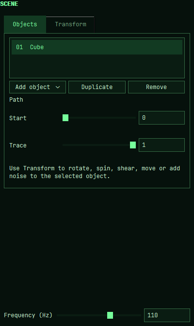
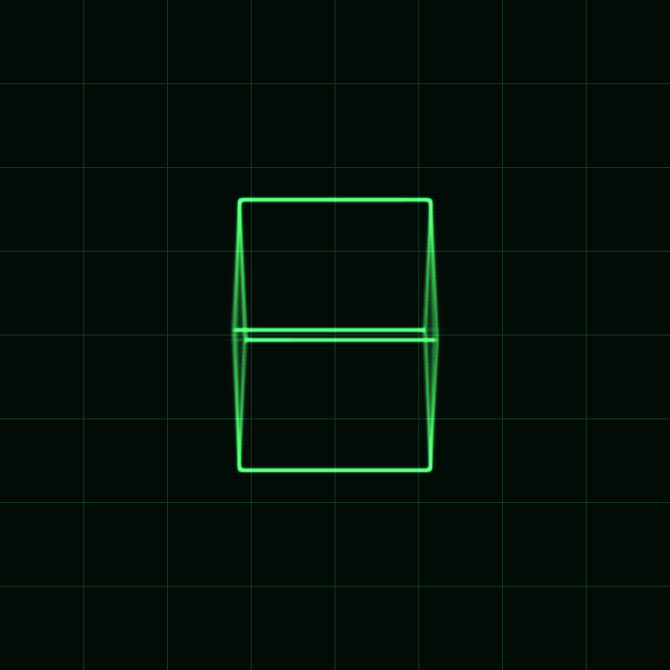
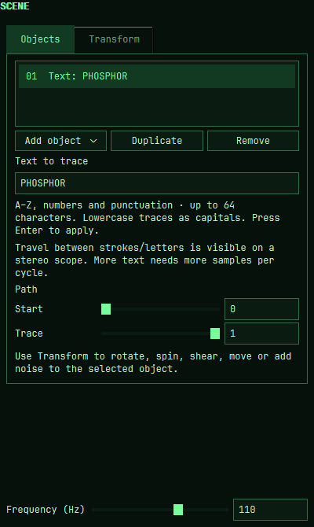
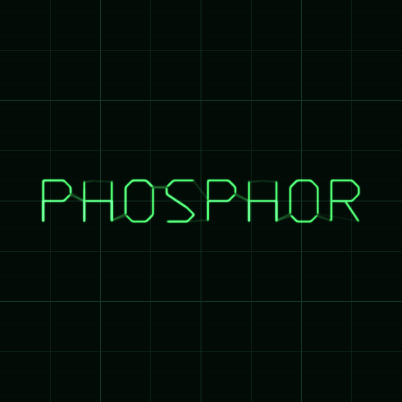
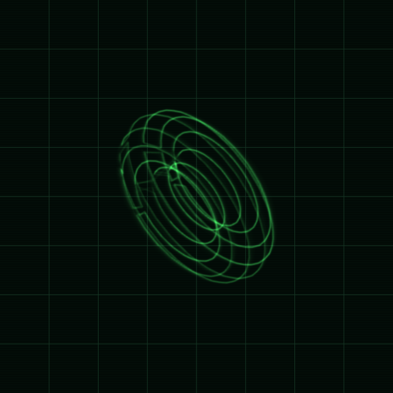

# 4. Objects and scenes

Each Objects row has **M** (mute) and **S** (solo). Muting removes the object from the
beam path; the other objects take its share of the cycle. Dimmed objects remain
selectable and have a faint outline in the editor. Mute is saved and undoable ([4.13](#413-undo-and-redo)).
Select several rows with Ctrl/Command or Shift to switch them together using the keys.

With the Objects list focused, **M** toggles mute, **S** toggles solo and **Alt+M**
(Option+M on Mac) unmutes all. Alt/Option-click M also unmutes all; Ctrl/Command-click S
solos that object exclusively. Solo lasts until cleared or the edited scene/clip changes.
Solo affects Sandbox, Live MIDI, the edited Composer clip and its exports, and is never
saved. Audio and video export warn while solo is active. Switching while playing is
click-free: the change crossfades over **Switch sweep** in Signal output (0 = immediate).

To switch an object on and off over time, right-click its row › **Automate On/Off**
(Composer only; the Sandbox shows it greyed out as *Automate On/Off (in Composer)*). An
On/Off lane appears in the timeline's transform roll, and the row shows **◆**. Where the
lane is off, the object leaves the beam path exactly as if it were muted, and the editor
shows its faint outline while the playhead is there. **M** still
wins: a muted object stays silent wherever its lane is on. Right-click › **Remove On/Off
automation** deletes the lane. See [On/Off lanes](08-composer.md#onoff-lanes).

A scene combines objects, a source that supplies the drawing cycle, and mix settings that turn the drawing into stereo audio. Add objects in **Scene**, select one to edit its path, and use **Transform** to pose and place it. The same objects can form a Sandbox scene or the scene inside a Composer clip.

## 4.1 What a scene contains

Scene files use `.scene.json`. This build writes version **24** and opens versions **11–24**. Version 11 rotation and spin settings become transform steps when opened, and White noise steps from versions before 20 open as Noise / White. Older parametric variables called `p` are renamed when necessary because `p` now means beats. Earlier scene versions are rejected.

A scene stores its objects, source settings, travel and mix settings, listening mode and MIDI device choice. Display appearance and machine signal preferences are separate; see [Mix, output and export](09-mix-output-and-export.md) and [Display and monitor](10-display-and-monitor.md).

New scenes are empty. You can also **Remove** the last object. The panel then says: “The scene is empty. Add an object to draw it; the source is still heard through MIX › Original blend.” An empty drawing produces a resting centre signal rather than a substitute shape.

## 4.2 Add and select objects

Open **Scene**, choose **Objects**, then click **Add object**. Built-in objects appear immediately. **Custom shape…** opens the builder; import commands open a file chooser.


*The Objects tab selects the object whose text, equation or path controls you edit.*

| Control | Action |
| --- | --- |
| Object list | Click an entry to select it. Each object retains its own settings. |
| **Duplicate** | Make another instance of the selected object. |
| **Remove** | Remove the selected instance, including the last object. |
| **Edit shape…** | Open a selected custom drawing in the builder. |
| Double-click a custom drawing | Open that drawing in the builder. Double-clicking another object type does not open it there. |
| Right-click a row › **Replace** | Change the object's type and keep its place, transforms and automation ([4.14](#414-replace-an-objects-type)). |

The **Object** list in **Transform** selects the same target. You can also select an object by dragging its centre handle on the scope.

## 4.3 Built-in solids, polygons and curves

The menu groups are **3D solids**, **2D shapes** and **Curves**. These objects have no separate topology controls: use their **Path**, transform stack, **Position X, Y** and **Size** controls.

| Menu object | What you draw |
| --- | --- |
| **Cube** | A wireframe box with six square faces. |
| **Tetrahedron** | A four-face triangular wireframe. |
| **Octahedron** | Eight triangular faces, like two square pyramids joined at their bases. |
| **Dodecahedron** | A wireframe with twelve pentagonal faces. |
| **Icosahedron** | A wireframe with twenty triangular faces. |
| **Triangle (2D)** | A flat three-sided outline. |
| **Square (2D)** | A flat four-sided outline. |
| **Pentagon (2D)** | A flat five-sided outline. |
| **Tilting circle** | One circular ring. Rotate it to see a projected ellipse or an edge-on line. |
| **Octant sphere** | Three perpendicular rings meeting at their axis poles, rather than a shaded sphere. |

New 3D solids and imported models rest untilted, with XY facing the screen and Z pointing toward you. A new Cube looks like a square until rotated. Older scenes retain their pose through an explicit **Rotate X** step (about 22.92°) at the top of the transform stack; delete it to square the object. A shape does not animate merely because its name includes “Tilting”: add **Spin** in **Transform** for continuous rotation. Rotating a flat polygon around X or Y also reveals its edge-on projection.


*The scope traces edges, including repeated edges needed to complete a continuous route.*

## 4.4 Text

Choose **Add object** › **Text**, enter **Text to trace**, and press Enter to apply. A newly added Text object reads `HELLO`. The field accepts up to **64 characters**. Lowercase traces as capitals.

Supported characters are A–Z, digits, spaces and this punctuation:

```text
. , : ; ! ? - _ + = / \ ( ) [ ] { } < > " ' # * % & @ $ ^ ` | ~
```

Accented letters, emoji, tabs and newlines are not part of the stroke alphabet. Spaces separate letters without adding a glyph. Letters use the app's own line alphabet, rather than a font selector.


*Text remains editable as a string in the Scene panel.*


*`PHOSPHOR` at Size 1.6: the dim diagonal lines are the visible travel between letters.*

Travel between separate strokes and letters is visible on a stereo scope. More text means more detail within each cycle, so a high note can make long strings coarse. Use **Size**, placement, transforms and the path window as for other objects. For editable letter geometry and bold or extruded letters, use the builder's [Text tool](05-shape-builder.md#55-place-text-as-strokes).

## 4.5 Equations and custom drawings

**Parametric equation** creates an object from X, Y and Z expressions. Z starts at `0`, keeping the curve flat; enter a depth expression to make a spatial curve. All three fields accept `s`, `t`, `p`, variables and the same maths functions. Press Enter to apply; an invalid edit displays its axis and keeps the last valid curve. Its panel supplies presets and variables; [Parametric equations](06-parametric-equations.md) explains those controls. The equations are evaluated for the audio samples, and the object still shares the scene cycle with other objects. It also has the common path and transform controls. **Rotate**, **Spin** and perspective act on depth before the final stereo X–Y projection. Try **Helix**, **Trefoil knot** or **Toroidal spiral**, then rotate around X or Y to see the depth. Existing presets stay flat.

**Custom shape…** opens the [shape builder](05-shape-builder.md). Draw lines and curves, place text as strokes, or assign followers to motion guides. Apply the completed drawing to add it to the scene. **Edit shape…** returns to its editable construction geometry.

## 4.6 Import a 3D model

Choose **Add object** › **3D model…**, or **File** › **Import 3D model…**. Supported formats are Wavefront OBJ (`.obj`), STL (`.stl`, ASCII or binary), and glTF 2.0 (`.gltf` with external `.bin` buffers or embedded data, and `.glb`). External buffers must sit next to the model file or in a sub-folder.

OBJ imports vertices, polygon faces and explicit polylines; other OBJ statements are ignored. glTF imports the default scene, applies node transforms and merges all meshes into one model. Point primitives are skipped and line primitives are kept as edges. Materials and textures are ignored: this is wireframe geometry without filled surfaces. Draco or meshopt compressed files must be re-exported without compression.

For an animated glTF or GLB, **Animation** lists actions with at least two keys, showing name, duration and key count. The longest is selected initially; choose **None (static)** for the original static import. Node motion and skeletal skins are baked at 30 fps. Morph targets are not supported yet. **In place**, on by default, removes horizontal root travel. Up axis applies to every frame. The preview summary reports the embedded frame size; animations exceeding 16 MB of decoded quantized positions or 18,001 frames are refused. Simplifying can reduce the embedded size.

An animated object's **Transform** tab includes **Animation** controls: **Speed** multiplies its original rate; **Loop (beats)** sets one pass to that many project beats (0 uses Speed). **Mode** chooses Loop, Ping-pong or Hold. Hold keeps the final pose after one pass. **Trim in** and **Trim out**, in seconds, restrict the played span. These edits support Undo. Composer clips can extend beyond the animation: it keeps looping, bouncing or holding for the clip's full length, using the clip's local time when enabled.

Edges and simplification are chosen once on the first frame. Later frames move those same vertices; creases that form only later are not added. Centre and scale are fixed over the entire animation, so the model does not pulse in size.

Reading a large file shows a progress window. The import dialog then shows the source triangle count. **Simplify to N triangles** chooses a target of at least **4** triangles and fewer than the source. For models of up to **10,000** triangles it is off by default. Larger models open with it ticked at **10,000**, so nothing dense reaches the viewport by accident; unticking it asks before importing the full model. The live preview shows the resulting triangle count and feature-edge count, with a progress bar while it computes. **Import** is available once the preview for the current settings is ready. You can cancel at any time.

Simplification removes vertices on flat areas first and keeps the original positions of the vertices that remain. It never turns a closed surface inside out. While it can, it preserves open boundaries, explicit lines and the surface topology. If that stops above the target, it next merges vertices along open edges (outlines lose detail) and then closes holes and handles (for example the openings of a lattice) to reach the target. Holes close a few at a time and the surface always stays clean (no pinched points or torn faces); if no clean way to close more exists, simplification stops at the lowest count it reached. The preview and the summary say when either happened, with the lowest count reachable without it. After import, a summary shows the source and resulting triangle counts and the kept edge count. Import adds one object in one **Undo** step.

**Up axis** chooses Y or Z and updates the preview. It defaults to **Y** for OBJ, glTF and GLB, and **Z** for STL. Choose the file's vertical axis: Z-up rotates `(x, y, z)` to `(x, z, −y)` before welding, simplification and normalization, preserving handedness. Stored models are Y-up and have no automatic resting tilt.

The model is centred and normalized to unit radius. Feature-edge reduction keeps boundary and explicit line edges, plus creases of at least **30°**, removing flat-face triangulation. If there are too few sharp edges, it keeps the mesh edges instead and reports that the model draws as a full wireframe.

| Import limit | Value |
| --- | --- |
| Model file size | 512 MB (a glTF and its buffers together) |
| Polygon faces (and glTF line segments) | 2,000,000 |
| Kept model edges | 32,768 |
| Stored model vertices | 65,536 |

If necessary, only the sharpest 32,768 edges are kept and the app reports the reduction. These are safety limits, not a guarantee of a clean trace at every pitch. Dense imports trace dimly and coarsely because each cycle has finite samples. Try a lower source pitch or show part of the model with **Trace**.


*Imported models use the common path, placement and transform controls.*

## 4.7 Import an SVG drawing

Choose **Add object** › **SVG drawing…**, or **File** › **Import SVG…**. Import creates a normal custom drawing, so you can use **Edit shape…** afterwards.

Supported outlines are SVG `path`, `line`, `polyline`, `polygon`, `rect`, `circle` and `ellipse`. Paths support straight lines, cubic and quadratic Bézier curves, smooth curve commands, elliptical arcs and closed subpaths. Element and group transforms support `matrix`, `translate`, `scale`, `rotate`, `skewX` and `skewY`. Curves become editable line geometry in the imported drawing.

Fills and colours are ignored. Text, images, `use` references and `foreignObject` content are not imported; convert text to outlines first. Definitions, clipping paths, masks, symbols, markers, patterns, gradients and filters do not supply drawn geometry. This imports outlines rather than reproducing a rendered SVG page.

SVG files are limited to **16 MB** and **500,000 source points**. The result must fit the drawing limits in [the builder](05-shape-builder.md#59-files-and-limits). The app reports significant simplification, dropped parts or unsupported elements after import.

## 4.8 Place and pose an object

Select an object, then open **Transform**. Placement applies after the transform stack.

| Control | Range and initial value | Use |
| --- | --- | --- |
| **Position X, Y** | Each −1,000,000 to +1,000,000; initially 0, 0 | Move the final drawing horizontally and vertically. |
| **Size** | 0.05 to 1,000,000; initially 1 | Scale the posed object. |
| **Reset** | Position 0, 0; Size 1 | Restore placement without clearing transform steps. |

The spin boxes show three decimal places. On the scope, drag an object's centre to select and move it; drag the selected corner handle to resize it.

The pose order is **transform stack → final rotation/spin used by motion following → Size/Position**. Stack steps run in order. This matters when a translation should rotate with an object or should happen after its rotation; see [Transforms](07-transforms.md).

The older separate X/Y/Z view-rotation sliders described in earlier documentation are not present in this UI. Use the stack's **Rotate** and **Spin** steps to orient and animate the selected object. X tips it vertically, Y turns it horizontally, and Z rolls it in the drawing plane. These alter the generated trajectory, including audio and exports.

## 4.9 Choose a path window

In **Objects**, **Path** chooses where the selected object begins and how much of its route is drawn.

| Field | Range | Default | Meaning |
| --- | --- | --- | --- |
| **Start** | 0–1 | 0 | Position along the route; 0 is its first point. |
| **Trace** | −1–1 | 1 | Fraction traced from Start. Negative values trace backwards; 0 hides the object. |

For a nonzero partial trace, the route is weighted so the object keeps its share of the cycle rather than simply donating the omitted portion to other objects. **Trace** exactly `0` removes the object from the active route, so its time goes to the remaining scene. The visible piece also needs a return/travel connection; partial tracing does not add CRT blanking.

Right-click either field and choose **Time varying…** to enter an expression. `t` is seconds; `p` is beats (`t × tempo / 60`). Expressions run once per pose frame. Press Enter to apply; choose **Static** to return to the slider. Start expressions wrap around the route; Trace is limited to −1…1. See [Parametric equations](06-parametric-equations.md) for the shared maths functions, and [Composer](08-composer.md) for gain automation.

To reveal a cube over four seconds, set **Start** to `0` and use **Trace** expression `min(1, t/4)`.
<!-- example: {"id": "cube-draw-on", "kind": "path", "object": "Cube", "start": "0", "trace": "min(1, t/4)"} -->

To move a quarter-route window around a cube once every four seconds, use **Start** `t/4` and **Trace** `0.25`.
<!-- example: {"id": "cube-moving-quarter", "kind": "path", "object": "Cube", "start": "t/4", "trace": "0.25"} -->

To trace a quarter of the route backwards from its midpoint, use **Start** `0.5` and **Trace** `-0.25`.
<!-- example: {"id": "cube-backward-quarter", "kind": "path", "object": "Cube", "start": "0.5", "trace": "-0.25"} -->

## 4.10 Recurrence equation

Choose **Add object › Recurrence equation**. Unlike a parametric curve, this object
builds a sequence: each new x/y/z is calculated from earlier points. The three
equations run together, so `x`, `y` and `z` always mean the previous point, even in
the y and z equations. `x[n-2]` reads x two steps back. Only literal history offsets
from 1 through **Order** are accepted.

**Order** is 1–8. The **Initial values** table supplies exactly that many x/y/z rows,
starting at step 0; those rows are the first points drawn. **Steps** is the total
point count, including initial rows, from 16 to 4096. `n` is the current step and
`N` is Steps. `t` (seconds) and `p` (beats) stay constant throughout one sequence.
There is no `s` in recurrence equations or their variable expressions.

**Draw › Path** joins consecutive points with straight lines. **Points** holds each
point for an equal fraction of the cycle, producing dots; moves between dots can
remain faintly visible on a stereo scope. Pitch comes from the source. Path Start,
Trace, placement and the Transform stack work as for a Parametric equation.

Load **Hénon map**, **Clifford attractor**, **Peter de Jong attractor**, **Lorenz
attractor**, **Second-order oscillator** or **Sunflower** from the preset list.
The oscillator uses Order 2 and `2*cos(w)*x-x[n-2]` (and y likewise) to draw an
ellipse. Lorenz uses Euler steps in three dimensions; rotate it in Transform to
reveal depth. **Save…** keeps the current equations, Order, Steps, Draw, initial values
and variables as your own preset (listed with ★ after the built-ins), and **Delete…**
removes one. They are stored in `recurrence-presets.json`, apart from parametric presets.

**Add variable** supplies the same range and slider controls as Parametric equations.
Right-click for a time expression of `t`/`p`, or **Automate** in Composer. Variables
are evaluated once per pose. Every pose rebuilds the sequence from its initial rows;
there is no audio-rate memory between notes, seeks or playback runs. Static sequences
are reused. Maths functions, comparisons, `and/or/not` and `a if condition else b`
follow the [equation language](06-parametric-equations.md).

If a calculation fails, becomes non-finite or exceeds ±1,000,000, the remaining
points repeat the last finite point. **Sequence stopped at step n** is a warning;
the equations stay editable. Reduce coefficients or change the initial values to
resume a complete sequence.

## 4.11 Share one cycle between objects

Objects are parts of one repeating drawing route, not separate audio channels. By default, routes follow scene-list order and then return to the first object. The cycle is shared according to route lengths, including travel; it is not divided into equal time per object. Size, pose, route planning and path windows can change timing. New scenes use **Faster travel** at **64×**.

**Mix** › **Travel between shapes** offers **No changes**, **Faster travel**, **Nearest-shape ordering** and **Retrace existing edges**. Nearest-shape ordering can reorder visits and move entry points when that reduces travel. Retracing can use existing edges to reach a closer exit. Faster travel shortens the time spent on connecting links, including links between disconnected strokes inside an object. See [Mix, output and export](09-mix-output-and-export.md) for the speed controls.

Stereo provides X and Y, with no third blanking channel. Links can remain visible even when fast travel makes them faint; an instant jump does not command CRT intensity.

**Signal output** › **Route minimizing** is a separate machine preference: **Off**, **Shortest jumps**, or **Shortest total path** (the default). It changes routes inside shapes, retaining the original if a proposed route is not shorter. This can change the sound as well as travel lines.

**Shape redraw (experimental)** is another machine signal setting, off by default. Its count is the total number of draws, **1–32**, before travelling to the next shape. It takes effect with multiple drawable shapes; connected builder components count separately, while motion guides do not count. One drawable shape, a count of 1, or redraw off preserves the single-pass behavior. Complex scenes can exceed the redraw expansion limit and fall back to one pass. Source phase and the motion clock continue unchanged.

## 4.12 Inspect one cycle and pin a reference

The cycle inspector shows exactly what the beam draws in one cycle of the note, after
route planning, transforms, path windows, redraw and travel. Use it to find an unwanted
stroke, change one setting and see what changed. It only displays: the audio never changes,
and nothing it shows is saved.

Open it with **View › Inspect one cycle**, or right-click an object in the Objects list ›
**Inspect one cycle**. The **INSPECT CYCLE** side panel opens and the pose freezes: the
inspector keeps showing the scene at that moment while the animation runs on. **Freeze now**
takes the pose showing now (in Composer, the playhead's pose in the edited clip's time).
To stop, choose **✕ Close inspector** at the top of the panel or press Esc while the panel has
the focus: the inspector turns off and the panel that was showing before it opened comes back
(Objects, when the side panel was hidden). Unticking the View menu item does the same; turning
**Inspect** off inside the panel stops inspecting and keeps the panel open.

Over the scope:

- **Solid lines** are drawing strokes and **dashed lines** are travel (between objects, and
  between strokes or letters inside one), so it reads in every palette. A jump made instant by
  **Faster travel** stays visible as a dashed line, though no samples land on it.
- Small **arrows** give the direction, a **square** marks the start of the cycle and a **ring**
  marks the beam at the selected sample. With **Show sample points**, a dot marks every output
  sample of the cycle. With corner dwell on (Signal output), small **diamonds** mark the held
  corners.
- The object under the cursor is drawn brighter, and the segment under it brighter still.

In the panel:

| Control | What it does |
|---|---|
| **Pitch (Hz)** | The note the cycle is drawn at, 5–20,000 Hz. It starts at the source's note at the frozen pose (110 Hz when there is none, such as Live MIDI or a rest); **Source** returns to it. Higher notes have fewer samples per cycle. |
| **Sample** | Follow the beam sample by sample with the slider (arrow keys step one sample) or the number box. The readout gives the time and phase, the object or travel the beam is on, and the visit. |
| **Next visit** | When the beam runs along the same edge more than once in the cycle (a retraced edge, or Shape redraw), jumps to its next pass. |
| **Share of the cycle** | Each drawn object's share of the cycle and its samples in this cycle, then **Travel** and **Corner dwell**. Objects that are muted, switched off by their On/Off lane or have Trace 0 at this pose are listed as not drawn. Click a row to jump to that object's first sample. |

The shares are the cycle's phase budget: travel and dwell come out of the same cycle as the
drawing, so faster travel gives the objects more of it. The sample counts are this cycle's,
from phase 0 at the output sample rate.

**Pin a reference.** **Pin this cycle** keeps the current cycle as a faint outline. Change any
setting (a transform, travel, Map, a path window): the inspector redraws the cycle at the same
frozen pose, and the reference stays where it was pinned, at any window size. When pitch, rate
and sample count match, the panel gives the largest and RMS distance between the two cycles,
sample by sample. **Show reference** hides the outline and **Clear** removes it. The reference
lasts until you clear it or close phosphor. Turning **Inspect** on again with a reference
pinned freezes at the reference's pose.

The inspector shows the generated scene only (not system audio, video or **Original audio**),
and the overlay is hidden in Trace only and the popped-out monitor. Switch sweeps are not
shown: each cycle uses the frozen pose's own path.

## 4.13 Undo and redo

**Edit › Undo** (⌘Z on macOS, Ctrl+Z on Windows) reverses the last Sandbox edit, and
**Edit › Redo** (⇧⌘Z on macOS, Ctrl+Y or Ctrl+Shift+Z on Windows) reapplies it. The menu
names the step, for example **Undo Move object**, **Undo Add transform** or **Redo Change tempo**.

Every part of the scene that a scene file saves is covered, except the MIDI input:

- Adding, duplicating and deleting objects, and **Replace** (one step, **Undo Replace object**,
  however many objects were selected).
- Object settings: shape type, position and size, the path window, text, equations and
  their variables, recurrences, imported models, applied drawings, animation and mute.
- The Transform stack: adding, removing and reordering steps, their values, bypass, Map
  formulas, Noise options and bypassing the whole stack.
- The source, tempo, scale, MIDI file, mix and listening mode.

Solo, the playback position, selecting an object, the MIDI input device and the Signal
output and Appearance preferences are not recorded: they are not part of the scene. Undo
selects the object that was selected before the edit. Solo stays while the scene keeps the
same objects and clears when Undo or Redo adds or removes one.

A drag (a slider, or an object on the scope) is one step, and repeated steps on the same
control within 400 ms (wheel turns, arrow keys) are grouped. A focused text field undoes its
own typing first; once it has nothing left to undo, the keys reach the scene. In the shape
builder the keys undo drawing edits, and each **Apply to scene** (or Live audition update) is
one Sandbox step.

The history holds up to 200 steps, fewer when its steps keep many different imported models
alive (about 128 MB of models and drawings). Making an edit after Undo clears the redo
steps. Saving marks the current step: returning to it with Undo clears the unsaved mark in
the title. Opening a scene or restoring a recovered one starts a fresh history. Composer has
its own history ([8.15](08-composer.md#815-undo-and-redo)), and switching workspaces keeps both.

## 4.14 Replace an object's type

Right-click an object in the Objects list › **Replace**, then pick a type. The submenu has
the same categories and items as **Add object**; the object's current type is ticked and
greyed out. With several rows selected (right-click one of them), every selected object is
replaced, and **Edit › Undo** reverses all of them in one step (**Undo Replace object**).
Replace works in the Sandbox and in Composer clip scenes. Motion paths cannot be replaced,
because other objects follow them.

The object keeps:

- its place in the list and its identity (motion bindings to it still work);
- position, size, rotation and spin, the path window (**Start** and **Trace**), mute and
  **Bypass all**;
- the whole transform stack;
- its automation: Position and Size lanes, Path lanes, transform lanes and On/Off lanes.

The settings that only belong to the old type are **parked**: kept with the object, out of
the way. Replacing it with that type again brings them back, so a text keeps its words, an
equation object its equations and variables, a custom shape its drawing and a model its
geometry. Parked settings are saved in the scene file (and in Composer projects), so this
still works after reopening. A type the object has never been starts with the same defaults
as **Add object**.

- **3D model…** opens the file picker. Cancelling it, or the import dialog, leaves the object
  unchanged.
- **Custom shape…** opens the builder on an empty drawing; **Apply to scene** replaces the
  object, and leaving the builder without applying leaves it unchanged. A motion path cannot
  replace an object.
- **SVG drawing…** imports the picked file as the object's drawing.
- If the object already has a parked model or drawing, **3D model…** and **Custom shape…**
  bring it back at once, without the picker or the builder.

**Equations and their variables.** When you replace one equation type with the other
(**Parametric equation** and **Recurrence equation**), a variable with the same name keeps
its value (limited to the new variable's range) and its automation. The automation of the
other variables is parked. In Composer, a parked lane stays in the transform roll, dimmed and
labelled, for example *Variable a (parked: Parametric)*, in the object's **Parked variables**
block. You can still edit or remove it; it has no effect until the object is that type again.
Loading a preset in the equation panel is not a Replace: it gives the preset's own values and
removes the variables' automation, as before. A parked lane whose variable no parked equation
declares is dropped, with a notice, when the scene or project is opened.
