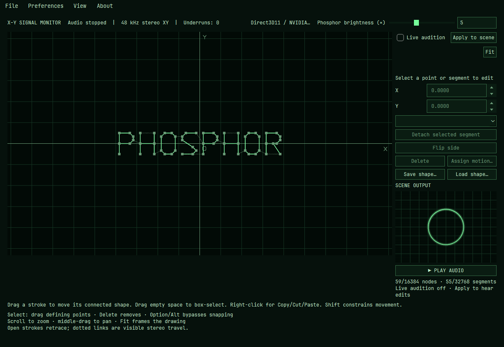
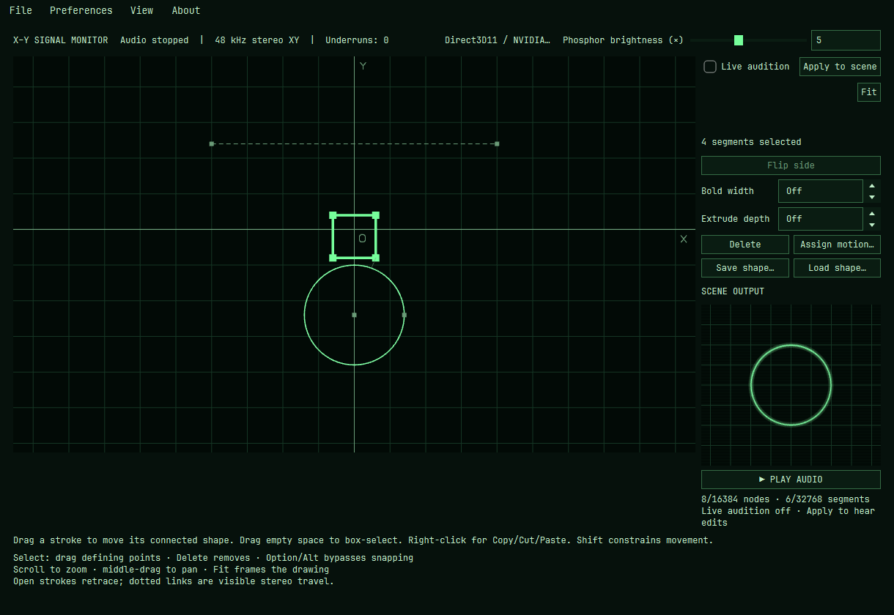

# 5. The shape builder

Use the shape builder to draw editable lines and curves, turn text into strokes, and move connected shapes along construction guides. Its large canvas shows the drawing at rest; **SCENE OUTPUT** shows the applied scene. Complete a gesture before applying it or auditioning it.

## 5.1 Open the builder and find the controls

Choose **Scene** › **Add object** › **Custom shape…** for a new drawing. Select an existing custom drawing and click **Edit shape…**, or double-click its object-list entry, to edit it. With a system-audio or video monitor input, switch to **Generated scene / MIDI** first.

*The construction canvas is on the left; selection controls and the scene output preview are on the right.*

The top row contains **← Back to scene**, the drawing name (up to 64 characters), **Live audition** and **Apply to scene**. Below are drawing tools and **Fit**, then **Undo**, **Redo**, **Finish stroke ↵**, **Snap + join** and **Use as motion path**. The Text tool reveals its text entry and **Size**.

The right panel changes with your selection. It provides node coordinates, incident-segment selection, curve controls or styles, then **Delete**, **Assign motion…**, **Save shape…**, **Load shape…**, **SCENE OUTPUT** and **▶ PLAY AUDIO**. The bottom lines explain the current tool and report errors and geometry counts.

Scroll the mouse wheel to zoom around the pointer, middle-drag to pan, and click **Fit** to frame the drawing. On a trackpad, drag two fingers to pan (the canvas follows the fingers) and pinch to zoom around them. These canvas operations do not move the drawing or change its audio. X/Y axes and the zero marker locate the construction origin.

## 5.2 Draw lines and curves

New editing sessions start with **Polyline** selected. Click a tool, then click defining points on the canvas.

| Tool | How to use it |
| --- | --- |
| **Select** | Select and move defining nodes or connected shapes; drag empty space for a selection box. |
| **Line** | Click two endpoints. The line completes after the second click. |
| **Polyline** | Click successive corners. Press Enter or **Finish stroke ↵** to finish an open stroke; click the first point to close it. |
| **Arc** | Click start, a point on the curve, then end. The three-point arc completes automatically. |
| **Semicircle** | Click the two diameter endpoints. Select the result and click **Flip side** to reverse its bulge. |
| **Spline** | Click points the smooth curve passes through. Press Enter to finish, or click the first point to close it. |
| **Circle** | Click its centre, then a point on its circumference. Select it to edit **Radius**. |
| **Text** | Type text, set **Size**, then click to place it as strokes. |

Press Escape to cancel the unfinished stroke or drag. Changing tools also cancels the current gesture. An open stroke retraces to make a continuous route. Curves are flattened for output within bounded geometry limits; their defining points remain editable.

**Snap + join** starts enabled. Within 12 screen pixels of an eligible node, the pointer snaps to it and shares that node. This makes connected endpoints, including closing a provisional polyline. Hold Option / Alt to bypass snapping temporarily. Crossing two strokes does not itself create a shared node.

Hold Shift to constrain drawing or movement to an axis. When the axis is established, snapping respects that constraint.

## 5.3 Select and edit geometry

In **Select**, click a defining node to edit or drag that node alone. A node drag can snap and join to another node. Click or drag a stroke away from its nodes to select and move its entire connected component. Joined segments move together; nearby unjoined strokes remain separate.

Drag empty canvas space to box-select. Any hit segment brings its whole connected shape into the selection. Shift-click a stroke adds its connected shape; Shift-box-select adds to the existing selection. Shift during movement constrains the drag horizontally or vertically.

| Selection control | Action and range |
| --- | --- |
| **X**, **Y** | Edit the selected node; −100 to +100, four decimal places, step 0.05. |
| Incident-segment list | Choose one of the segments attached to the selected node. |
| **Detach selected segment** | Separate that segment's connection at the selected node so it can move independently. |
| **Radius** | Selected circle radius: 0.0001–100, four decimal places. |
| **Flip side** | Reverse the selected semicircle's bulge. |
| **Delete** | Delete the selected node or selected connected shapes. |

Whole-shape selections show style controls in place of the node controls. Release a drag to commit it; unfinished drags stay local to the canvas.

## 5.4 Copy, cut, paste and undo

Right-click in **Select** for **Copy**, **Cut** and **Paste**. A right-click on an unselected stroke selects its connected shape first. Copy and Cut require selected shapes, rather than just a defining node.

Paste creates independent geometry with new node identities. Keyboard pastes are offset successively by 0.12 units right and 0.12 units down. Context-menu Paste centres the copied geometry at the clicked position. Finish or cancel any current gesture before pasting. The clipboard uses phosphor geometry, so arbitrary plain text is not pasted as drawing strokes.

**Undo** and **Redo** restore completed drawing edits, including styles and motion metadata. The builder retains up to **100** past drawing states, clears redo after a new edit, and starts a fresh history each time you open a drawing. Undo first cancels any unfinished gesture. With **Live audition** enabled, restored playable drawings are applied too.

## 5.5 Place text as strokes

1. Click **Text**.
2. Enter text in **Text to place** and set **Size**.
3. Click the canvas where the text should be centred.
4. Use **Select** to move or style the placed strokes.

Text uses the same alphabet and **64-character** limit as a [Text object](04-objects-and-scenes.md#44-text): A–Z, digits, spaces and standard punctuation, with lowercase drawn as capitals. **Size** ranges from **0.01 to 50**, defaults to **0.3**, shows three decimal places and steps by **0.05**.

The placed letters become ordinary geometry. They are no longer a scene Text object's editable string. Placement selects the new strokes; individual connected parts can subsequently be selected separately. Travel between disconnected letter strokes remains part of the stereo signal.

## 5.6 Bold and extrude connected shapes

Select strokes or a box of shapes to reveal **Bold width** and **Extrude depth**. Styles apply to whole connected shapes, following their node identities as you edit.

| Control | Range | Result |
| --- | --- | --- |
| **Bold width** | 0–2, step 0.01; 0 displays **Off** | Trace the outline of fattened strokes with round caps, rather than merely brightening a thin centre line. |
| **Extrude depth** | 0–4, step 0.05; 0 displays **Off** | Make front and back copies separated along Z and join corners. |

Both controls show three decimal places and start off for unstyled geometry. The construction view shows bold outlines with faint editable centre lines. Extrusion needs a tilt or spin in the scene's **Transform** tab to reveal the depth. You can combine both styles, including on placed text. More outlines and depth edges lengthen the route, so high pitches can undersample the result; route minimizing can reduce unnecessary travel.

## 5.7 Motion guides and followers

*Guides remain construction geometry; followers supply the moving output.*

1. Draw a connected open path or closed loop. **Circle** is convenient for a circular guide.
2. Select that connected path and enable **Use as motion path**. Each connected path has its own role; changing one does not change the others.
3. Select the follower shapes without their guide. Use Shift-click or a box for several followers.
4. Click **Assign motion…** and choose the guide from the list.
5. Set the motion controls and click **Assign / update motion**.
6. Enable **Live audition** or click **Apply to scene**, then play to preview motion.

Guides are dashed in construction and never enter the drawing audio. A guide must be a usable connected route; branches or invalid geometry can produce a validation message. The **Use as motion path** checkbox is available for one connected selection. **Assign motion…** is enabled for selected follower geometry without an included guide.

| Motion dialog control | Behavior |
| --- | --- |
| Guide list | Choose an enabled guide in this drawing. |
| **Velocity (scene units / second)** | 0–100, default 0.25, three decimal places, step 0.05. |
| **Back and forth** | On an open guide, bounce at its endpoints. This is the initial endpoint choice. |
| **Stop at end** | On an open guide, stop after reaching its end. |
| **Follow path direction** | Turn the follower relative to the guide direction; initially unchecked. |
| **Angle offset (degrees)** | −360 to +360, initially 0; one decimal place. Enabled with direction following. |
| **Assign / update motion** | Apply the binding to the selected shapes. |
| **Remove motion from selection** | Remove their assignment. |
| **Close** | Close the dialog. Assignments already applied remain. |

A closed path loops continuously, so its endpoint selector is disabled. Assignment preserves the selected shapes' current offset from the guide and their initial relative heading. Several shapes assigned together form a rigid moving group: their internal spacing is retained. With direction following, the guide-relative offset rotates too. A nonzero angle offset intentionally rotates both the group and its offset.

Select an assigned follower group and reopen **Assign motion…** to update it. Turning a guide role off can pause retained bindings; restoring the role makes the guide available again. Construction continues to show rest positions while output evaluates the movement.

## 5.8 Audition, apply and return

**Live audition** starts off each time you open the builder. When enabled, completed edits update the scene. Unfinished strokes and in-progress drags do not reach playback. **Apply to scene** explicitly sends the completed playable drawing to the scene; a new drawing becomes a new custom object, while editing an existing drawing replaces that object's geometry.

**SCENE OUTPUT** previews the applied scene, including transforms and follower motion. The large construction canvas stays at rest so you can edit stable positions. Dotted construction links disclose visible stereo travel; they are not blanking commands. **▶ PLAY AUDIO** uses scene playback and changes to **■ STOP AUDIO** while running. Starting Sandbox playback resets the scene motion clock; in Composer, the button uses song playback.

Click **← Back to scene** when finished. If there are unapplied edits or an unfinished gesture, **Unapplied shape edits** offers:

| Choice | Result |
| --- | --- |
| **Apply** | Apply the completed shape and return. If a gesture is unfinished or the drawing cannot be applied, you stay in the builder. |
| **Discard** | Return with the scene at its last applied or auditioned state. |
| **Cancel** | Stay in the builder. |

Discard does not undo edits already sent through Live audition. Escape cancels a gesture; it does not discard the entire builder session. A drawing with no playable segments cannot replace the last applied scene shape.

## 5.9 Files and limits

**Save shape…** writes a reusable `.shape.json` drawing. Finish or cancel a pending stroke before saving. **Load shape…** replaces the current builder drawing, rather than inserting it; loading is a completed undoable edit. The reader accepts reusable shape versions **1–5** and files up to **200,000 bytes**. Styled shapes save as version 5; simpler shapes use the version appropriate to their geometry and motion metadata.

| Drawing safety limit | Maximum |
| --- | --- |
| Defining nodes | 16,384 |
| Segments, including curves | 32,768 |
| Straight and flattened curve points | 65,536 |

The status reports node and segment counts. Invalid or excessive geometry produces a message instead of being applied. A drawing within these limits can still need more samples than a high-pitched cycle provides. Simplify it, reduce source pitch, use [Path Trace](04-objects-and-scenes.md#49-choose-a-path-window), or adjust [signal routing](09-mix-output-and-export.md).

## 5.10 Keyboard and mouse reference

These commands operate on the construction canvas; when you type in a text field, normal text editing retains its keys. Clipboard and undo/redo use the platform's standard shortcuts.

| Key or gesture | Action |
| --- | --- |
| Enter / Return | Finish the current stroke. |
| Escape | Cancel the current gesture. |
| Delete / Backspace | Delete the selected node or shapes. |
| Command / Ctrl+C | Copy selected shapes. |
| Command / Ctrl+X | Cut selected shapes. |
| Command / Ctrl+V | Paste independent geometry. |
| Command / Ctrl+Z | Undo. |
| Shift+Command+Z / Ctrl+Y | Redo using the platform standard. |
| Shift-drag | Constrain movement to an axis. |
| Shift-click stroke | Add a connected shape to the selection. |
| Shift-box-select | Add connected shapes to the selection. |
| Option / Alt | Temporarily bypass snapping. |
| Scroll wheel | Zoom at the pointer. |
| Middle-button drag | Pan the construction canvas. |
| Two-finger drag / pinch (trackpad) | Pan with the fingers / zoom at the pointer. |
| Right-click in Select | Open Copy, Cut and Paste. |
