# 6. Parametric equations

Use a **Parametric equation** object to draw a curve from X, Y and Z maths expressions. Z defaults to `0` for a flat curve; depth participates in rotation, spin and perspective before stereo X–Y output. The source supplies the note cycle, and the object's placement and transforms put the curve into the scene.

## 6.1 Add and edit a curve

1. Open **Scene › Objects** and choose **Add object › Parametric equation**.
2. Enter expressions in **x =**, **y =** and optionally **z =**. Press Enter to apply. Each field accepts the same names and functions.
3. Choose **Load a preset…** for a starting point, or enter a gallery pair below.
4. In Sandbox, select **Single tone** as the source and set **Frequency (Hz)** at the bottom of **Scene** to control the drawing rate.

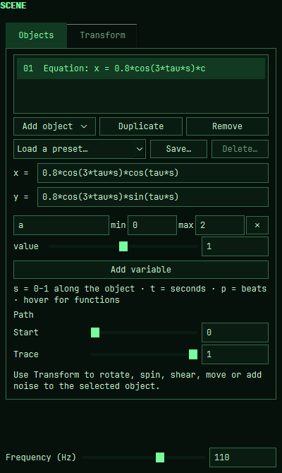
*The equation editor and its variable controls.*

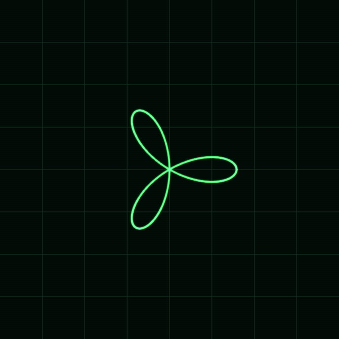
*The curve those equations draw: `x = 0.8*cos(3*tau*s)*cos(tau*s)`, `y = 0.8*cos(3*tau*s)*sin(tau*s)`.*

| Name | Meaning |
|---|---|
| `s` | Position from 0 to 1 along this object's share of each note cycle. With Single tone, one object and instant travel, `s = (t*f) % 1`, where `f` is the tone frequency. |
| `t` | Seconds on the scene clock. In Composer it starts at the clip's start; trimming the left edge preserves the existing scene clock. |
| `p` | Beats on that same clock: `t*tempo/60`. It uses the Composer **Tempo**, including in Sandbox. |

Use `s` for the figure and `t` or `p` for its slower animation. Equations using only `t` generate channel waveforms independently of the note-cycle position.

Coordinates are object units. **Size** multiplies them after the transform stack; **Position X** and **Position Y** move the result. Start with Size 1 and coordinates around −0.8…0.8 for room inside the scope's approximately −1…1 signal area. Size accepts 0.05…1,000,000; large coordinates or transforms can take the signal outside the visible area. See [Transforms](07-transforms.md).

## 6.2 Expression language

Use numbers, parentheses, `+`, `-`, `*`, `/`, `//` (floor division), `%` (modulo) and `**` (power). Unary `+` and `-` work. Comparisons are `==`, `!=`, `<`, `<=`, `>`, `>=`, including chained comparisons. `and`, `or`, `not`, and `a if condition else b` work element by element. Constants are `pi`, `tau` (2π) and `e`. The `math.` spelling also works for available functions and constants, for example `math.sin(tau*s)` and `math.pi`.

Every available function is listed here. Angles in trigonometric functions are radians.

| Function | Meaning |
|---|---|
| `sin(a)` | Sine. |
| `cos(a)` | Cosine. |
| `tan(a)` | Tangent. |
| `asin(a)` | Inverse sine. |
| `acos(a)` | Inverse cosine. |
| `atan(a)` | Inverse tangent. |
| `atan2(y,x)` | Quadrant-aware angle of a vector. |
| `sinh(a)` | Hyperbolic sine. |
| `cosh(a)` | Hyperbolic cosine. |
| `tanh(a)` | Hyperbolic tangent. |
| `asinh(a)` | Inverse hyperbolic sine. |
| `acosh(a)` | Inverse hyperbolic cosine. |
| `atanh(a)` | Inverse hyperbolic tangent. |
| `exp(a)` | e raised to a power. |
| `log(a)` | Natural logarithm. |
| `log2(a)` | Base-2 logarithm. |
| `log10(a)` | Base-10 logarithm. |
| `sqrt(a)` | Square root. |
| `abs(a)` | Absolute value. |
| `fabs(a)` | Alias for absolute value. |
| `floor(a)` | Round down to an integer value. |
| `ceil(a)` | Round up to an integer value. |
| `trunc(a)` | Discard the fractional part toward zero. |
| `round(a)` | Round to nearest integer, ties to even. |
| `sign(a)` | −1, 0 or +1 according to the sign. |
| `hypot(x,y)` | Length of a 2D vector. |
| `fmod(x,y)` | Remainder with the sign of x. |
| `copysign(x,y)` | Magnitude of x with the sign of y. |
| `degrees(a)` | Radians to degrees. |
| `radians(a)` | Degrees to radians. |
| `min(a,b)` | Smaller value at each sample; exactly two arguments. |
| `max(a,b)` | Larger value at each sample; exactly two arguments. |
| `clip(a,low,high)` | Limit a value to the supplied bounds. |
| `square(q)` | Period-1 square wave: +1 for the first half-cycle, −1 for the second. |
| `saw(q)` | Period-1 rising ramp from −1 toward +1. |
| `tri(q)` | Period-1 triangle: −1 at q=0, +1 at q=0.5, −1 at q=1. |

The periodic helpers take cycle position, not radians: use `tri(s)`, rather than `tri(tau*s)`, for one triangle per traversal. All functions take one argument except the explicitly shown two- and three-argument forms. Keyword arguments and `*` argument unpacking are rejected.

Expressions are restricted maths, not general Python. Imports, assignments, strings, Boolean literals, lists, indexing, lambdas, comprehensions, arbitrary attributes, `np` access and unknown names are rejected. Only `math.<available name>` attributes are allowed. This prevents scene and preset files from executing arbitrary code. Functions must be called, not used as bare values.

Each expression has a maximum of 400 characters (`MAX_EXPRESSION_LENGTH`) and 300 syntax-tree nodes (`MAX_NODES`). Numerical literals are converted to floating point; integers too large to convert are refused. Avoid singularities: invalid numerical results such as `sqrt(-1)` become zero in the coordinate output; positive and negative infinities become +2 and −2 before subsequent output handling. Conditional expressions are vectorized, so both branches may be evaluated; they are not a way to execute code conditionally.

## 6.3 Variables and automation

Click **Add variable** to add a named parameter. A new variable starts at **value** 1, **min** 0, **max** 10. Edit the name, bounds and value slider; **✕** removes it. Remove its references from the equations first, otherwise the editor refuses removal. Renaming a variable updates its references in X, Y and Z.

You can have eight variables (`MAX_VARIABLES`). Names use ASCII letters, digits and underscores, cannot begin with a digit, and must be unique. Python keywords, function/constant names, and `t`, `s`, `p`, `math`, `np` are reserved. Bounds must be finite with −1,000,000 ≤ min < max ≤ 1,000,000; the static value must lie between them.

Right-click **value › Time varying…** to replace the slider with an expression. It can read `t`, `p`, `s` and the maths functions, but no user variables, including itself. It is evaluated every sample before X, Y and Z, then limited to min…max. Non-finite values are replaced by the relevant bounds (NaN uses min). **Static** restores the stored slider value; clearing the expression also returns to Static. **ƒ** marks an expression.

In Composer, right-click **value › Automate** to create a gain lane; **◆** marks it. The gain multiplies the static value or expression before limiting it to min…max. A variable bounded below by zero therefore cannot become negative through a negative gain. **Remove automation** removes its lane. Sandbox holds the first node's gain. See [Composer](08-composer.md).

## 6.4 Built-in and saved presets

The following built-in presets have Z = `0`. Values in the final column are variable value [min, max].

| Preset | X equation | Y equation | Variables |
|---|---|---|---|
| Circle | `sin(tau*s)` | `cos(tau*s)` | — |
| Lissajous 3:2 | `sin(3*tau*s + phase)` | `sin(2*tau*s)` | phase = pi/2 [0, tau] |
| Rose (k petals) | `cos(k*tau*s)*cos(tau*s)` | `cos(k*tau*s)*sin(tau*s)` | k = 4 [1, 12] |
| Spiral | `s*cos(turns*tau*s)` | `s*sin(turns*tau*s)` | turns = 6 [1, 20] |
| Diamond | `tri(s)` | `tri(s + 0.25)` | — |
| Heart | `0.055*16*sin(tau*s)**3` | `0.055*(13*cos(tau*s) - 5*cos(2*tau*s) - 2*cos(3*tau*s) - cos(4*tau*s))` | — |
| Rotating ellipse | `cos(tau*s)*cos(rate*tau*t) - 0.4*sin(tau*s)*sin(rate*tau*t)` | `cos(tau*s)*sin(rate*tau*t) + 0.4*sin(tau*s)*cos(rate*tau*t)` | rate = 0.25 [−2, 2] |
| Stereo tones (t in seconds) | `0.8*sin(tau*220*t)` | `0.8*sin(tau*330*t)` | — |

Three spatial presets supply depth as well:

| Preset | X equation | Y equation | Z equation |
|---|---|---|---|
| Helix | `0.6*cos(3*tau*s)` | `0.6*sin(3*tau*s)` | `1.6*s - 0.8` |
| Trefoil knot | `0.27*(sin(tau*s)+2*sin(2*tau*s))` | `0.27*(cos(tau*s)-2*cos(2*tau*s))` | `-0.27*sin(3*tau*s)` |
| Toroidal spiral | `(0.6+0.2*cos(8*tau*s))*cos(tau*s)` | `(0.6+0.2*cos(8*tau*s))*sin(tau*s)` | `0.2*sin(8*tau*s)` |

Use a **Rotate** or **Spin** step around X or Y to reveal their depth. The helix is open, so its closing travel connects the two ends. Saved presets retain all three expressions. Z = `0` is omitted from files, preserving existing 2-D documents without changing the scene or preset format version.

Click **Save…**, enter **Preset name**, and accept replacement if that name already exists. Names are trimmed, nonempty, at most 40 characters, and cannot equal a built-in name. Up to 200 saved presets are allowed. Saved entries appear with **★** in **Load a preset…**. **Delete…** opens **Delete saved preset** and asks before deleting; deletion cannot be undone.

`phosphor/storage/function_presets.py` stores them in `USER_DIR/function-presets.json` (current format version 3). A source checkout uses `.user` beside `app.py`; packaged macOS uses `~/Library/Application Support/phosphor`; packaged Windows normally uses `%APPDATA%/phosphor`. `PHOSPHOR_USER_DIR` overrides that location. Presets store equations and variables, not object placement or transforms. Old version-1 presets lose their former frequency field because the source now controls pitch. Older variables called `p` are renamed `p_`, or `p_2`, `p_3`, etc. if necessary, with references rewritten and a notice: `p` now means beats.

## 6.5 Sampling and errors

The planner builds 256 segments (`PARAMETRIC_STEPS`) from 257 positions for timing, travel and pose planning. Segment timing makes `s` linear in phase rather than slowing down on longer curve segments. A closing travel step connects the endpoint to the start. Open curves and discontinuous expressions can therefore produce visible connecting strokes.

Audio evaluates X, Y and Z at every sample's exact `s` and `t`, rather than merely playing the planning polyline. Variables also update every sample. Transforms retain the pose-frame clock described in [Transforms](07-transforms.md#72-pose-order-and-clocks).

Invalid edits show a message below the equations and retain the last valid plot. Compilation also probes runtime errors, such as constant division by zero, before accepting an edit. Fix the message before saving a preset. A damaged preset file reports **Saved presets could not be read:** followed by the reason. Numerical domain errors may instead become zeros as described above; a silent or flattened curve is a reason to inspect its formulas.

## 6.6 Examples gallery

Enter each pair as **x =** and **y =**. Use Size 1, Position 0, no transforms, and one object for these starting views. Image references identify the separately captured monitor images. Animation examples are snapshots of moving curves.

### Circle

`x = 0.8*cos(tau*s)`; `y = 0.8*sin(tau*s)`. Equal orthogonal sinusoids trace a circle.

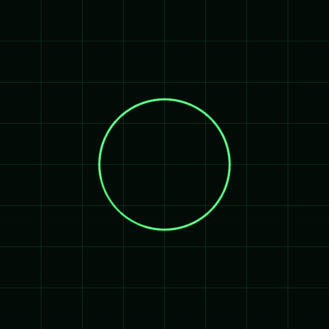
*A circle of radius 0.8.*
<!-- example: {"id":"circle","kind":"equation","x":"0.8*cos(tau*s)","y":"0.8*sin(tau*s)"} -->

### Ellipse

`x = 0.8*cos(tau*s)`; `y = 0.4*sin(tau*s)`. Halving Y compresses the circle vertically.

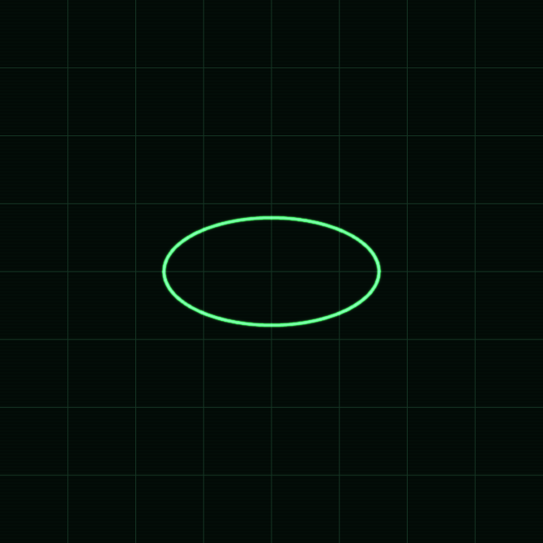
*An ellipse with a 2:1 axis ratio.*
<!-- example: {"id":"ellipse","kind":"equation","x":"0.8*cos(tau*s)","y":"0.4*sin(tau*s)"} -->

### Lissajous 1:2

`x = 0.8*sin(tau*s)`; `y = 0.8*sin(2*tau*s)`. Two vertical cycles create a figure eight.

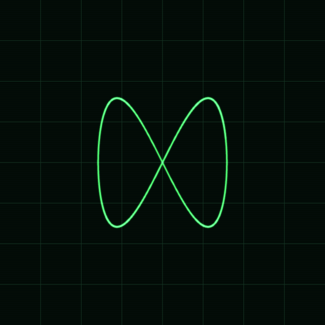
*A 1:2 Lissajous.*
<!-- example: {"id":"liss12","kind":"equation","x":"0.8*sin(tau*s)","y":"0.8*sin(2*tau*s)"} -->

### Lissajous 3:2

`x = 0.8*cos(3*tau*s)`; `y = 0.8*sin(2*tau*s)`. Integer frequencies close after one traversal.

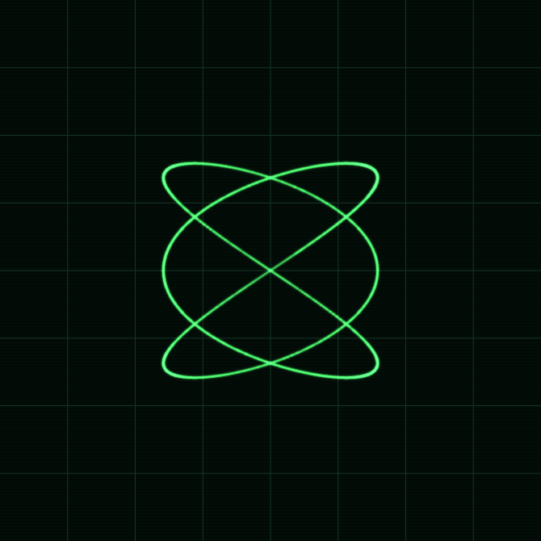
*A three-by-two harmonic figure.*
<!-- example: {"id":"liss32","kind":"equation","x":"0.8*cos(3*tau*s)","y":"0.8*sin(2*tau*s)"} -->

### Lissajous 5:4

`x = 0.8*sin(5*tau*s+0.4)`; `y = 0.8*sin(4*tau*s)`. A phase offset separates the crossings.

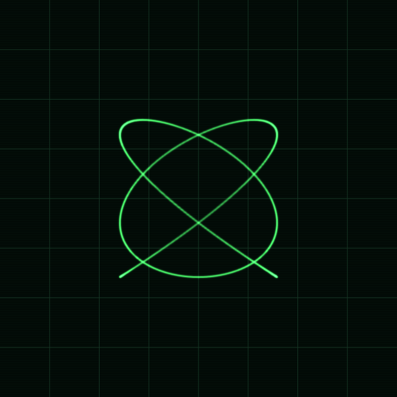
*A denser harmonic weave.*
<!-- example: {"id":"liss54","kind":"equation","x":"0.8*sin(5*tau*s+0.4)","y":"0.8*sin(4*tau*s)"} -->

### Three-petal rose

`x = 0.8*cos(3*tau*s)*cos(tau*s)`; `y = 0.8*cos(3*tau*s)*sin(tau*s)`. An odd radial multiplier gives three petals, retraced during the full cycle.

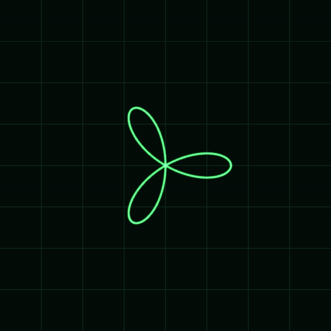
*A polar rose with three petals.*
<!-- example: {"id":"rose3","kind":"equation","x":"0.8*cos(3*tau*s)*cos(tau*s)","y":"0.8*cos(3*tau*s)*sin(tau*s)"} -->

### Eight-petal rose

`x = 0.8*cos(4*tau*s)*cos(tau*s)`; `y = 0.8*cos(4*tau*s)*sin(tau*s)`. An even multiplier doubles the petal count.

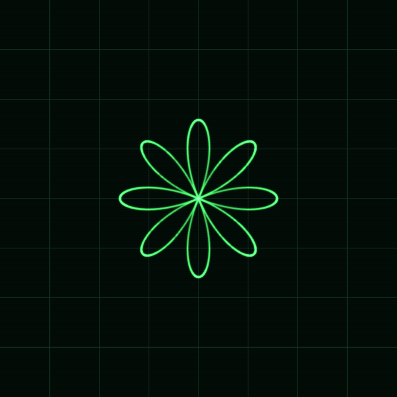
*Four radial oscillations produce eight petals.*
<!-- example: {"id":"rose8","kind":"equation","x":"0.8*cos(4*tau*s)*cos(tau*s)","y":"0.8*cos(4*tau*s)*sin(tau*s)"} -->

### Outward spiral

`x = 0.8*s*cos(5*tau*s)`; `y = 0.8*s*sin(5*tau*s)`. Radius increases with s over five turns; the endpoint returns to the centre by travel.

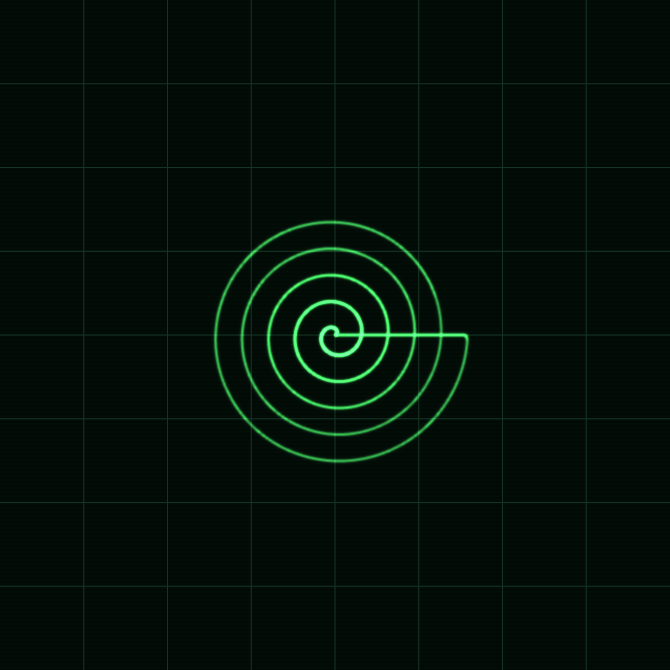
*An open five-turn spiral.*
<!-- example: {"id":"spiral5","kind":"equation","x":"0.8*s*cos(5*tau*s)","y":"0.8*s*sin(5*tau*s)"} -->

### Hypotrochoid

`x = 0.5*cos(tau*s)+0.25*cos(3*tau*s)`; `y = 0.5*sin(tau*s)-0.25*sin(3*tau*s)`. Opposite harmonic rotation gives an inside-rolling spirograph form (R=4, r=1, d=1.5, scaled by 1/6).

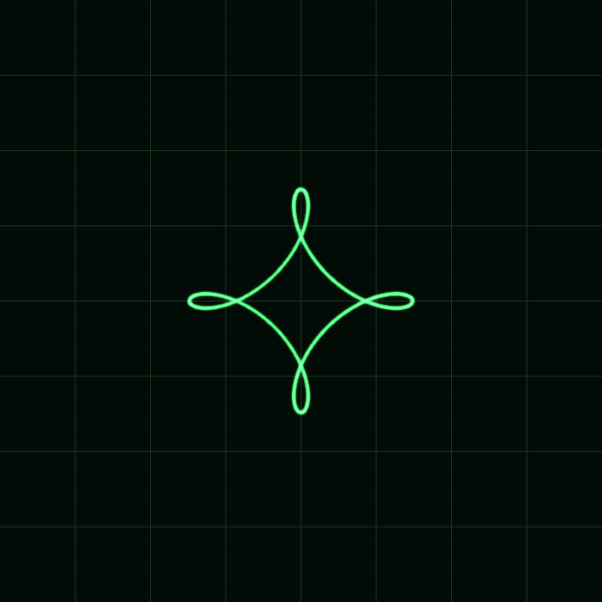
*Counter-rotating components form a fourfold spirograph.*
<!-- example: {"id":"hypotrochoid","kind":"equation","x":"0.5*cos(tau*s)+0.25*cos(3*tau*s)","y":"0.5*sin(tau*s)-0.25*sin(3*tau*s)"} -->

### Epitrochoid

`x = 0.5*cos(tau*s)-0.2*cos(4*tau*s)`; `y = 0.5*sin(tau*s)-0.2*sin(4*tau*s)`. Outside rolling (R=3, r=1, d=1.6, scaled by 1/8) gives a threefold lobed form.

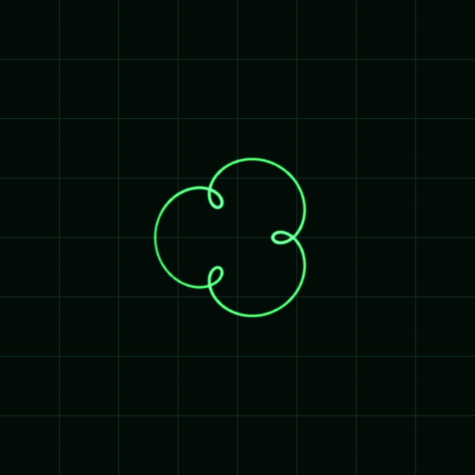
*A threefold outside-rolling curve.*
<!-- example: {"id":"epitrochoid","kind":"equation","x":"0.5*cos(tau*s)-0.2*cos(4*tau*s)","y":"0.5*sin(tau*s)-0.2*sin(4*tau*s)"} -->

### Heart

`x = 0.05*16*sin(tau*s)**3`; `y = 0.05*(13*cos(tau*s)-5*cos(2*tau*s)-2*cos(3*tau*s)-cos(4*tau*s))`. A cubic sine makes the lobes; cosine harmonics form the notch and point.

*A harmonic heart outline.*
<!-- example: {"id":"heart","kind":"equation","x":"0.05*16*sin(tau*s)**3","y":"0.05*(13*cos(tau*s)-5*cos(2*tau*s)-2*cos(3*tau*s)-cos(4*tau*s))"} -->

### Rounded star

`x = (0.6+0.2*cos(5*tau*s))*cos(tau*s)`; `y = (0.6+0.2*cos(5*tau*s))*sin(tau*s)`. Five radial peaks make a soft five-point star.

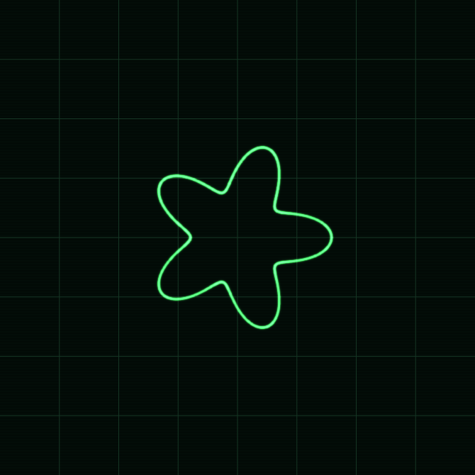
*A star with smooth edges.*
<!-- example: {"id":"star5","kind":"equation","x":"(0.6+0.2*cos(5*tau*s))*cos(tau*s)","y":"(0.6+0.2*cos(5*tau*s))*sin(tau*s)"} -->

### Hexagon using floor

`x = 0.65*cos(tau*s)/cos((s*6-floor(s*6)-0.5)*tau/6)`; `y = 0.65*sin(tau*s)/cos((s*6-floor(s*6)-0.5)*tau/6)`. Folding the angle into six sectors sets the radius of each straight side.

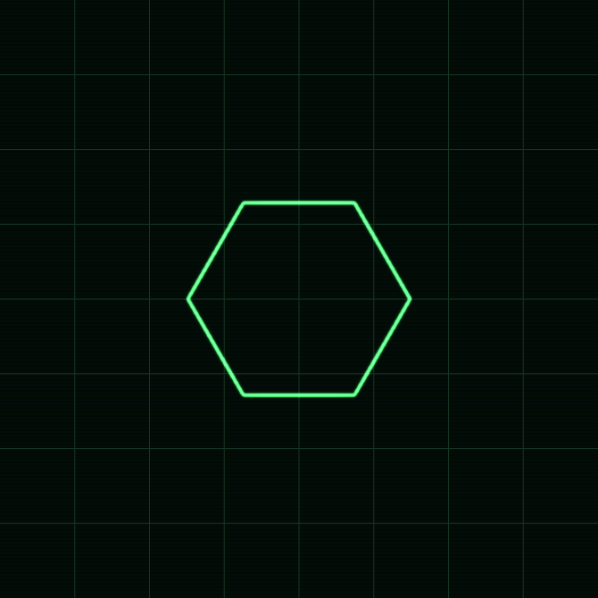
*A six-sided polygon from an angular sector formula.*
<!-- example: {"id":"hexagon","kind":"equation","x":"0.65*cos(tau*s)/cos((s*6-floor(s*6)-0.5)*tau/6)","y":"0.65*sin(tau*s)/cos((s*6-floor(s*6)-0.5)*tau/6)"} -->

### Diamond with triangle waves

`x = 0.8*tri(s)`; `y = 0.8*tri(s+0.25)`. Quarter-cycle-separated ramps trace four straight sides.

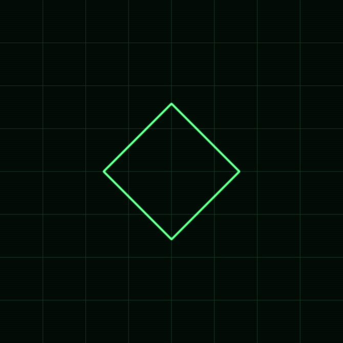
*A diamond from two triangle waves.*
<!-- example: {"id":"diamond","kind":"equation","x":"0.8*tri(s)","y":"0.8*tri(s+0.25)"} -->

### Square-wave trace

`x = 0.8*saw(s)`; `y = 0.5*square(3*s)`. A horizontal ramp displays three square-wave cycles as six flat dashes. The vertical jumps and the return to the left take almost no time, so the beam barely lights them: a real scope shows a fast edge the same way.

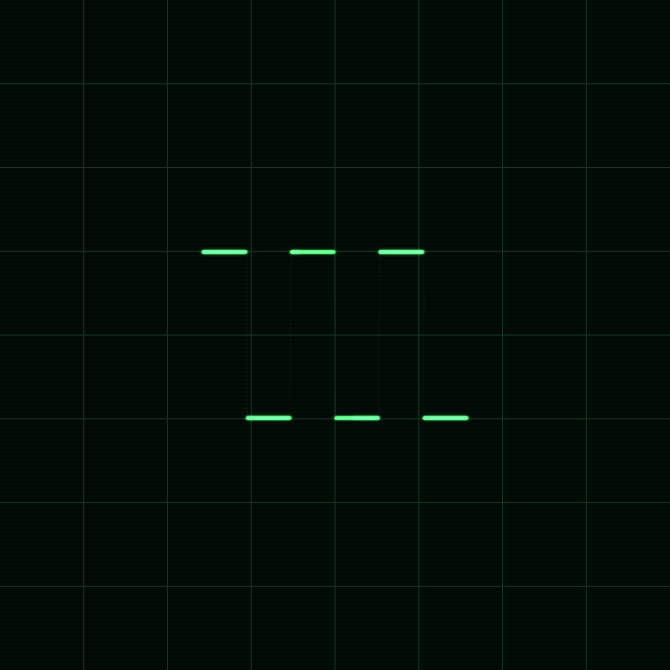
*A waveform drawn in X–Y space.*
<!-- example: {"id":"squarewave","kind":"equation","x":"0.8*saw(s)","y":"0.5*square(3*s)"} -->

### Saw-wave trace

`x = 0.8*saw(s)`; `y = 0.5*saw(3*s)`. Three rising diagonals; the fast resets between them are almost invisible.

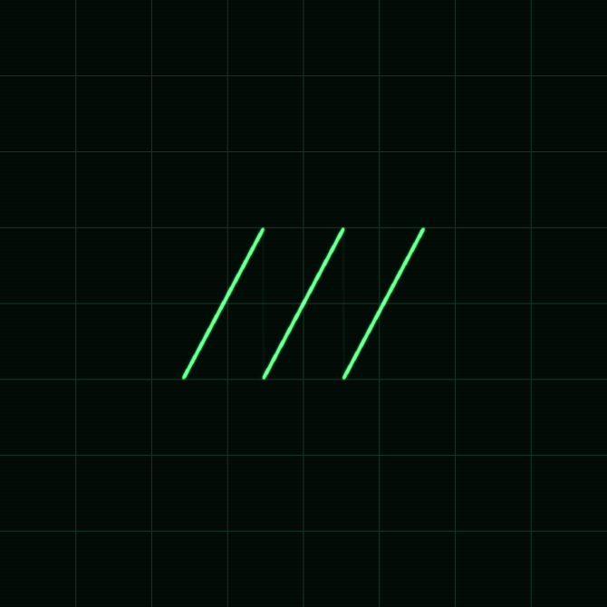
*Three saw periods across one traversal.*
<!-- example: {"id":"sawwave","kind":"equation","x":"0.8*saw(s)","y":"0.5*saw(3*s)"} -->

### Rotating ellipse

`x = 0.7*cos(tau*s)*cos(tau*t/8)-0.3*sin(tau*s)*sin(tau*t/8)`; `y = 0.7*cos(tau*s)*sin(tau*t/8)+0.3*sin(tau*s)*cos(tau*t/8)`. A rotation matrix turns the figure once in eight seconds.

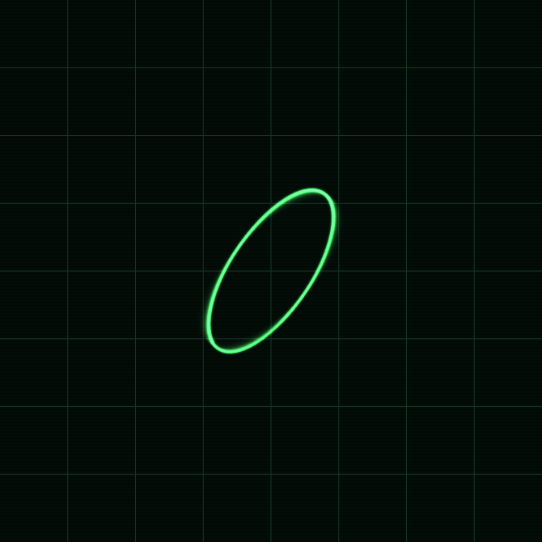
*The figure's orientation follows t.*
<!-- example: {"id":"rotate","kind":"equation","x":"0.7*cos(tau*s)*cos(tau*t/8)-0.3*sin(tau*s)*sin(tau*t/8)","y":"0.7*cos(tau*s)*sin(tau*t/8)+0.3*sin(tau*s)*cos(tau*t/8)"} -->

### Beat pulse

`x = (0.5+0.25*(1-p%1))*cos(tau*s)`; `y = (0.5+0.25*(1-p%1))*sin(tau*s)`. Radius jumps up on each beat and decays linearly through it.

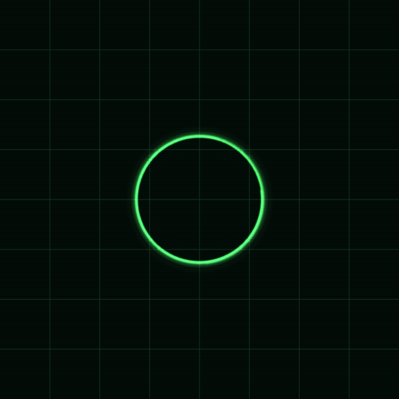
*A sharp beat-synchronized circular pulse.*
<!-- example: {"id":"beatpulse","kind":"equation","x":"(0.5+0.25*(1-p%1))*cos(tau*s)","y":"(0.5+0.25*(1-p%1))*sin(tau*s)"} -->

### Circle-to-diamond morph

Add variable `a`, value 0.5, min 0, max 1, and set its **Time varying…** expression to `0.5+0.5*sin(tau*p/8)`. Use `x = 0.7*((1-a)*cos(tau*s)+a*tri(s+0.5))`; `y = 0.7*((1-a)*sin(tau*s)+a*tri(s+0.25))`. The weighted sum morphs between a circle and a diamond over eight beats.

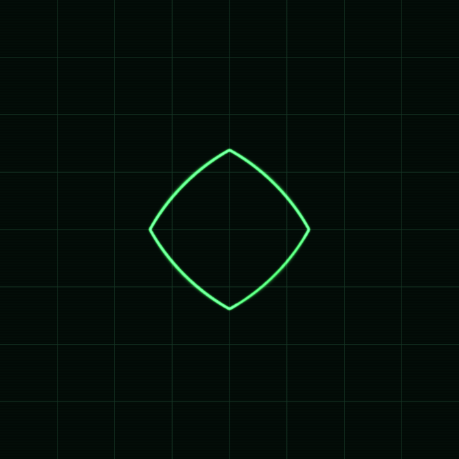
*A variable blends two coordinate pairs.*
<!-- example: {"id":"morph","kind":"equation","x":"0.7*((1-a)*cos(tau*s)+a*tri(s+0.5))","y":"0.7*((1-a)*sin(tau*s)+a*tri(s+0.25))","variables":[{"name":"a","value":0.5,"low":0,"high":1,"expression":"0.5+0.5*sin(tau*p/8)"}]} -->

### Animated wobble

`x = (0.6+0.1*sin(11*tau*s+tau*t))*cos(tau*s)`; `y = (0.6+0.1*sin(11*tau*s+tau*t))*sin(tau*s)`. Eleven moving ripples suggest an audio-reactive ring. This is clock-driven animation; it does not measure incoming audio.

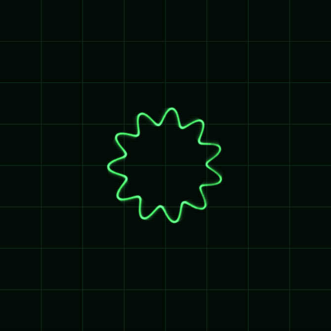
*Moving radial ripples.*
<!-- example: {"id":"wobble","kind":"equation","x":"(0.6+0.1*sin(11*tau*s+tau*t))*cos(tau*s)","y":"(0.6+0.1*sin(11*tau*s+tau*t))*sin(tau*s)"} -->

### Infinity logo

`x = 0.9*cos(tau*s)/(1+sin(tau*s)**2)`; `y = 0.9*sin(tau*s)*cos(tau*s)/(1+sin(tau*s)**2)`. A bounded rational curve makes a continuous infinity symbol; use a Text object for actual lettering.

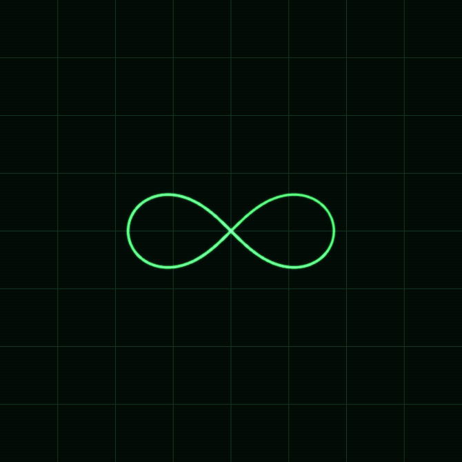
*A logo-like lemniscate.*
<!-- example: {"id":"infinity","kind":"equation","x":"0.9*cos(tau*s)/(1+sin(tau*s)**2)","y":"0.9*sin(tau*s)*cos(tau*s)/(1+sin(tau*s)**2)"} -->

### Trefoil knot

`x = 0.27*(sin(tau*s)+2*sin(2*tau*s))`; `y = 0.27*(cos(tau*s)-2*cos(2*tau*s))`. The classic
projection of the trefoil, the simplest knot (it is the (2,3) torus knot): three lobes that
cross each other. This gallery pair uses Z = `0`; choose the **Trefoil knot** preset or
enter `z = -0.27*sin(3*tau*s)` for the spatial knot, then add a **Rotate** or **Spin** step.
There is no hidden-line removal.

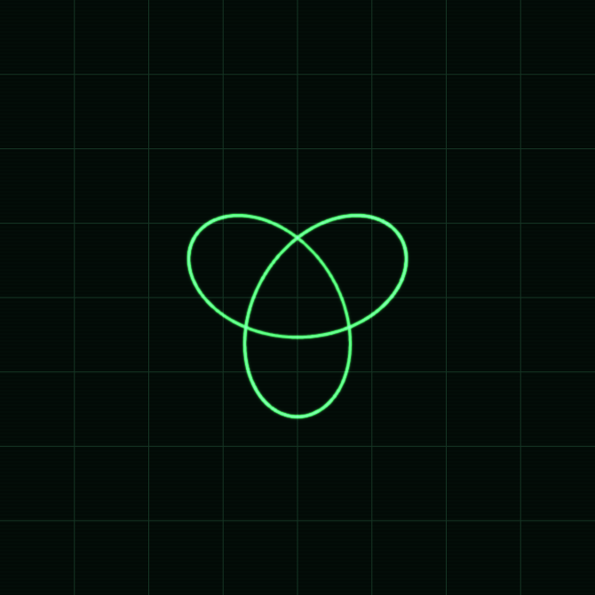
*The trefoil knot: one closed line with three crossings.*
<!-- example: {"id":"trefoil","kind":"equation","x":"0.27*(sin(tau*s)+2*sin(2*tau*s))","y":"0.27*(cos(tau*s)-2*cos(2*tau*s))"} -->

### Breathing circle

`x = (0.6+0.15*sin(tau*p/4))*cos(tau*s)`; `y = (0.6+0.15*sin(tau*p/4))*sin(tau*s)`. The radius breathes smoothly once per four-beat bar.

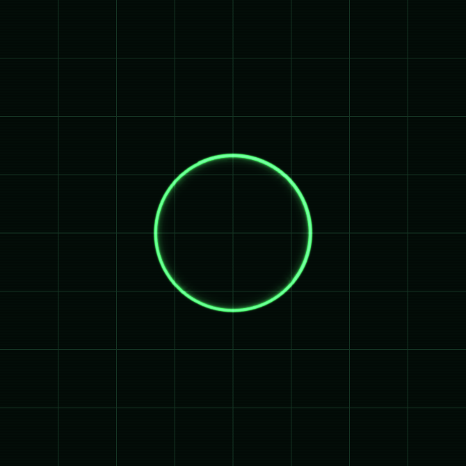
*A smooth bar-length pulse.*
<!-- example: {"id":"breathe","kind":"equation","x":"(0.6+0.15*sin(tau*p/4))*cos(tau*s)","y":"(0.6+0.15*sin(tau*p/4))*sin(tau*s)"} -->
