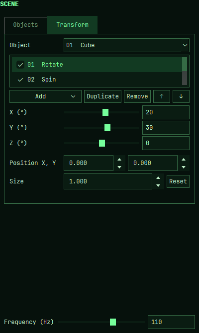

# 7. Transforms

Use transforms to turn, stretch, move, project, reshape or disturb individual objects. Each object has its own ordered stack; you can use fixed values, expressions and Composer gain lanes together.

## 7.1 The transform stack

Open **Scene › Transform** and choose the target in **Object**. Above the stack, **Variables** holds the object's own numbers, which every step can read by name (see [Variables](#78-variables)). Click **Add** and choose a transform kind. The new step is inserted after the selected step. The power icon beside a step enables or disables it without deleting it. **Duplicate** copies the selected step immediately after it; **Remove** deletes it. **↑** runs it earlier and **↓** runs it later. Each object can have at most 16 steps (`MAX_TRANSFORMS`), including disabled ones. **Add › Saved** inserts a step or stack you saved earlier (see [Saved transforms](#79-saved-transforms)).

**Alt/Option-click the power icon** to solo that step; repeat to clear. Only that step
is active, even if its saved power flag was off. Transform solo is temporary, never saved,
and clears when the edited scene/clip changes. **Bypass all** turns the object's entire
stack off for A/B listening while keeping the individual power flags. Bypass all is saved.

In Composer, **right-click a step › Automate On/Off** to switch it on and off over time:
an On/Off lane appears in the transform roll and the step shows **◆**. Where the lane is
off, the step is skipped, as if its power icon were off. The power icon, solo and
**Bypass all** still apply on top of the lane. **Remove On/Off automation** deletes the
lane. See [On/Off lanes](08-composer.md#onoff-lanes).

*The selected object's ordered steps and fields.*

Order matters: translating before rotating swings the translated object around the origin; translating afterwards moves the already-rotated object. The examples below specify complete stacks in top-to-bottom order. Unlisted fields keep their defaults.

## 7.2 Pose order and clocks

The pose pipeline is the transform stack, the retained rotation/spin pose fields (also used by motion-follow code), then **Size** and **Position**. Motion-path following also contributes to the object's final placement. Stack coordinates are therefore in object units, before final Size/Position. New objects rest untilted; older scenes preserve their tilt with a first Rotate X step.

Transforms update once per pose frame, at **Mix › Rotation updates (Hz)** (1…240 Hz, 60 by default). In an expression, `t` is that pose's time in seconds and `p=t*tempo/60` is its beat clock. Composer uses the clip-local scene clock, preserved across left-edge trims; Sandbox uses the Composer tempo too. Increasing Rotation updates gives finer motion steps. **Noise / Sample** displaces every output sample, although its intensity expression is evaluated on the pose clock; **Wobble** moves the pose. Equation X/Y and equation variables have their own per-sample evaluation; see [Parametric equations](06-parametric-equations.md).

## 7.3 Field reference

The following labels, internal names, static ranges and defaults come from `transforms.FIELDS`. Ranges apply separately to every listed axis. Translation and motion use object units; Scale and Shear use dimensionless factors. Expression results are limited to these ranges except Rotate and Spin angles/rates, which are not clipped. Mirror accepts static values only and cannot have automation lanes. Map's fields are formulas only: no slider, no Static and no automation.

| Kind | UI field → internal name | Unit | Static range | Default | Effect |
|---|---|---|---|---|---|
| Rotate | **X (°)** → `x`; **Y (°)** → `y`; **Z (°)** → `z` | degrees | −180…180 | 0 each | Rotate about X, then Y, then Z, using fixed viewport axes. |
| Spin | **X (rev/s)** → `x`; **Y (rev/s)** → `y`; **Z (rev/s)** → `z` | revolutions/second | −10…10 | 0 each | Apply angle `360*rate*t`, X then Y then Z. |
| Translate | **X** → `x`; **Y** → `y`; **Z** → `z` | object units | −10…10 | 0 each | Add an offset to each coordinate; final Size scales this offset too. |
| Scale | **X (×)** → `x`; **Y (×)** → `y`; **Z (×)** → `z` | multiplier | −10…10 | 1 each | Multiply each coordinate; zero flattens an axis, negative values flip it. |
| Shear | **X by Y** → `xy`; **X by Z** → `xz`; **Y by X** → `yx`; **Y by Z** → `yz`; **Z by X** → `zx`; **Z by Y** → `zy` | ratio | −5…5 | 0 each | Add the source coordinate times the amount to the target coordinate. All six use the coordinates before this step. |
| Mirror | **Flip X** → `x`; **Flip Y** → `y`; **Flip Z** → `z` | checkbox | 0 off / 1 on | off each | Negate the selected coordinates. |
| Motion path | **x(t)** → `x`; **y(t)** → `y`; **z(t)** → `z` | object units | −10…10 | stored value 0 each | Add time-dependent offsets. A new step loads Orbit expressions for X/Y. |
| Perspective | **Camera distance** → `distance` | object units | 0.5…100 | 3 | Enlarge points toward the camera and shrink far points. |
| Map | **X′** → `x`; **Y′** → `y`; **Z′** → `z` | object units | formula only; results −10…10 | `x`, `y`, `z` | Replace each coordinate with its formula; all three read the point before this step. |
| Noise | **Intensity** → `intensity` | object units | 0…1 | 0.02 | Noise displacement, scaled by final Size. |
| Noise | **Speed (steps/s)** → `speed` | table steps/second | 0…200 | 4 | Wobble drift speed; 0 holds still. |
| Noise | **Detail (steps)** → `detail` | table steps | 0…64 | 2 | Wobble variation along the route; 0 moves all points together. |

### Rotate

Turn a Cube 30° about Z. The rotation is applied to its untilted geometry.
<!-- example: {"id":"rotate-fixed","kind":"transform","object":"Cube","steps":[{"transform":"Rotate","fields":{"z":30}}]} -->

### Spin

Turn a Cube at one quarter revolution per second about Y.
<!-- example: {"id":"spin-quarter","kind":"transform","object":"Cube","steps":[{"transform":"Spin","fields":{"y":0.25}}]} -->

Spin with a changing rate is not integrated velocity: its current value is multiplied by elapsed t. For a predictable beat-locked angle, use Rotate with a beat expression instead.

### Translate

Move a Cube 0.3 object units to the right.
<!-- example: {"id":"translate-right","kind":"transform","object":"Cube","steps":[{"transform":"Translate","fields":{"x":0.3}}]} -->

### Scale

Compress a Cube's Y dimension to half and leave X/Z unchanged.
<!-- example: {"id":"scale-flat","kind":"transform","object":"Cube","steps":[{"transform":"Scale","fields":{"y":0.5}}]} -->

### Shear

Set **X by Y** to 0.4: each point's X gains 0.4 times its original Y, slanting the object.
<!-- example: {"id":"shear-slant","kind":"transform","object":"Cube","steps":[{"transform":"Shear","fields":{"xy":0.4}}]} -->

### Mirror

Enable **Flip X** to reverse the object's horizontal coordinate. Symmetric objects may look unchanged; lettering makes the effect clearer.
<!-- example: {"id":"mirror-x","kind":"transform","object":"Cube","steps":[{"transform":"Mirror","fields":{"x":1}}]} -->

### Motion path

Orbit at radius 0.3 with a four-second period; all three fields are explicitly specified here.
<!-- example: {"id":"motion-orbit","kind":"transform","object":"Cube","steps":[{"transform":"Motion path","fields":{"x":"0.3*cos(tau*0.25*t)","y":"0.3*sin(tau*0.25*t)","z":0}}]} -->

### Perspective

Use Camera distance 3 on a rotated Cube to reveal its depth.
<!-- example: {"id":"perspective-basic","kind":"transform","object":"Cube","steps":[{"transform":"Perspective","fields":{"distance":3}}]} -->

### Map

Write the new coordinates as formulas. **X′** = `x + 0.2*sin(3*y + tau*t)` makes a travelling wave; see [Map in detail](#77-map-in-detail) for spherize, bulge, twist and more.
<!-- example: {"id":"map-basic","kind":"transform","object":"Text","steps":[{"transform":"Map","fields":{"x":"x + 0.2*sin(3*y + tau*t)"}}]} -->

### Noise

Use Colour **White**, Rate **Sample** and a small intensity for a fuzzy outline and audible hiss.
<!-- example: {"id":"noise-small","kind":"transform","object":"Cube","steps":[{"transform":"Noise","noise":{"colour":"White","rate":"Sample"},"fields":{"intensity":0.01}}]} -->

**Colour** chooses White (flat), Pink (about −3 dB/octave), Brownian (about −6 dB/octave), Custom or a saved preset. **Rate** chooses Sample hiss or Wobble drift on all three axes. Only Wobble shows Speed and Detail. All three numeric fields support expressions and automation. Detail 0 moves the whole object together; larger Detail bends it along the route, with matching offsets at the closed route's seam.

The spectrum editor shows frequency from 20 Hz to 20 kHz on a log axis and gain from −72 to 0 dB. The faint background is the generated loop's measured spectrum. Click empty space to add a node (2–32 total), drag to move, Shift-drag for gain only, or Alt/Option-drag for frequency only. Nodes cannot cross their neighbours. Right-click a node to delete it (at least two remain); double-click to type its gain. Hover to see Hz and dB. Small clicks do not move nodes. Edits take effect on release. Editing a built-in or saved curve switches to Custom and clears its preset label.

Choose **Save curve as preset…** or **Delete preset…** in Colour. Presets live in `USER_DIR/noise-presets.json`, written only after a save or delete. Scenes embed the Custom curve and keep working without that file.

## 7.4 Expressions, static fields and automation

Right-click a numeric field and choose **Time varying…**. The slider becomes an expression entry, initially containing its stored value, so switching modes alone does not change the pose. Press Enter to apply. **ƒ** beside the caption and step name marks an expression. **Static**, or clearing the expression, restores the stored number. An invalid edit displays an error below the fields and preserves the last valid stack.

Use the complete [equation expression language](06-parametric-equations.md#62-expression-language), with these additional coordinate names:

| Name | Value at this step |
|---|---|
| `x`, `y`, `z` | Each point's object-space coordinates immediately before this step. |
| `s` | Position from 0 to 1 along the route, using the point's first visit; it is not an independently advancing animation clock. |
| `t`, `p` | Pose time in seconds and beats. |

All fields within a step read the incoming coordinates. A later step sees the result of the earlier one. The object's own **Variables** are available by name (see [Variables](#78-variables)); the variables of a Parametric or Recurrence object's equations are not.

For example, **Rotate › Y (°)** = `90*y` twists the object: upper and lower points rotate by different angles.
<!-- example: {"id":"twist-y","kind":"transform","object":"Cube","steps":[{"transform":"Rotate","fields":{"y":"90*y"}}]} -->

Scale by depth with **X (×)** and **Y (×)** = `1+0.3*z`; the far and near sections get different widths.
<!-- example: {"id":"taper-z","kind":"transform","object":"Cube","steps":[{"transform":"Scale","fields":{"x":"1+0.3*z","y":"1+0.3*z"}}]} -->

Use **Rotate › Z (°)** = `20*sin(tau*p)` for a ±20° wobble once per beat.
<!-- example: {"id":"rotate-beat-wobble","kind":"transform","object":"Cube","steps":[{"transform":"Rotate","fields":{"z":"20*sin(tau*p)"}}]} -->

For an animated slant, set **Shear › X by Y** = `0.3*sin(tau*t/4)`.
<!-- example: {"id":"shear-moving","kind":"transform","object":"Cube","steps":[{"transform":"Shear","fields":{"xy":"0.3*sin(tau*t/4)"}}]} -->

For a route-dependent ripple, set **Translate › Y** = `0.1*sin(4*tau*s+tau*t)`.
<!-- example: {"id":"route-ripple","kind":"transform","object":"Cube","steps":[{"transform":"Translate","fields":{"y":"0.1*sin(4*tau*s+tau*t)"}}]} -->

Rotate a translated Cube to make the offset orbit the origin: Translate X 0.3, then Rotate Z `90*t`.
<!-- example: {"id":"ordered-orbit","kind":"transform","object":"Cube","steps":[{"transform":"Translate","fields":{"x":0.3}},{"transform":"Rotate","fields":{"z":"90*t"}}]} -->

Translate after rotation instead to keep the offset fixed on screen: Rotate Z `90*t`, then Translate X 0.3.
<!-- example: {"id":"ordered-fixed-offset","kind":"transform","object":"Cube","steps":[{"transform":"Rotate","fields":{"z":"90*t"}},{"transform":"Translate","fields":{"x":0.3}}]} -->

In Composer, right-click a field and choose **Automate**. Its gain lane multiplies the current number or expression, then the field range limits the result (except angles/rates). **◆** marks the field. **Remove automation** removes the lane. Mirror is excluded. Sandbox shows disabled **Automate (in Composer)** and holds the first gain of an existing lane. Gains range from −1 to +1: zero suppresses the field, +1 preserves it, −1 inverts it. Choose a useful nonzero base value; multiplying a zero Translate field cannot move anything. See [Composer](08-composer.md).

## 7.5 Motion path in detail

**Motion path** is a transform offset, separate from the shape builder's guide/follower system. It does not create a visible guide or automatically turn the object to face its direction of travel. Its X/Y/Z fields support the same per-point expressions as other numeric transform fields; expressions of time alone move the object rigidly.

Adding a Motion path loads **Orbit**. The **Load a path…** picker replaces the three expressions while keeping existing gain lanes. Blank preset entries mean a static field; the stored static value is retained. On a fresh step those values are zero.

| Preset | x(t) | y(t) | z(t) |
|---|---|---|---|
| Orbit | `0.3*cos(tau*0.25*t)` | `0.3*sin(tau*0.25*t)` | static |
| Figure 8 | `0.4*sin(tau*0.2*t)` | `0.2*sin(tau*0.4*t)` | static |
| Bounce | static | `0.4*abs(sin(tau*0.5*t)) - 0.2` | static |
| Drift | `0.3*sin(tau*0.07*t) + 0.1*sin(tau*0.19*t)` | `0.3*sin(tau*0.05*t + 1) + 0.1*sin(tau*0.23*t)` | static |
| Toward and away | static | static | `0.8*sin(tau*0.25*t)` |

For a beat-synchronized orbit, replace the default fields with `0.25*cos(tau*p/4)`, `0.25*sin(tau*p/4)` and static 0.
<!-- example: {"id":"motion-beat-orbit","kind":"transform","object":"Cube","steps":[{"transform":"Motion path","fields":{"x":"0.25*cos(tau*p/4)","y":"0.25*sin(tau*p/4)","z":0}}]} -->

## 7.6 Perspective and noise in detail

Perspective models a camera at positive Z looking down −Z. With distance d, it multiplies X and Y by `d/max(d-z,0.05*d)` and preserves Z. At z=0 the multiplier is 1; positive Z grows, negative Z shrinks. The denominator guard limits the multiplier to 20, but a close point can still leave the visible area. Put Perspective after the rotations and depth offsets you want it to project. A flat XY equation object has z=0, so first rotate it out of plane or supply depth with another step to see perspective.

Rotate a Cube slowly about Y, then project at distance 4.
<!-- example: {"id":"perspective-spin","kind":"transform","object":"Cube","steps":[{"transform":"Spin","fields":{"y":0.1}},{"transform":"Perspective","fields":{"distance":4}}]} -->

Move a Cube toward and away from the camera before Perspective to vary its apparent size. Lower final Size if necessary.
<!-- example: {"id":"perspective-depth","kind":"transform","object":"Cube","steps":[{"transform":"Motion path","fields":{"x":0,"y":0,"z":"0.6*sin(tau*p/8)"}},{"transform":"Perspective","fields":{"distance":3}}]} -->

Noise uses a deterministic 40-second Gaussian loop at 48 kHz, shaped by the spectrum and normalized to equal RMS loudness across colours (1/√3 before Intensity and Size). The curve holds its end gains below and above its nodes. All objects share the same sequence, with a half-loop offset between X and Y; other output rates read the same table by time. Each loop is built once per session on a worker thread (about 0.1 s). During playback a Sample step stays silent until its loop is ready; Wobble, exports and renders wait for it. Seeking and block splits reproduce the same samples. Scene versions before 20 migrate White noise to Noise / White / Sample and discard Seed; the sequence intentionally changes.

Multiple active Sample steps add their intensities; the first active Sample step supplies the colour. Sample displacement is added after posing, so later stack rotations do not rotate it. Wobble runs at its place in the stack, with smooth periodic interpolation and a quarter-loop offset for Z. Both change the signal and sound, unlike display grain.

Pulse Pink Sample noise gently once per beat with **Intensity** = `0.02*(0.5+0.5*cos(tau*p))`.
<!-- example: {"id":"noise-pulse","kind":"transform","object":"Cube","steps":[{"transform":"Noise","noise":{"colour":"Pink","rate":"Sample"},"fields":{"intensity":"0.02*(0.5+0.5*cos(tau*p))"}}]} -->

## 7.7 Map in detail

**Map** moves every point to a new position that you write as three formulas: **X′**, **Y′** and **Z′**. Each is an expression of `x`, `y`, `z` (the point before this step), `t`, `p` and `s`, in the [equation expression language](06-parametric-equations.md#62-expression-language). A new Map step holds `x`, `y` and `z`, so it changes nothing until you edit a formula. Type a formula and press Enter; clear a field to restore its axis. **Load an example…** below the fields replaces all three formulas with one of the examples below (Undo brings yours back).

- **Every formula sees the same point.** X′, Y′ and Z′ all read the coordinates from before the step, so **X′** = `y` with **Y′** = `x` swaps the axes; Y′ never sees the new X.
- **Safety:** a result that is not a number (`sqrt(-1)`) or is infinite (`1/x` at x = 0) becomes 0, and results are clipped to −10…10 object units, Translate's range. A formula that is just its own axis name passes that coordinate through untouched.
- **Points move, edges stay straight.** Like every transform, Map moves an object's points; the beam still draws straight lines between them. A Cube or tetrahedron barely changes under a spherize, and so does every example below on a solid with few corners, until a later version adds a Subdivide step that splits long edges. Objects with many points bend smoothly: text, dense models, and parametric equations, which take the stack at every output sample.
- Map formulas are not sliders: they have no **Static** mode and no gain lane. Put a number in the formula instead (`x*(1 + 0.3*sin(tau*p))`), or switch the whole step with **Automate On/Off**.
- Map costs about as much as a Scale step with three expressions, once per pose frame.

**Spherize** pushes every point onto the unit sphere. The centre itself has no direction, so it goes to 0.
<!-- example: {"id":"map-spherize","kind":"transform","object":"Text","steps":[{"transform":"Map","fields":{"x":"x/sqrt(x*x + y*y + z*z)","y":"y/sqrt(x*x + y*y + z*z)","z":"z/sqrt(x*x + y*y + z*z)"}}]} -->

**Partial spherize** goes halfway: replace 0.5 with 0…1, or with `0.5 + 0.5*sin(tau*p/4)` to breathe over four beats.
<!-- example: {"id":"map-partial-spherize","kind":"transform","object":"Text","steps":[{"transform":"Map","fields":{"x":"x + 0.5*(x/sqrt(x*x + y*y + z*z) - x)","y":"y + 0.5*(y/sqrt(x*x + y*y + z*z) - y)","z":"z + 0.5*(z/sqrt(x*x + y*y + z*z) - z)"}}]} -->

**Bulge** enlarges the middle of the object and leaves its edges: points near the centre move out by up to half their distance.
<!-- example: {"id":"map-bulge","kind":"transform","object":"Text","steps":[{"transform":"Map","fields":{"x":"x*(1 + 0.5*exp(-4*(x*x + y*y)))","y":"y*(1 + 0.5*exp(-4*(x*x + y*y)))"}}]} -->

**Wave**: **X′** = `x + 0.2*sin(3*y + tau*t)` ripples the object sideways, one wave per second travelling along Y.
<!-- example: {"id":"map-wave","kind":"transform","object":"Text","steps":[{"transform":"Map","fields":{"x":"x + 0.2*sin(3*y + tau*t)"}}]} -->

**Swap X and Y**: **X′** = `y`, **Y′** = `x` mirrors the object across the diagonal.
<!-- example: {"id":"map-swap","kind":"transform","object":"Text","steps":[{"transform":"Map","fields":{"x":"y","y":"x"}}]} -->

**Twist** turns each horizontal slice about Y by 2 radians per unit of height: **X′** = `x*cos(2*y) - z*sin(2*y)`, **Z′** = `x*sin(2*y) + z*cos(2*y)`. Follow it with Rotate X 30 to see the depth. (**Rotate › Y (°)** = `90*y` does the same with a slider; Map lets you write any other bend.)
<!-- example: {"id":"map-twist","kind":"transform","object":"Cube","steps":[{"transform":"Map","fields":{"x":"x*cos(2*y) - z*sin(2*y)","z":"x*sin(2*y) + z*cos(2*y)"}},{"transform":"Rotate","fields":{"x":30}}]} -->

Scene version 22 adds Map; earlier builds cannot open a scene saved by this one.

## 7.8 Variables

**Variables**, at the top of **Scene › Transform**, are the object's own numbers. Click
**+ Variable** to add one (named `a`, then `b`, …; at most eight per object). Each has a
name, **min** and **max**, a remove button **✕** and a **value** slider. Every step's
expressions, Map's formulas included, and the object's **Path › Start** and **Trace** can
use a variable by name, so one slider can drive several steps at once.

For example, add a variable `a` (min 0, max 90), then set **Rotate › Z (°)** = `a` and
**Scale › X (×)** = `1 + a/180`: dragging `a` turns and widens the object together.
<!-- example: {"id":"variable-turn-and-widen","kind":"transform","object":"Cube","object_variables":[{"name":"a","value":30,"low":0,"high":90}],"steps":[{"transform":"Rotate","fields":{"z":"a"}},{"transform":"Scale","fields":{"x":"1 + a/180"}}]} -->

A variable `k` (min 0, max 1) can also choose where the object starts drawing: **Path ›
Start** = `k`, **Trace** 0.5.
<!-- example: {"id":"variable-path-start","kind":"path","object":"Cube","object_variables":[{"name":"k","value":0.25,"low":0,"high":1}],"start":"k","trace":0.5} -->

- **When it is evaluated:** once per pose frame, before the stack, so every step and the
  path window see the same value in that frame.
- **Time varying:** right-click the value › **Time varying…** for an expression of `t` and
  `p` (`s` reads 0: a variable belongs to the whole object). The result is limited to
  min…max, and an undefined result (the log of a negative number, for example) gives min. A variable's expression cannot
  read other variables or `x`, `y`, `z`. **Static** goes back to the slider.
- **Automation (Composer):** right-click the value › **Automate**. The gain lane multiplies
  the variable, then min…max limits it, and every step that reads it follows. The transform
  roll shows it in an *Object › Variables* block, as *Object variable a*. The Sandbox holds
  the lane's first gain, as for every lane.
  <!-- example: {"id":"variable-lane","kind":"lane","object":"Cube","object_variables":[{"name":"a","value":45,"low":0,"high":90}],"steps":[{"transform":"Rotate","fields":{"z":"a"}}],"key":"transform_variable:a","points":[[0,0,"linear"],[16,1,"linear"]]} -->
- **Names:** letters, digits and `_`, not starting with a digit. A variable cannot be
  called `x`, `y`, `z`, `t`, `p` or `s`, `gx`, `gy` or `gz` (kept for Gridify), a function or
  constant (`sin`, `pi`…), or the name of another variable of the object, including the
  variables of its Parametric or Recurrence equations (those kept aside by **Replace**
  too). The panel says why a name is refused. The equation panel likewise refuses an
  equation variable named like one of the object's variables, and **+ Variable** and **Add
  variable** skip names in use. Loading an equation preset whose variable has the name of
  one of the object's variables renames the preset's variable (`k` becomes `k_2` in its
  equations) and says so.
- **Renaming:** type a new name and press Enter. Every step, Start and Trace expression
  that uses the variable follows the new name. A variable that an expression still uses
  cannot be removed; the panel says where it is used.
- **Undo:** adding, removing, renaming and changing variables are Undo steps; a slider drag
  is one step. This works in the Sandbox and in Composer.
- **Replace** keeps an object's variables and their lanes: they belong to the object, not to
  its type.

## 7.9 Saved transforms

Save a step or a whole stack to reuse it on other objects and in other scenes.

- **Save:** right-click a step › **Save step…** saves that step; **Save stack…** (on the same
  menu, or **Add › Saved**) saves every step of the object. Type a name (up to 40
  characters); saving under an existing name asks before replacing it. A saved transform
  keeps every field, expression, power flag and automation lane (number lanes and On/Off
  lanes), plus the object [variables](#78-variables) its expressions read, with their
  ranges, expressions and lanes. Variables that no step reads are not saved.
- **Insert:** **Add › Saved** lists your saved **Steps** and **Stacks**. Choosing a step
  inserts it below the selected step. A stack offers **Append to stack** (its steps go after
  the object's last step) and **Replace stack** (its steps take the place of the whole
  stack; the object's variables stay). Inserting is one Undo step, in the Sandbox and in
  Composer.
- **Copies:** the scene gets its own copy. Renaming, replacing or deleting the saved
  transform later never changes a scene that used it.
- **Variable names:** a saved variable named like one the object already has (or like a
  variable of the object's Parametric or Recurrence equations, active or kept aside by
  **Replace**) is added under a new name, `k` becoming `k_2` (then `k_3`…), and the inserted
  expressions follow; the object's own variable stays as it was, and the panel says what
  was renamed. Inserting twice therefore gives two independent sets of variables.
- **Limits:** an insert that would give the object more than 16 steps or 8 variables is
  refused and the panel says why.
- **Rename… / Delete…** at the bottom of **Add › Saved** manage the list. Delete asks first
  and cannot be undone.
- **File:** saved transforms live in `transform-presets.json` in your user data folder
  ([Files](12-reference.md#125-files)). If the file is damaged, or was written by a newer
  phosphor, **Add › Saved** says so and saving is refused, so the file is never overwritten;
  the rest of the app works as usual.
