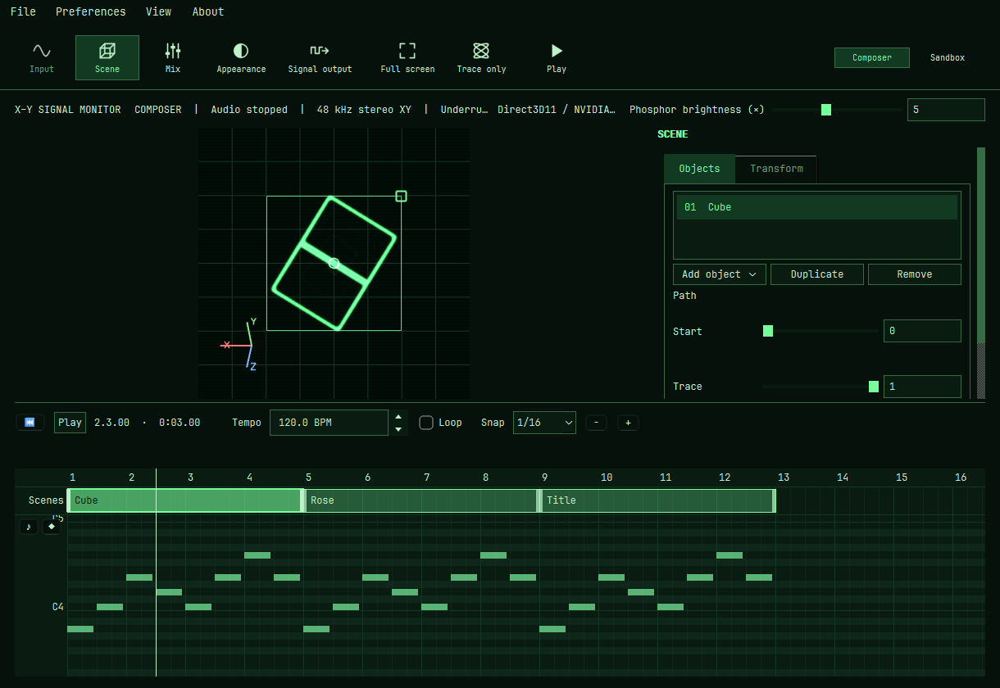
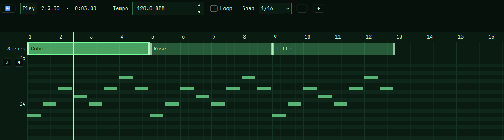
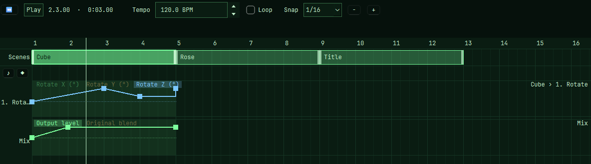

# 8. Composer

Composer arranges scenes into a song: clips on a **Scenes** track supply the pictures, the
note roll supplies the pitch, and automation lanes change the clips' numbers over time.
This chapter covers the whole workspace: the window, a first song, the transport, clips,
notes, automation, copy and paste, projects, export and [undo and redo](#815-undo-and-redo). Keys are written for both
systems as **macOS / Windows**; "Command" is ⌘ on the Mac.

*Composer: the monitor and side panel above, the transport and the timeline below.*

## 8.1 What Composer is

phosphor turns drawings into stereo audio: the left channel is X and the right channel is
Y, so an oscilloscope in X–Y mode draws the picture while you hear it. In the Sandbox you
build one **scene** (objects, transforms, a source) and play it. Composer arranges many
scenes into a **song**:

- The **Scenes track** holds **clips**. Each clip is a complete scene with its own
  objects, transforms, path window, mix and listening mode, placed at a position and
  length on the timeline.
- The **note roll** holds the melody. Notes set the pitch: the scene playing at that
  moment is traced once per cycle of the note's frequency, so the note's pitch is the
  pitch you hear and the picture's drawing rate.
- The **transform roll** holds **automation**: lines that change numbers of the clip
  (a rotation angle, a size, the output level…) over time.

How a moment of the song is made: at each instant the clip under the playhead supplies
the picture, the sounding note supplies the pitch, and the automation shapes the clip's
numbers. Where no clip plays, or no note sounds, the output is silent.

Two things to know from the start:

- **New projects play chords.** Overlapping notes sound together, up to eight voices.
  Turn **Transport › Chords** off for last-note priority: the note that started last
  wins, and an earlier note still held resumes with its own phase when it ends.
- **Notes without glide restart the drawing** from the path's Start point, so a scene is drawn
  from the same place each time a note begins.

Composer is the default workspace the first time phosphor opens. After that the app
reopens in the workspace you used last.

## 8.2 The window

From top to bottom:

| Area | What it holds |
|---|---|
| **Application bar** | Input, Scene, Mix, Appearance, Signal output (each opens its side panel; choosing the open one again hides it), Full screen, Trace only, Play, and the **Composer \| Sandbox** switch at the right end. Input is disabled in Composer: the note roll drives the pitch. |
| **Status strip** | The view heading, the status line and the graphics backend on one line (long text ends in …; hover for the full text), and the Phosphor brightness slider. |
| **Monitor** | The oscilloscope display (left) and the side panel (right). |
| **Composer panel** | The transport rows and the timeline. A faint line marks its top edge: drag that line up or down to give the timeline more or less room. |

**The transport row** (left to right): ⏮ (playhead to the start), **Play**, the playhead
position as `bar.beat.fraction · minutes:seconds`, **Tempo**, **Tap**, **Loop**, **Snap**, and the
**−** / **+** zoom buttons. Then **Click** (the metronome), **Cycle**, the count-in box and the clip controls: **Editing:** (the selected clip's
name), **Length**, **Add clip**, **Delete clip**. When the window is too narrow for one
row, the monitoring and clip controls move to a second row.

**The timeline** (top to bottom):

1. **Ruler** — bar numbers and tempo/time-signature flags. Right-click to edit tempo or
   meter; drag flags to move changes. Click to move the playhead; while looping is on, the loop
   range shows as a tinted band.
2. **Scenes track** — the clips.
3. **Audio tracks** — rows of audio clips (sound files mixed into the output), each with a
   header in the left margin (name, **M**, **S**, gain and a meter), then the **+ Add audio
   track** row with the **Gain** button. The summed output's meter is in the ruler's left
   corner (**Out**). See *Audio tracks* below.
4. **Roll** — either the **note roll** (♪) or the **transform roll** (◆). The two small
   buttons at the roll's top left switch between them.

The side panels scroll vertically when their controls need more room, in Composer and
the Sandbox alike; they never scroll sideways.

## 8.3 A first song in ten minutes

1. **Start a project.** Switch to **Composer** (top right of the application bar), then
   **File › New project**. You get one empty clip, *Scene 1*, four bars long.
2. **Give the clip a picture.** With *Scene 1* selected (its name follows **Editing:**),
   open **Scene** in the application bar, then **Add object** › *Cube*.
3. **Write a melody.** In the note roll (♪), click to draw notes; drag while drawing to
   set a note's length. Drag a note to move it, drag its right edge to resize it.
4. **Play.** Press **Play** in the transport (or in the application bar). The playhead
   runs from where it is; press again to stop. Click the ruler to move the playhead.
5. **Add a second scene.** Double-click the Scenes track after *Scene 1* (or press
   **Add clip**). Select the new clip and give it different objects: the panels now edit
   *that* clip.
6. **Make something move.** In **Scene › Transform**, add a *Rotate* step, then
   right-click its *Z* field › **Automate**. The timeline switches to the transform roll
   with a flat line for that number. Click the line to add nodes and drag them: the
   rotation now follows the line through the clip.
7. **Save.** **File › Save project** writes a `.project.json` file that contains
   everything (all scenes, imported drawings and models, equations and automation).
8. **Export.** **File › Export song WAV…** renders the whole song to a stereo file you
   can play into a scope or share.

## 8.4 Transport, time and navigation

### Playing

- **Play / Stop** — **Space**, the transport's Play button or Play in the application bar. Playback
  starts at the playhead.
- **⏮** — moves the playhead to the start.
- **Home** — moves to the start, or the loop start when **Loop** is on.
- **End** — stops playback and moves to the song end (the last clip or note's end).
  On Mac laptops, use **fn+Left** for Home and **fn+Right** for End.
- **Click the ruler** to move the playhead. Dragging along the ruler scrubs it.
- While playing, the view follows the playhead when it leaves the visible area.

The **Transport** menu lists the keys. They leave typing and navigation to editable
fields (including Tempo) and do not control playback in the shape builder. In the
Sandbox, **Space** plays or stops; **Home** restarts generated playback, or resets the
motion clock when stopped. **End** does nothing there.

### Cycle audition

Turn on **Cycle** to hear one trace cycle of the song at the playhead, repeating
while Composer is stopped. The monitor shows that same cycle. Click or drag the
ruler, use Home or End, or otherwise move the playhead to update it live. Pitch
(including glide), clip mix and automation follow the song at that position. The
cycle is the one nearest the playhead within the note's steady part, after its 4 ms
attack and before its 8 ms release, so a playhead at a note's very edge loops a cycle
just inside the note.
A rest or a gap between clips gives silence and the notice **No note at the playhead**.

With **Chords** on, cycle audition looks for a short common period of the sounding
voices: up to eight cycles of the lowest note, with each voice within 0.05 cycle of a
whole number. If none fits inside all voices' steady parts, it loops one cycle of the
lowest note. A single voice uses the usual cycle audition unchanged.

**Play** takes over with normal song playback; **Stop** returns to cycle audition
if Cycle is still checked. Turn Cycle off to stop the sound. Switching to Sandbox,
using a system/video monitor, recording or closing the window stops cycle audition.
Cycle adds no metronome clicks and does not change exports. The checkbox lasts for
this window session.

### Tempo

- **Tempo** (20–400 BPM) sets the song's starting speed. The timeline defaults to 4/4;
  [tempo and time-signature changes](#817-tempo-changes-and-time-signatures) can divide it
  into sections. Notes, clips and automation are placed in quarter-note beats, so changing the tempo changes
  how fast everything plays without moving anything.
- **Tap**, beside Tempo, estimates BPM from the intervals between the last four taps.
  After more than two seconds idle, the next tap starts a fresh estimate. The first tap
  does not change tempo; estimates are clamped to 20–400 BPM. Tempo changes use the
  existing undo path; successive taps within 400 ms can coalesce into one undo step.
- Expressions in any scene can use **`p`**, the beats elapsed on the scene's clock
  (`p = t × tempo / 60`). Write `sin(tau*p)` for one cycle per beat, or
  `sin(tau*p/4)` for one per 4/4 bar, and it stays in time if the tempo changes. The Sandbox
  uses the project's tempo for `p` too.

### Metronome and count-in

- **Click** (the metronome) adds a short click on each beat, higher and louder on the first beat of
  each bar, following its time signature. Clicks follow the song position through loops and seeks.
- The count-in box selects **No count-in**, **Count 1 bar** or **Count 2 bars** before Play. During count-in,
  only clicks play and the playhead holds; then the song starts at that playhead.
  Count-in works even with Metronome off. Seeking or changing tempo during playback
  proceeds immediately without another count-in.
- **Preferences › Controls › Metronome level** sets the click level from 0 to 1
  (default 0.3). The toggle and count-in selection last for this window session.
- Clicks are monitoring only: audio and video exports always omit them and the count-in.
  The mono click goes to both X/Y channels after song synthesis, so it draws a small
  diagonal tick on the oscilloscope during monitoring.

### Loop

- **Shift-drag on the ruler** sets the loop range (it snaps to the grid) and turns
  looping on.
- The **Loop** box turns looping on or off without changing the range.

### Snap

**Snap** sets the grid for clips, notes and automation nodes: *Bar*, *1/4* (a beat),
*1/8*, *1/16*, or *Off*. With Snap *Off*, new notes are a quarter beat long.

### Zoom and scroll

Over the note roll's pitch names, Control + wheel (Ctrl + wheel on Windows)
zooms pitch by changing row height. Over the cells it still zooms time. This follows
the Zoom time modifier selected in Preferences › Controls.

**View › Zoom to song** (**⌘0 / Ctrl+0**) frames beat zero through the last clip or
note. **View › Zoom to selection** frames all selected notes; with no notes selected,
it frames the selected clip. Both leave the playhead and song unchanged and add a
little space at the edges. They respect the normal zoom limits, so very long songs
may still extend past the view at minimum zoom. These commands work in Composer.

| Gesture | macOS | Windows |
|---|---|---|
| Move earlier / later in time | Shift + wheel (or a horizontal swipe) | Shift + wheel |
| Zoom time (around the pointer) | Control + wheel, or − / + | Ctrl + wheel, or − / + |
| Taller / shorter note rows or automation blocks (over the roll) | Command + wheel | Alt + wheel |
| Scroll pitch (note roll) | wheel | wheel |
| Scroll through automation blocks (transform roll) | wheel | wheel |

Over the ruler and the Scenes track, Command + wheel (Alt on Windows) zooms time like
Control. Row heights range from 5 to 24 px; blocks from 40 to 240 px in steps of 10. The
row or block under the pointer stays where it is while you resize.

**Trackpad.** Two fingers move the whole timeline the way your fingers move, in both
directions at once, like a touchscreen: sideways in time and up and down through pitches
or automation blocks, over the note roll, the transform roll, every audio track and the
Scenes track. Pinch zooms time around the pointer; Option + pinch (Alt + pinch on
Windows) makes rows or blocks taller or shorter. The wheel modifiers above work with two
fingers too. **Preferences › Controls › Scroll & trackpad** sets the trackpad and mouse
wheel sensitivities separately (section 2.5).

## 8.5 The Scenes track: clips

A **clip** is one scene placed on the timeline. Clips never overlap: a gap between clips
is silence.

| Action | How |
|---|---|
| Select a clip (its scene appears in Scene, Transform and Mix) | Click it |
| Select several clips | Shift-click more clips (Shift-click again to take one out) |
| Add a clip | Double-click empty space on the Scenes track (it starts at that bar), or **Add clip** (after the last clip) |
| Move, reorder | Drag the clip body (snaps to the grid): past the middle of a neighbour the two swap; any free gap that holds the clip takes it (see below) |
| Duplicate | Option-drag (macOS) / Alt-drag (Windows) a clip |
| Split at playhead | **S** with the timeline focused, or right-click › **Split at playhead** |
| Colour | Right-click › **Colour**, then choose a swatch or **Default** |
| Mute | Right-click › **Mute clip** (again to unmute) |
| Change the end | Drag the bar at the clip's right end |
| Change the start, keeping the end | Drag the bar at the clip's left end |
| Set the exact length | **Length** (in bars) |
| Delete | Right-click › **Delete clip**, or **Delete clip** (one clip always remains) |
| Copy, cut, paste | See [section 9](#89-copy-cut-paste-and-delete) |

New clips are empty, four bars long (shortened to fit before the next clip), named
*Scene N*, and use **Fully shaped audio**.

**Mute clip** silences a clip like a gap, as deactivating a clip does in other DAWs: it
plays nothing, exports as silence and has no cycle to audition. Its scene and lanes are
kept, and you can still select and edit it. A muted clip is drawn dim with a dashed
outline and *(muted)* after its name. Mute is saved and undoable (*Mute clip* /
*Unmute clip*).

### Moving and reordering clips

Drag a clip's body to move it. Within the free space around it the clip follows the pointer
and stops flush against a neighbour. Drag it on, past the **middle of the neighbour**, and the
two swap, like reordering tabs: the neighbour slides into the dragged clip's old place, the gap
that was between them stays between them, and the dragged clip ends where the neighbour ended.
Keep dragging to pass more clips. Dropped into any free gap long enough to hold it, anywhere
along the roll, the clip lands exactly there and nothing else moves. Clips never overlap.

Shift-click clips to select several (the clicked clip stays the one whose scene you edit); a drag
then moves them together as a block, keeping their spacing, and the block swaps past a
neighbour the same way. A block of clips with an unselected clip between them moves freely and
stops at neighbours, but never swaps. A plain click on one of them selects it alone again.

Each clip takes its own scene, Mix, lanes and automation with it (they count from the clip's
start). Tempo changes, markers, notes and audio clips stay where they are. Each drag is one
Undo step, **Move clip**.

### Split, duplicate and colour

**Split at playhead** divides the clip under the playhead into two pieces. The playhead
must be strictly inside the clip; at an end or in a gap, nothing changes. The second
piece continues the scene clock and automation without restarting the picture or sound.
The notes stay in the note roll, and the second piece becomes selected.

**Option/Alt-drag** copies the whole clip, including its scene, mix, lanes and colour.
The original stays in place. The copy snaps to the grid; over an occupied clip it goes
after that clip, and it shortens to fit before the next. Drag into a larger gap to keep
the full length. Pressing Option/Alt and clicking without dragging makes no copy.

**Colour** offers Rose, Orange, Gold, Green, Teal, Blue, Violet and Pink swatches,
blended with the current CRT theme. **Default** restores the theme's accent. Colour
only labels the clip on the timeline and has no effect on playback or export. Older
projects open with Default. Splitting, duplicating and changing colour each take one
**Undo** step.

### The left end keeps the clip's content in place

Dragging a clip's **left end** changes where the clip starts but does **not** slide its
content:

- **Automation stays put in song time.** Lanes are measured from the clip start, so
  every lane of the clip shifts with the start. Trimming the start cuts the nodes before
  it and adds a node holding the value the lane had there; extending earlier holds the
  first value.
- **The scene's clock continues.** The scene's time `t` (used by expressions, Spin,
  motion paths and equations) carries on as before, so the picture at any song moment
  is the same after the trim.
- **Extending earlier than the scene began** gives negative `t` there. The scene holds
  its starting pose until `t` reaches 0; notes and mix automation play normally.

Every drag is computed from the clip as it was when you pressed the mouse, so dragging
back and forth loses nothing.

### Audio tracks

Under the Scenes track are the **audio tracks**. They hold audio clips: WAV, FLAC, OGG, MP3
or AIFF files added on top of what the scenes draw. Left is X and right is Y, so a clip's
sound moves the figure. Loud clips make it shake with the beat; quiet ones add texture. A new
project shows one empty row; dropping the first file on it makes the track **Audio 1**.
Projects from before version 0.85 open with all their clips on one track named **Audio 1**.

- **Add a track:** click **+ Add audio track** under the last track, or right-click a track's
  header › **Add audio track** (it goes below). Drop files on **+ Add audio track** to put
  them on a new track. Up to 32 tracks. When the tracks do not all fit above the roll, they
  scroll: turn the wheel (or move two fingers up and down) over them; a thin bar at the
  header's right edge shows where you are. Drag the timeline's top edge for more room.
- **The header** (the track's left margin) shows its name, **M** (mute), **S** (solo), its
  gain (×0 to ×2), its **pan** and **phase**, and a meter with a lamp.
  - **Select:** click a header. Shift-click selects every track from the last one clicked;
    Command-click (macOS) or Ctrl-click (Windows) adds or removes one. Selected headers are
    tinted, with the name in bold.
  - **Reorder:** drag a header (or the selected headers, as one block) up or down; or
    right-click › **Move up** / **Move down**.
  - **Rename:** double-click the name, or right-click › **Rename…**.
  - **Gain:** drag the ×1.00 up or down (Shift: finer), or double-click it to type a value.
    The track gain multiplies the sum of its clips, on top of each clip's own gain and gain
    lane. When several tracks are selected and you drag one of them, they all take the
    same gain.
  - **Pan** (**C**, **L50**, **R25** …): the balance between X (left) and Y (right). Panning
    right fades X out, panning left fades Y out; the near side stays at full level, so nothing
    is boosted and the figure stays on screen. Drag it up or down (Shift: finer), or
    double-click it to type −1 to 1. On the scope, panning squashes the figure flat toward one
    axis.
  - **Phase** (**0°**, **+90°**, or **+1.5ms** in Time delay): how Y lines up against X.
    Right-click it to choose:
    - **True phase** rotates Y by an angle at every frequency (−180° to 180°). At 90° a mono
      sound, which draws a diagonal line, opens into a circle or ellipse; at 180° the line
      flips to the other diagonal. It is exact from about 80 Hz to within about 1 kHz of the
      top of the sample rate's range (above 22 kHz at 48 kHz), and about 2% weak at 50 Hz;
      lower, and in that top band, the rotation fades. It reads 20 ms of sound either side of
      each sample, which playback and export both have, so it adds no delay.
    - **Time delay** plays Y up to 20 ms behind X (negative: X behind Y). Because a delay is a
      different angle at each frequency, low notes open a little and high notes a lot. A
      whole-song export runs on by the delay so the last sound isn't cut.
    Drag it up or down (Shift: finer), or double-click it to type a value.
  - A **~** after the pan or phase means its lane is automating it.
  - **M** mutes the track (saved with the project). **S** solos it (see *Mute and solo*
    below; never saved).
  - **Meter:** the bar shows the track's peak while the song plays; the lamp turns red when
    the track alone passes full scale, until you click it.
- **Lanes under the tracks:** **Gain** (left of **+ Add audio track**) shows a lane under
  every expanded track. Right-click a header, a track's empty space or the lane › **Lane** to
  choose what it shows: **Gain** (the clips' gain lanes), **Pan** or **Phase** (the track's
  own automation, over the whole song). In a pan or phase lane, click to add a node, drag nodes
  (Shift: value only, Option/Alt: time only) and right-click one for **Delete node**,
  **Linear to next** or **Hold to next**; **Remove … automation** clears the lane. While a
  lane has nodes, they set the value and the header shows **~**; without nodes the header's
  value plays. The phase lane follows the track's mode (an angle, or a delay).
- **Effects:** right-click a header › **Effects…**, or click the header's **fx** (shown once a track
  has effects; grey when they are all bypassed), to open **Library › Effects** for that track.
  Choose another track in the box at the top or click its header in the timeline. If the project
  has no audio tracks, choose **Add audio track** here. The effects run after pan and phase, top to
  bottom, at most 8 per track:
  - **Filter:** **Low-pass**, **High-pass** or **Band-pass**; **Cutoff** (20 Hz–20 kHz) and
    **Resonance** (Q, 0.5–12; high values ring). On the scope a low-pass rounds corners and a
    high-pass thins bass. A high-pass also removes DC, which is position: a figure drawn off
    centre drifts back to the middle.
  - **Saturate:** **Drive** (0–36 dB) squashes peaks softly, so the line thickens and corners
    round; full scale stays full scale. **Mix** blends it with the dry sound.
  - **Bitcrush:** **Bits** (1–16) steps the levels; **Rate** holds each sample (100 Hz–48 kHz),
    so the figure turns into steps and dots. **Mix** blends it.
  - **Delay:** **Normal** (each side echoes itself) or **Ping-pong** (echoes alternate X-only and
    Y-only, so the figure flicks between the axes); **Time** (1 ms–2 s), **Feedback** (up to
    0.95) and **Mix**. A whole-song export runs on until the echoes die away (at most 10 s).
  - **Compressor:** **Compress** or **Limit**; **Threshold**, **Ratio**, **Attack**, **Release**
    and **Makeup**. It listens to the louder of X and Y, so a loud passage shrinks the whole
    figure evenly and its shape stays. **Limit** never lets the sound past threshold + makeup.

  On the Effects page, **Add** puts an effect after the selected one; drag an effect or use **Up**
  and **Down** to reorder; untick it to bypass it; **Bypass all** plays the track dry while
  keeping the chain; **Remove** deletes it. Each parameter has a caption with its unit, a slider,
  a box to type it (in a narrow Library the box and **Lane** wrap under the slider), and
  **Lane**, which expands the track if it is collapsed and scrolls its parameter lane into
  view when the timeline is short (the other tracks keep theirs;
  choosing Gain, Pan or Phase sets every track's lane again). The track's **Lane** menu lists
  its effect parameters too. While a parameter's lane has nodes it sets the value: the page
  shows **~** and its control is read-only. Switching tracks during a slider drag finishes
  one Undo step on the original track. Turning a control while the song plays keeps the
  echoes and filters going; adding, removing or reordering effects starts them again. After
  a jump (a seek or a loop start) the effects hear the 2 s before it, so a very long echo
  tail starts fresh. The song plays on past its end until the echoes die away, as the export
  does.
- **Right-click a header:** **Add audio track**, **Paste audio tracks**, **Rename…**,
  **Gain…**, **Pan…**, **Phase** (True phase, Time delay, Phase…/Delay…), **Effects…**, **Lane**, **Mute**,
  **Solo**, **Collapse** / **Expand**, **Copy**, **Duplicate**,
  **Move up**, **Move down** and **Delete**. With several tracks selected and the header one of
  them, the commands act on all of them (Rename only on one). The **M** and **S** buttons act on
  their own track. Undo and Redo clear the track selection.
- **Collapse / Expand:** right-click a header or a track's empty space › **Collapse track**.
  A collapsed track is a thin row: its clips are still drawn, heard and editable, and its
  header keeps the name, **M** and **S**. The collapse is saved with the project.
- **Copy, paste, duplicate and delete tracks:** after clicking a header, Command-C / Ctrl+C
  copies the selected tracks with all their clips, fades, routing, mutes and gain lanes;
  Command-V / Ctrl+V pastes them below the selected tracks (or at the end), with the clips at
  the same beats. **Duplicate** puts copies named "… copy" right below. Delete or Backspace
  deletes the selected tracks and their clips. Pasted clips link to the same files; a file
  that is gone pastes as missing.
- **Add a clip:** drag files from your file manager onto a track (several files are placed
  one after another), double-click the track's empty space, or right-click it › **Add audio
  clip here…**. Edit › **Add audio clip at playhead…** adds to the first selected track, else
  the first track. Each clip shows its
  waveform as it will be heard: after its gain, fades and gain lane. Columns above full
  scale are red. Files are read in the background, so the editor never waits for them: a
  long file's waveform appears a moment after you add it or open the project, and until
  then the clip is silent in the stopped preview. **Play** waits for the clips at the
  playhead, so they never start silent.
- **Move:** drag the clip, along its track or onto another track. Option-drag (macOS) or
  Alt-drag (Windows) copies it. Clips may overlap.
- **Trim:** drag either end bar. The audio stays where it was in song time, so trimming the
  start hides the beginning of the file rather than sliding it. You cannot trim past the
  file's first or last sample.
- **Fades:** drag the small squares at the clip's top corners. The fade in starts silent;
  both fades are linear.
- **Right-click a clip:** **Split at playhead** (the halves meet without fades),
  **Duplicate** (the copy starts where the clip ends), **Gain…** (0 to 2; 1 plays the file as
  it is), **Routing** (Stereo; Mono → X and Y; Mono → X only; Mono → Y only), **Show gain
  lane**, **Mute clip**, **Solo clip** and **Delete audio clip**. A missing clip also has
  **Locate file…** at the top. With an audio clip selected, the Split shortcut and Delete
  act on it.
- **Gain lane:** the **Gain** button left of **+ Add audio track** shows a lane under every
  expanded track. In each lane, the selected clip's line can be edited; the other clips of
  that track are drawn dim. Click to add a
  node; the first node also adds level nodes at the clip's ends. Drag a node to move it:
  Shift changes the gain only, Option/Alt the time only. Right-click a node for **Delete
  node**, **Linear to next**, **Hold to next** and **Remove gain automation**. The lane
  multiplies the clip's gain by 0 to 1.
- **Timing:** a clip starts at a beat but plays in seconds at its own speed. Tempo changes
  move where it starts, not how fast it plays. Trims, fades and gain nodes are in seconds,
  so they stay on the same sound when the tempo changes. Audio clips play in every
  listening mode.
- **Meter and clipping:** the **Out** bar in the ruler's left corner shows the summed output's
  peak while the song plays (scenes and every track). Its lamp turns red when the output
  passes full scale and stays red until you click it. Each track's own meter does the same
  for that track. Composer also says so once per playback in the status line. A **!**
  on a clip means its gain times the file's loudest sample already passes full scale on its
  own. The output is clipped hard at full scale; lower the gains to avoid it.
- Every edit is one Undo step, with labels such as *Move audio clip*, *Trim audio clip*,
  *Split audio clip*, *Edit audio gain lane*, *Mute audio clip*, *Relink audio file*, *Add
  audio track*, *Move audio tracks*, *Change audio track gain*, *Collapse audio track* and
  *Delete audio tracks*. A drag (a clip, a header, a gain) is one step. Single audio clips are
  not copied to the clipboard; use Duplicate, or copy the whole track.

### Audio clips: mute, solo and linked files

**Mute and solo.** The rule, for every clip:

> A clip is heard when it is not muted, its track is not muted, and — while any audio clip
> or track is soloed — the clip or its track is soloed. Mute wins over solo. Any audio solo
> also silences the scenes.

So a muted track stays silent even when soloed, and soloing a track and a clip on another
track plays both. A track solo ends when tracks are added, deleted, renamed or reordered.

Right-click an audio clip:
- **Mute clip** silences it. It stays in the project, drawn dim and dashed with *(muted)*,
  and the mute is saved. Splitting or duplicating a muted clip keeps the mute.
- **Solo clip** plays only the soloed audio clips, and silences the scenes, so you hear the
  sound on its own. Soloed clips carry an **S**; everything silenced is drawn dim. Choose
  Solo clip again to end it. Like object solo, audio solo is never saved, and an export
  made while a clip is soloed warns first (it exports what you hear).
- **No clicks at the edges.** A clip that meets a muted clip (for example the two halves of
  a split, one muted) fades out or in over **Signal output › Switch sweep** where they meet,
  as scenes do next to a muted scene clip. With a sweep of 0, or with nothing muted, the
  sound is unchanged. Muting, unmuting or soloing while the song plays crossfades over the
  same length. Playback and export always match.

**Linked files.** A project does not contain its audio: each clip links to its file by a
path relative to the project, its last full path, its name, its size and a fingerprint of
its contents (so a file that merely has the same name is never taken for it).

When you open a project, each file is looked for, in order:
1. at the relative path from the project file;
2. at its last full path;
3. in the project's media folder, `<project name> media`, beside the project file;
4. under its own name in the project's folder.

Only a file whose size and fingerprint match is used.

**The Missing audio files dialog** lists any files that are still not found, with how many
clips use each one and where it was last:
- **Locate…** opens a file picker for the selected file. If you pick a file with other
  contents (a re-export, say), phosphor asks **Use it anyway?**. A file that is shorter
  than the clip shortens the clip.
- After a file is located, phosphor looks in the same folder for the other missing files
  and offers to relink those it finds.
- **Search folder…** searches a folder and its subfolders for every missing file, by name
  and fingerprint.
- **Skip** keeps the rest missing.

A missing clip stays in the project and plays silence. It is drawn hatched with a red
**Missing** badge; right-click it › **Locate file…** to fix it later, or use **File › Find
missing audio files…** to reopen the dialog. Saving keeps its last known location. An
export while any clip is missing warns that those clips will be silent. Relinking is one
Undo step (*Relink audio file*), and located files are read in the background.

**File › Collect media and save** copies every audio file the project uses into
`<project name> media` beside the project file, points the clips at the copies, and saves
the project. Files already in that folder stay; a different file with the same name gets a
numbered name (`kick (2).wav`). Missing files are skipped, and the status line says how
many. An unsaved project is saved first. After collecting, the project folder holds
everything the song needs, so you can move or share it as one folder.

## 8.6 Editing a clip's scene

Select a clip and the usual panels edit **that clip's scene**:

- **Scene › Objects** — add and remove objects (solids, 2D shapes, curves, Text,
  Parametric equation, Custom shape, 3D model and SVG imports), Position, Size, and each
  object's path window (**Start**, **Trace**).
- **Scene › Transform** — the selected object's transform stack (Rotate, Spin,
  Translate, Scale, Shear, Mirror, Motion path, Perspective, Noise). Fields can be
  numbers or expressions of `t`, `p` and `s`.
- **Mix** — *Output level*, *Original blend*, the **Listening mode** (*Fully shaped
  audio*, *Processed output* or *Original audio*) and *Rotation updates (Hz)* (how often
  transforms are re-posed, 60 by default). Each clip keeps its own mix and mode.
- **Input** is unavailable in Composer: the note roll supplies the pitch. (Input's view
  controls moved to Appearance › Monitor; see [section 11](10-display-and-monitor.md).)

What "Original audio" is in Composer: a plain sine at the note's pitch, with 4 ms and 8 ms
fades at the note's start and end to avoid clicks. *Original blend* mixes it with the
shaped drawing signal.

**Time inside a clip.** A clip's `t` starts at 0 at the clip's start (adjusted by left-end
trims, see above). `p` counts beats on the same clock.

## 8.7 The note roll

*The transport, the ruler, the Scenes track and the note roll (♪).*

Switch to the note roll with **♪** at the roll's top left. Pitches are labelled down the
left side; black-key rows are shaded. The playable range is A0–C8 (MIDI 21–108).

| Action | How |
|---|---|
| Draw a note | Click empty space; drag right while drawing to set its length (it starts one Snap step long) |
| Stamp a chord | Choose Notes › Draw › Chord, then click empty space; drag to set every chord note's length |
| Copy and move notes | Option-drag (macOS) / Alt-drag (Windows) a selected note |
| Move notes (time and pitch) | Drag a selected note's body to move the selected set; dragging an unselected note selects and moves it |
| Change its length | Drag its right edge (the pointer turns into a resize arrow) |
| Delete a note | Right-click › **Delete notes**, or select it and press **Delete** / **Backspace** |
| Glide (portamento) | Right-click › **Glide…**, then enter a duration in beats |
| Select several notes | Shift-click each note (Shift-click again to remove one) |
| Box selection | Shift-drag on empty space; notes touched by the rectangle are added to the existing selection |
| Select one / all notes | Click a note / ⌘A on macOS or Ctrl+A on Windows with the note roll focused |
| Transpose selection | ↑ / ↓ one semitone; Shift+↑ / ↓ one octave |
| Shift selection in time | ← / → one Snap step (a quarter beat with Snap Off) |
| Copy, cut, paste notes | See [section 9](#89-copy-cut-paste-and-delete) |

**Transport › Chords** makes overlapping notes play together, each tracing the scene at
its own pitch. It is on for new projects; projects saved before this feature open with
it off to keep their original sound. The switch is saved per project and supports Undo.
With it off, the latest note to start sounds (see [section 1](#81-what-composer-is)).

**Reading chords.** Every note has an outline; darker same-row overlaps show stacked
notes. Chord names at the playhead and above a selection are a best guess, including
extra tones and inversions. The selection name also appears with Chords off. With
Chords on, a ninth simultaneous voice drops the oldest: its remaining note fades,
with a tick at the drop and a small × where there is room. The **Chords** button
under ♪ / ◆ in the roll header controls the same switch as Transport › Chords.

For a smooth pitch slide, right-click a note and choose **Glide…**. Enter the duration
in beats (zero turns glide off). If the clicked note is selected, the value applies to
all selected notes; the maximum is the shortest selected note's length. Undo restores
the whole edit. A small slanted line at a note's start marks a non-zero glide.

Glide applies only when the note starts at or before the previous note ends (legato).
During those first beats, pitch moves evenly in semitones from the previous pitch to
the new pitch. Both the tone and the picture's tracing rate slide together, keeping
the drawing phase continuous. After a gap the note starts at its own pitch, even if
it has glide set. Shortening a note also limits its glide to the new length.

With Chords on, glide notes pair greedily with the nearest available sounding pitches,
including notes ending exactly at the new onset. Each partner hands over its phase and
pitch to one glider. Extra notes start fresh; a longer partner resumes at the glider's
end with its own phase.

Selected notes are highlighted. Moving clamps each note to A0–C8 and beat zero;
lengths and velocities stay unchanged. Copy, cut, paste and Delete act on the set.
Each edit, including a whole drag, is one Undo step; selecting notes does not edit the song.

### Velocity

The lane below the notes shows each note's velocity as a bar, with MIDI values
0–127. Hide or show it with **Notes ▾ › Velocity lane**. To make room for notes without hiding it,
right-click the lane › **Collapse velocity lane**: it shrinks to a thin labelled strip;
right-click the strip › **Expand velocity lane** brings it back. Whether it is collapsed is
saved with the other note roll settings. Drag a bar up or down to
change its velocity (a click alone changes nothing); dragging a selected bar shifts all selected notes by the same amount,
clamped at the ends. Drag empty lane space to paint crossed bars. **Shift-drag**
draws a straight ramp between its ends. Painting and ramps affect selected notes
when there is a selection, otherwise all notes in their path. Each drag is one Undo step.
Double-click a bar, or choose **Set velocity…** in Notes or the note menu, to type
a value. **Ramp velocity…** sets From and To values across selected note starts;
notes that start together get the same value.

**Transport › Velocity** (also **Vel** in the gutter) makes velocity set each note's
loudness and drawing size, scaling about its centre without moving it. It is linear,
like Live MIDI: 64 is about half full strength. Chords weight each voice separately
and never exceed full-velocity loudness. New projects have Velocity on; projects
saved before 0.66 open with it off. New notes start at 127. When off, velocities
are still kept and exported to MIDI. The switch is saved in the project.

### Note tools

Open **Notes** beside Snap and zoom for draw settings and selection tools. Choose
**Draw › Note / Chord**, a **Chord type** (major, minor, dim, aug, sus2, sus4, 6, 7,
maj7, m7 or 9), and **Inversion** (Root through 4th, where the chord supports it).
Click empty space to stamp with the clicked pitch as root; drag to set all lengths.
Pitches outside A0–C8 are omitted. **Option/Alt-drag** copies the selection and moves
the copies; the originals stay in place.

**Scale** and **Root** tint scale rows lightly and root rows more strongly. Enable
**Snap to scale** to snap drawn roots and moved notes to that scale; chord intervals
stay intact. Up/Down then moves one scale degree; Shift+Up/Down still moves an octave.
The scale is a roll setting, saved in preferences, not in the project. **Hear notes**
auditions a drawn note or stamped chord, or a clicked existing note through the scene
at that beat (the selected scene in a gap), for up to 0.3 seconds while stopped.
Playback, recording and export suppress audition. Scale, Root, Snap to scale and
Hear notes are remembered between launches; chord and dialog settings last per window.

Select notes first; the same tools appear in their right-click menu. Each tool is
one **Undo** step, and its resulting notes become selected:

- **Duplicate** (**⌘D / Ctrl+D**) appends copies after the selection's span, rounded
  up to Snap (Off uses the exact span).
- **Split at playhead** (**⌘E / Ctrl+E**) cuts selected notes across the playhead;
  with no selection the shortcut cuts all notes there. **Split here** in the
  right-click menu uses the clicked, snapped beat. Cuts too close to an edge do nothing.
- **Join** (**⌘J / Ctrl+J**) merges touching or overlapping selected notes of the same
  pitch, keeping the first note's velocity and glide. Gaps remain.
- **Legato** (**⌘L / Ctrl+L**) extends or shortens each selected chord group to the
  next selected group's start; the last group stays unchanged.
- **Quantize…** (**⌘U / Ctrl+U**) moves starts towards a grid from 1/2 through 1/32,
  including 1/8T and 1/16T. Strength blends from unchanged (0%) to exact (100%);
  Swing delays odd grid points by up to half a grid step. **Quantize ends** also
  adjusts ends; otherwise lengths stay unchanged.
- **Humanize…** adds random timing and velocity offsets within the entered ± limits.
  The same seed reproduces the same result; **New seed** chooses another.
- **Strum…** delays each chord group's notes from low to high (**Up**) or high to low
  (**Down**) by successive multiples of Amount, keeping their ends fixed.
- **Arpeggiate › Up / Down / Up-down** replaces each selected onset group with a
  cycling pitch pattern through its latest end, at one Snap step per note (Off:
  quarter beat). For short chords the step halves until the pattern fits, down to
  1/64 beat. Up-down turns without repeating the highest or lowest note.

Tools keep notes at beat zero or later, within the playable pitch and velocity
ranges, and at least 1/64 beat long. Shortening also limits glide. Edits exceeding
the project's note limit show a notice and leave the song unchanged.

### Recording

Connect a Live MIDI input in **Sandbox › Input › Live MIDI**, then return to Composer.
Click **Record** in the transport to start a take from the playhead. It turns red while
recording. The selected **Count-in** runs first; notes played during it are ignored.
If the song is already playing, Record joins it without another count-in.

Open the Record button's arrow menu before starting:

- **Overdub** keeps existing notes. With Chords on, performed overlaps stay intact;
  with Chords off, monophonic cuts apply where onsets overlap.
- **Replace** removes existing notes intersecting the take's span, from its earliest
  note start to its latest note end. An empty take leaves the roll unchanged.
- **Quantise to Snap** rounds note starts and ends to the current Snap grid; Snap Off
  keeps the performed timing. Notes rounded to zero length are discarded.

Click Record again or **Stop** to finish. Held notes end at the stop position. The
notes appear in the roll when you stop, and **Undo** removes the whole take in one step.
Incoming notes are not auditioned through the Composer during the take.
Timing subtracts the device output latency shown in the status strip. With Chords on,
every held key is recorded independently; releasing one key ends only that note, and
pressing the same key again ends its previous note first. With Chords off, a new note
ends the previous one, even if its key is still held. Pitches clamp to A0–C8 (MIDI 21–108)
and the roll holds at most 20,000 notes.

Looped takes use wrapped song positions; a held note is split at the loop boundary.
With Chords off, later onsets at the same position take priority. Seeking, changing tempo, switching
workspace or disconnecting MIDI ends the take. Choose recording options and tempo
before starting; options are captured at the start of each take.

## 8.8 Automation: the transform roll

Automation changes a number of a clip over time by **multiplying** it by a **gain** drawn
as a line. A gain of 1 leaves the number as it is, 0.5 halves it, 0 sets it to zero and
−1 inverts it. If the number is itself an expression of `t`, the expression's value is
multiplied. The result is then limited to the field's own range, as typed values are
(angles are not limited).

### What can be automated

Every automatable number of a clip:

- **Transform fields** of every step (Rotate angles, Spin rates, Translate, Scale, Shear,
  Perspective, Noise Intensity/Speed/Detail…). Mirror flips cannot be automated.
- **Path Start** and **Path Trace** of each object.
- **Variables** of Parametric and Recurrence equation objects, and every object's own
  **Variables** (Transform › Variables).
- **Position X**, **Position Y** and **Size** of each object.
- **Output level** and **Original blend** of the clip (MIX).
- **On/Off** of each object and each transform step (see [On/Off lanes](#onoff-lanes)).

Motion guides cannot be automated.

### Starting a lane

- **Right-click a number › Automate** (in Scene, Transform or Mix). This adds a flat lane
  at gain 1 across the clip and switches the timeline to the transform roll on that
  number. Automated numbers show **◆** next to their name.
- **Right-click › Remove automation** removes the lane.
- In the Sandbox the item is greyed out as *Automate (in Composer)*: the Sandbox has no
  timeline, so an automated number there holds its first node's gain.

### Reading the transform roll

*The transform roll (◆): a Rotate Z lane with a hold segment and a jump, and a Mix lane. The dotted lines are the lanes' references.*

Switch to it with **◆** at the roll's top left. It shows the **selected clip's**
automation as **blocks**, one per group:

- *Object › N. Transform* — the fields of one transform step (for example
  *Cube › 1. Rotate*),
- *Object › Placement* — Position X/Y and Size,
- *Object › Path* — Start and Trace,
- *Object › Equation* — equation variables,
- *Object › Variables* — the object's own variables (Transform › Variables),
- *Mix* — Output level and Original blend,
- *Object › On/Off* and *Object › N. Transform On/Off* — one block per On/Off lane.

Objects with the same name are numbered (*Cube #1*, *Cube #2*); Text objects show their
text. Each block's **legend** (the top row) names its numbers in their line colours:
click a name to edit that line. A dim name is not automated yet; clicking it starts a
lane.

Inside a block, the line runs over the clip's length; up is gain +1, down is −1. Hover
anywhere in a block for a tooltip with the gain, the resulting value (the static value ×
the gain) and the beat in the clip.

### Editing nodes

| Action | How |
|---|---|
| Add a node exactly on the line | Click on or near the line (within 10 px) without moving the mouse |
| Add a node at a chosen height | Click away from the line (at the snapped beat and the click's gain) |
| Move a node | Drag it (beat snaps to the grid) |
| Change only the gain | Shift-drag the node |
| Type a gain | Double-click a node › **Node gain** |
| Change only the time | Option-drag / Alt-drag the node |
| Bend a segment | Option-drag / Alt-drag its middle up or down |
| Straighten a curve | Right-click the curved segment › **Straighten** |
| Select several nodes | Shift-click them |
| Delete, or change the segment shape | Right-click the node › **Delete node**, **Linear to next** or **Hold to next** |
| Remove the whole lane | Right-click a node › **Remove automation of …** |

**Typing a gain.** Double-click a node to enter its gain from −1 to 1 with three
decimal places. If that node is selected, the value applies to every selected node
in that lane; otherwise the first click selects the node and the value applies only to it. Beats
stay in place, and a click that moves less than 3 pixels never moves a node. Cancel changes nothing; Undo restores the whole edit in one step.
Curve handles keep their offsets from the straight line between endpoints; as when
dragging, the change is limited if a handle reaches the gain range boundary.

**Segment shapes.** Each node sets the shape of the segment after it: *Linear* ramps to
the next node; *Hold* stays flat until the next node, then jumps. *Curve* is a smooth
cubic Bézier in gain over time. Option-drag / Alt-drag the segment's middle to bend it;
the endpoints stay in place. The two handle gains stay within the gain range. Moving
an endpoint or dragging a whole segment preserves the bend offsets where the range
allows. Right-click the curve › **Straighten** restores a linear segment. These edits
support Undo and Redo; adding a node on a curve or trimming a clip preserves its curve.

**Moving a whole segment.** Press on a segment (not a node) and drag up or down: the
segment moves straight up or down without changing its shape. A step node is added under
or over each end so the rest of the lane stays where it was (none at the lane's first or
last node). Dragging the segment again reuses those step nodes, and step nodes left level
with their partner disappear on release. On a Hold segment this moves the flat part.

**Instant jumps.** A lane may have two nodes at the same beat: the gain jumps there.
Segment drags create these; three nodes at one beat are not allowed.

### On/Off lanes

An On/Off lane switches an object or one transform step on and off over the clip, like a
DAW's device on/off automation. Start one with **right-click an Objects row or a
Transform step › Automate On/Off**. It begins on across the whole clip.

The lane has two values and no nodes. It is drawn as **blocks**: a solid run where the
object or step is on, an outline where it is off.

| Action | How |
|---|---|
| Turn a range off or on | Drag across beats. The range takes the opposite of the state where you pressed, snapped outward to the grid (Snap › Off paints exact beats) |
| Flip a run | Click it without moving: the whole run turns on or off and merges with its neighbours |
| Flip at a beat, turn everything on, remove | Right-click › **Turn off here** / **Turn on here**, **Turn all on**, **Remove On/Off automation** |

**Off removes it from the beam path.** An object that is off is dropped from the drawing
cycle and the other objects take its share, exactly as with **M**. A step that is off is
skipped, as with its power icon. Switching happens at the next pose update (*Pose
updates*, 60 per second by default). Playback and export switch at the same samples.

**Switching is click-free.** A hard cut would make the beam jump between shapes, an
audible click. Instead, an object that switches off has its Path Trace swept to zero over
the **Switch sweep** time (Signal output, 5 ms by default) just before it leaves the beam
path, and its share of the cycle shrinks with it; when it returns, it sweeps back up. A
step that switches crossfades its effect over the same time. Clips next to a **muted**
clip sweep their objects out before it and in after it. Set Switch sweep to 0 for the
hard cut. See [Signal output](09-mix-output-and-export.md).

The lane is stored like the gain lanes (0 or 1 with Hold steps, beats from the clip
start), so it moves with its clip, splits with it and undoes as *Edit On/Off*. In the
Sandbox the lane holds its first value. Scenes from before version 21 have no On/Off
lanes, so everything in them stays on.

### Automation examples

Each example lists the lane's nodes as *(beat from the clip start, gain, segment shape)*.
Beats count from the clip's start, so a lane moves with its clip. All of these are checked
against the engine (see [Examples in this manual](README.md#examples-in-this-manual)).

**Fade a clip in and out.** On a 16-beat clip, automate **Mix › Output level**: rise from
silence over the first bar, hold, and fall over the last bar.

| Beat | Gain | Shape |
|---|---|---|
| 0 | 0 | Linear |
| 4 | 1 | Linear |
| 12 | 1 | Linear |
| 16 | 0 | Linear |
<!-- example: {"id": "lane-fade-in-out", "kind": "lane", "key": "mix:drawing_gain", "points": [[0, 0.0, "linear"], [4, 1.0, "linear"], [12, 1.0, "linear"], [16, 0.0, "linear"]]} -->

**Draw the picture on over two bars.** Automate the object's **Path › Trace**: the drawn
part of the route grows from nothing to the whole object between beat 0 and beat 8.

| Beat | Gain | Shape |
|---|---|---|
| 0 | 0 | Linear |
| 8 | 1 | Hold |
<!-- example: {"id": "lane-draw-on", "kind": "lane", "key": "path:path_trace", "points": [[0, 0.0, "linear"], [8, 1.0, "hold"]]} -->

**Snap to a new pose on the drop.** With a *Rotate* step whose **Z (°)** is 90, a Hold
segment keeps the angle at 0 until beat 8, then the gain jumps to 1: the object turns a
quarter turn instantly. A second node at the same beat makes the jump explicit, so you can
drag the two halves separately.

| Beat | Gain | Shape |
|---|---|---|
| 0 | 0 | Hold |
| 8 | 0 | Hold |
| 8 | 1 | Hold |
| 16 | 1 | Hold |
<!-- example: {"id": "lane-drop-jump", "kind": "lane", "key": "transform:0:z", "steps": [{"transform": "Rotate", "fields": {"z": 90}}], "points": [[0, 0.0, "hold"], [8, 0.0, "hold"], [8, 1.0, "hold"], [16, 1.0, "hold"]]} -->

**Pulse the size on every beat.** Automate **Size**: Hold segments alternate between full
size and 70 % every half beat. (For a smooth pulse that follows the tempo by itself, use an
expression with `p` instead; see [Cookbook](11-cookbook.md).)

| Beat | Gain | Shape |
|---|---|---|
| 0 | 1 | Hold |
| 0.5 | 0.7 | Hold |
| 1 | 1 | Hold |
| 1.5 | 0.7 | Hold |
| … | … | … |
<!-- example: {"id": "lane-size-pulse", "kind": "lane", "key": "shape:shape_size", "points": [[0, 1.0, "hold"], [0.5, 0.7, "hold"], [1, 1.0, "hold"], [1.5, 0.7, "hold"], [2, 1.0, "hold"], [2.5, 0.7, "hold"], [3, 1.0, "hold"], [3.5, 0.7, "hold"]]} -->

**Invert a spin halfway.** Automate a *Spin* step's **Y (rev/s)**: the gain ramps from 1
to −1 across the clip, so the object slows, stops at the middle and turns the other way.

| Beat | Gain | Shape |
|---|---|---|
| 0 | 1 | Linear |
| 16 | −1 | Linear |
<!-- example: {"id": "lane-spin-reverse", "kind": "lane", "key": "transform:0:y", "steps": [{"transform": "Spin", "fields": {"y": 0.5}}], "points": [[0, 1.0, "linear"], [16, -1.0, "linear"]]} -->

**Sweep an equation variable.** On a Parametric equation object with a variable `k`
(static value 3, min 1, max 6) used in `cos(k*tau*s)`, a lane on **k** scales it: gain
0.34 gives about 1 petal-ratio, gain 1 the full 3, so the figure morphs through the bar.

| Beat | Gain | Shape |
|---|---|---|
| 0 | 0.34 | Linear |
| 4 | 1 | Linear |
<!-- example: {"id": "lane-variable-morph", "kind": "lane", "key": "variable:k", "x": "0.8*cos(k*tau*s)*cos(tau*s)", "y": "0.8*cos(k*tau*s)*sin(tau*s)", "variables": [{"name": "k", "value": 3.0, "low": 1.0, "high": 6.0, "expression": ""}], "points": [[0, 0.34, "linear"], [4, 1.0, "linear"]]} -->

Remember that a gain **multiplies** the number and the result is clipped to the field's
range: to make a number move *between* two values that are not 0 and the static value,
set the static value to the larger one and choose gains between their ratio and 1.

### The reference line

Each lane's **reference** is its first node's gain. Once a node leaves it, a dotted line
in the lane's colour marks the reference.

- Nodes, new nodes and dragged segment ends **snap** to the reference within 6 px. Hold
  **Command / Ctrl** while dragging to place freely.
- While you drag the first node, the reference stays where it was until you release.
- **Right-click the reference line** to type a new reference gain. Nodes on the line move
  with it; nodes placed elsewhere keep their gains. The dialog shows the number's static
  value so you can see what the gain means.

### Gain range

Gains run from **−1 to 1**. Projects saved by earlier builds (which allowed ±2) open with
larger gains clamped to ±1. This range is **provisional**: it may change after testing
whether ±1 gives enough room (for example to invert or double a value).

## 8.9 Copy, cut, paste and delete

**Command-C / Ctrl+C**, **Command-X / Ctrl+X**, **Command-V / Ctrl+V** and **Delete** act
on what you **clicked last** in the timeline. The right-click menus have the same items.
Right-click empty space for **Paste … at the playhead**.

| What | Copy / cut | Paste |
|---|---|---|
| **Notes** | The selected notes (Shift-click to select several) | At the playhead, keeping their spacing |
| **A clip** | The selected clip, with its whole scene and its mix lanes | At the playhead. If a clip already plays there, it goes after that clip, shortened to fit before the next |
| **Automation nodes** | The selected nodes (Shift-click to select several) | Into the lane clicked last, at the playhead; replaces that lane's nodes inside the pasted span |
| **Audio tracks** | The selected tracks (click a header; Shift- or Command/Ctrl-click for several), with their clips and gain lanes | Below the selected tracks, or at the end; the clips keep their beats |

The clipboard is shared between phosphor windows. Its contents are checked strictly when
pasted; anything that is not valid phosphor data is refused with a message in the status
line.

## 8.10 Projects, Sandbox and export

### Two workspaces, two documents

| | Composer | Sandbox |
|---|---|---|
| Document | a **project** (`.project.json`) | a **scene** (`.scene.json`) |
| File menu | New project, Open project…, Save project, Save project as…, **Collect media and save**, **Find missing audio files…** | Open scene…, Save scene, Save scene as…, **Send scene to Composer** |
| Export | **Export song WAV…** (the whole song) and **Export notes WAV…** (only the note tones) | Export processed WAV… and Export source WAV… |
| Input panel | unavailable (notes drive the pitch) | available |

Switch with **Composer | Sandbox** at the right end of the application bar. Each keeps
its own document while you switch.

- **Send scene to Composer** (Sandbox) adds the Sandbox scene to the project as a new clip
  after the last one.
- A project file **embeds every clip's whole scene**: drawings and imported SVGs, 3D model
  geometry, equations, transforms and automation. Nothing else is needed to rebuild it.
- Exiting, or opening a new instance, offers to save **both** documents if they have
  changes.

### Exported audio

Exports are stereo WAV files (left = X, right = Y) rendered from the song itself, so they
are identical however playback was going. *Export song WAV* includes the shaped drawing
signal as each clip's mix and listening mode set it; *Export notes WAV* renders only the
note tones.

## 8.11 Section markers

Marker names occupy the lower part of the ruler. Tempo and time-signature flags occupy
two thin rows above them; clicking or dragging a flag does not select a marker at the
same beat. Right-click a marker for its marker menu, or empty ruler space for tempo,
time-signature and **Add marker** actions.

With the timeline focused, press **M** to add a section marker at the playhead, or
right-click empty space on the ruler and choose **Add marker**. New markers are named
*Section*. Their names appear on the ruler; click a marker to jump the playhead to it,
or drag it to move it using the current **Snap** step (Off allows free placement).

Right-click a marker and choose **Rename…** or **Delete**. Names may contain up to
64 characters. A project holds at most 256 markers, ordered by beat, within beats
0–100,000. **Loop between here and next** enables looping from that marker to the
next marker at a later beat; it is disabled when there is no later marker.

Adding, moving, renaming and deleting markers supports **Undo** and **Redo**; a drag
is one undo step. Loop changes also support Undo. Markers are saved in the project;
older projects open with none. Copy, Cut and Paste for notes, clips and automation
do not include markers.

## 8.12 Reference: mouse, wheel and keys

**Help › Keyboard shortcuts…** searches these keys and gestures alongside the app
and shape-builder shortcuts. It can stay open while you edit.

### Mouse

| Where | Action | Result |
|---|---|---|
| Ruler | Click / drag | Move the playhead / scrub |
| Ruler | Shift-drag | Set the loop range (turns Loop on) |
| Scenes track | Click | Select a clip (its scene goes to the panels) |
| Scenes track | Shift-click | Add or remove a clip from the selection (a drag moves them as a block) |
| Scenes track | Drag body / left bar / right bar | Move or reorder (past a neighbour's middle: swap; into a free gap) / change start (end fixed) / change end |
| Scenes track | Option-drag (macOS) / Alt-drag (Windows) | Duplicate into free space |
| Scenes track | Double-click empty space | Add a clip at that bar |
| Scenes track | Right-click | Clip menu (Copy, Cut, Paste, Split at playhead, Colour, Mute clip, Delete clip) or Paste |
| Audio track | Drop files / double-click empty space | Add audio clips at that beat on that track |
| Audio track | Drag body / end bars / top corner squares | Move (also onto another track) / trim / fade in or out |
| Audio track | Option-drag (macOS) / Alt-drag (Windows) | Copy the audio clip |
| Audio track | Right-click clip / empty space | Audio clip menu (Mute clip, Solo clip, Locate file… for a missing clip) / Add audio clip here…, Collapse track |
| Track header | Click / Shift-click / Command- or Ctrl-click | Select the track / a range / add or remove one |
| Track header | Drag the name / double-click the name | Reorder the selected tracks / rename |
| Track header | Click M / S | Mute (saved) / solo (not saved) the track |
| Track header | Drag gain up or down (Shift: finer) / double-click gain | Track gain / Gain… dialog |
| Track header | Drag pan or phase up or down (Shift: finer) / double-click it | Track pan or phase / its dialog |
| Track header | Right-click the phase | True phase / Time delay |
| Track header | Click fx | Open Library › Effects for the track |
| Pan, phase or effect lane | Click / drag node / right-click node | Add a node / move it (Shift: value, Option/Alt: time) / node menu |
| Track header | Click the lamp / right-click | Reset the track lamp / track menu (Collapse, Copy, Duplicate, Move, Delete…) |
| + Add audio track | Click / drop files | Add a track / add the files on a new track |
| + Add audio track, left | Gain | Show the lanes under the tracks (clip gain, or track pan or phase: right-click › Lane) |
| Ruler corner (Out) | Click the red lamp | Reset the output lamp |
| Gain lane | Click / drag node / right-click node | Add a node / move it (Shift: gain, Option/Alt: time) / node menu |
| Note roll | Click empty / drag | Draw a note / set its length |
| Note roll | Click note | Select only that note |
| Note roll | Drag note / right edge | Move selected notes / resize that note |
| Note roll | Shift-drag empty space | Add notes touched by the selection box |
| Note roll | Shift-click | Add to or remove from the selection |
| Velocity lane | Drag bar | Set velocity, or shift the selected notes together |
| Velocity lane | Drag empty space | Paint crossed bars (selection only when selected) |
| Velocity lane | Shift-drag | Ramp velocity between the ends |
| Velocity lane | Double-click bar / right-click | Set velocity dialog / note menu, with **Collapse velocity lane** |
| Velocity lane, collapsed | Right-click | **Expand velocity lane** |
| Note roll | Right-click note / empty | Note menu (Glide, Copy, Cut, Paste, Delete notes) / Paste at the playhead |
| Transform roll | Click legend name | Edit that line (dim name: start automating it) |
| Transform roll | Click on line / elsewhere | Node on the line / node at that height |
| Transform roll | Drag node / segment | Move node / move the segment up or down |
| Transform roll | Shift-drag / Option- or Alt-drag node | Gain only / time only |
| Transform roll | Shift-click node | Add to or remove from the selection |
| Transform roll | Double-click node | Type gain for this node, or selected nodes if it is selected |
| Transform roll | Right-click node / reference line | Node menu / Reference gain dialog |
| On/Off block | Drag / click / right-click | Paint off or on / flip the run / On/Off menu |
| Composer top edge | Drag the faint line | Resize the timeline |
| Monitor corner | Hover | Pop out and Full screen buttons |

### Wheel

These wheel gestures apply by default. Choose different physical modifiers in
**Preferences › Controls**. Composer actions must have distinct modifiers; builder
zoom has its own mapping. To swap two assignments, choose an unused modifier first.

| Gesture | macOS | Windows |
|---|---|---|
| Pitch (note roll) / blocks (transform roll) | wheel | wheel |
| Time | Shift + wheel | Shift + wheel |
| Zoom time | Control + wheel | Ctrl + wheel |
| Row or block height (over the roll) | Command + wheel | Alt + wheel |
| Move time and pitch together (trackpad) | two-finger drag | two-finger drag |
| Zoom time around the pointer (trackpad) | pinch | pinch |
| Row or block height (trackpad) | Option + pinch | Alt + pinch |

### Keys

| Action | macOS | Windows |
|---|---|---|
| Zoom to song (View menu) | ⌘0 | Ctrl+0 |
| Zoom to selection (selected notes, else selected clip) | View › Zoom to selection | View › Zoom to selection |
| Split clip under playhead (timeline focused) | S | S |
| Add section marker at playhead (timeline focused) | M | M |
| Copy / Cut / Paste (timeline) | ⌘C / ⌘X / ⌘V | Ctrl+C / Ctrl+X / Ctrl+V |
| Delete selection | Delete or Backspace | Delete or Backspace |
| Select all notes (note roll focused) | ⌘A | Ctrl+A |
| Transpose selected notes | ↑ / ↓ semitone; Shift+↑ / ↓ octave | ↑ / ↓ semitone; Shift+↑ / ↓ octave |
| Shift selected notes in time | ← / → one Snap step (Off: quarter beat), also with Shift | ← / → one Snap step (Off: quarter beat), also with Shift |
| Place freely (no reference snap) | hold ⌘ while dragging | hold Ctrl while dragging |
| Full screen (window) | Control-Command-F | F11 |
| Trace only | Shift-Command-F | Ctrl+Shift+F |
| Leave full screen / Trace only | Escape | Escape |
| New instance / Open / Save / Save as | ⌘N / ⌘O / ⌘S / ⇧⌘S | Ctrl+N / Ctrl+O / Ctrl+S / Ctrl+Shift+S |

## 8.13 Limits and exact behaviour

| Item | Limit or rule |
|---|---|
| Tempo / meter | 20–400 BPM; default 4/4; up to 256 changes of each kind |
| Clips | up to 512; never overlapping; one always remains |
| Notes | up to 20,000; pitch A0–C8 (MIDI 21–108); 8 voices with Chords on, last-note priority with it off |
| Default clip | four bars, empty scene, Fully shaped audio, named *Scene N* |
| Default note | one Snap step long (a quarter beat with Snap Off) |
| Automation gain | −1 to 1 (provisional); multiplies the number; no nodes = gain 1 |
| Nodes at one beat | at most two (an instant jump) |
| Reference snapping | 6 px; Command / Ctrl to override |
| Click-on-line margin | 10 px; moving more than 3 px makes it a drag |
| Note edges | 4 ms attack and 8 ms release ramps |
| Transform posing | Mix › Rotation updates (Hz) per clip, 60 by default (equation variables: every sample) |
| Silence | between clips, and wherever no note sounds |

**Rendering is a pure function of song time.** The same moment always sounds the same,
whether you play from the start, seek, loop or export, so looping and seeking never
drift.

Chord drawings and tones are summed and divided by the greater of 1 and the sum of
their attack/release envelopes. Drawing centres follow an envelope-weighted average,
so a new voice does not jump the centre at its silent first sample. A song whose notes
never overlap (apart from a glide note and the note it glides from) sounds exactly the
same with Chords on or off. A ninth voice steals the oldest owner's voice
(ties go to the earlier note in the roll), fading it over 5 ms; that note never resumes.

## 8.14 Troubleshooting and known limitations

- **Nothing sounds.** A note must be sounding *and* a clip must be under the playhead, and
  the clip needs at least one object (new clips are empty). Check the clip's **Mix ›
  Output level** and that its **Listening mode** is not muting what you expect.
- **The side panel scrolls.** Expected: side panels scroll vertically when their controls
  need more room (both workspaces); they never scroll sideways.
- **An automated number does not move in the Sandbox.** The Sandbox has no timeline;
  automated numbers hold their first node's gain there.
- **A clip will not move past its neighbour.** Drag it further: it swaps once it passes the
  middle of the neighbour ([Moving and reordering clips](#moving-and-reordering-clips)).
  Clips with an unselected clip between them never swap; select the run as one block.
- **An audio clip is hatched and says Missing.** Its file was moved, renamed or deleted.
  Right-click it › **Locate file…**, or **File › Find missing audio files…**. Use **File ›
  Collect media and save** to keep a project's audio next to it.
- **Older projects look different after opening.** Builds before 0.43.4 allowed gains of
  ±2; those are clamped to ±1 now. Variables named `p` in older files are renamed `p_` (with
  a notice), because `p` is now the tempo parameter.
- **Not yet available:** song-clock clips in the editor
  (they exist only in files), and editing several
  clips' automation at once.

## 8.15 Undo and redo

Use **Edit › Undo** (⌘Z on macOS, Ctrl+Z on Windows) to reverse a Composer edit.
**Edit › Redo** (⇧⌘Z on macOS, Ctrl+Y or Ctrl+Shift+Z on Windows) reapplies it.
The menu names the action, for example **Undo Move clip** or **Redo Edit notes**.
Velocity edits use **Edit velocity**; the switch uses **Velocity on** or **Velocity off**.
Clips, notes, markers, automation, the selected clip's scene and Mix, tempo and loop are covered.
The selected clip and object are restored; the playhead stays where it is.

A drag is one step. Repeated edits in the same control within 400 ms are grouped.
History holds up to 200 snapshots; making a new edit after Undo clears the redo branch.
Saving marks the current step: returning to it with Undo clears the unsaved indicator.
New and Open start fresh histories. A focused text field undoes its own typing first;
once it has nothing left to undo, the keys reach the project's history.
The shape builder uses its own history, and the Sandbox scene has its own
([4.13](04-objects-and-scenes.md#413-undo-and-redo)): Composer edits never touch it.

## 8.16 MIDI import and export

Imported and recorded note velocities are kept, including when the project's Velocity switch is off.

In Composer, choose **File › Import MIDI into notes…** and select a `.mid` or `.midi`
file. The chooser starts in the bundled score examples. Then choose:

- **Replace notes** replaces the entire note roll, keeping the file's starting rests.
- **Insert at playhead** adds the melody at the playhead, rounded to the current
  **Snap** step (Off keeps the exact playhead position). Existing notes stay in place;
  the imported notes keep their spacing and starting rests.
- **Set the project tempo from the file** imports the starting tempo, subsequent tempo
  changes and time signatures. Leave it off to keep the project's tempo and meter maps.
  Tempos must fit 20–400 BPM; time signatures must fall on bar starts.
- **All notes (chords)** keeps overlapping notes, or choose **Melody only** for the
  highest line. The default follows **Transport › Chords**.

Melody only uses the same melody reduction as the Sandbox MIDI-file source: the highest
note of a chord (onsets within 15 ms), skipping lower notes under a held melody and
ignoring drum channel 10. All notes also ignores drum channel 10. Note positions and lengths come from the original ticks in
beats, so tempo changes in the file do not stretch their positions in the roll. Velocities are stored
but do not yet change playback.

Pitches outside A0–C8 (MIDI 21–108) are dropped. Imports keep up to 20,000 notes and
report the number dropped in the status line. An insertion that would take the project
over 20,000 notes is refused. Clips and automation stay in place. **Undo** reverses the
whole import, including its optional tempo change, in one step.

Choose **File › Export notes as MIDI…** to save the whole note roll as a type 0 `.mid`
file with the project's starting tempo, tempo changes, time signatures, pitches and velocities. Positions are rounded to a
1/480-beat grid (notes last at least one tick). Clips, pictures and automation are not
part of MIDI export; use the audio or video exports to include those.

## 8.17 Tempo changes and time signatures

Right-click empty space on the ruler and choose **Tempo change here…**. Enter a tempo
from 20 to 400 BPM. The change uses the current **Snap** grid; at beat zero it edits the
starting **Tempo** instead. Tempos change immediately at their flags, with no ramp.

Choose **Time signature here…** to set the nearest bar's meter: 1–16 beats per bar and
a beat unit of 2, 4, 8 or 16. Bars before the first change remain in 4/4. A change at
bar 1 sets the starting meter. All stored timeline beats are quarter notes: 3/4 and
6/8 both occupy three timeline beats, while 3/8 occupies one and a half.

Tempo flags appear in the ruler's top strip, and meter flags in the strip immediately
below. Drag a tempo flag using **Snap**, or a meter flag to a bar line. Right-click a
flag and choose **Remove** to delete that change. Adding, moving, removing and editing
changes supports **Undo** and **Redo**; a drag is one undo step.

Bar numbers, bar lines and the transport's bar/beat position follow the meter. The
**Bar** Snap option uses the bar under the cursor. **Add clip** and **Send scene to
Composer** start at the next bar line (or keep an end already on a bar line).
**Length**, in bars, uses the meter at the selected clip's start, even if the clip
crosses a later meter change. New clips retain their default length of 16 quarter-note
beats. The metronome accents bar starts, including fractional quarter-note positions.

Each project holds at most 256 tempo changes and 256 meter changes. MIDI import with
**Set the project tempo from the file** replaces both maps for the whole song, even
when inserting notes at the playhead; export includes both maps. Older projects open
with their original constant tempo and 4/4 meter.
