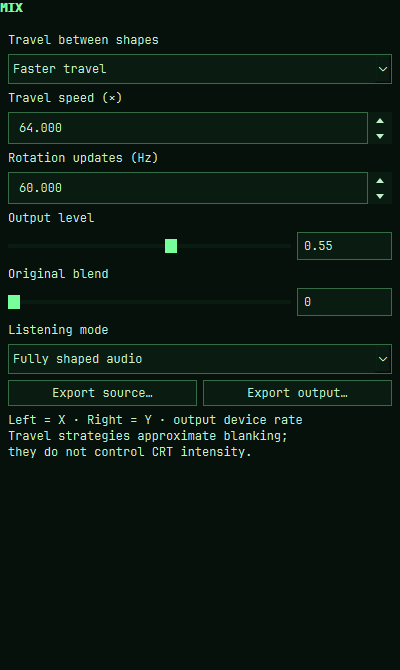
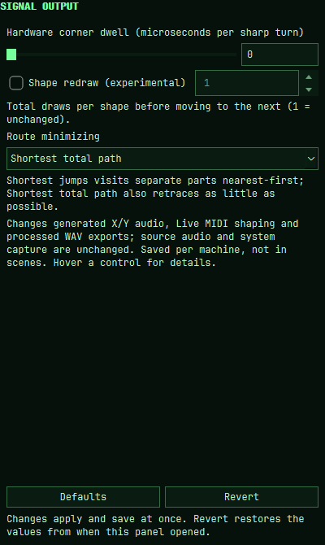

# 9. Mix, signal output and export

Use **Mix** to set travel, pose-update rate, levels and the signal you listen to. Use **Signal output** for machine calibration that changes generated X/Y audio. Offline export renders source or processed stereo WAV or FLAC files; Live MIDI uses performance recording instead.

## 9.1 The Mix panel

*Mix settings belong to the scene; signal calibration is saved separately.*

| Control | Range or choices | Default and purpose |
| --- | --- | --- |
| **Travel between shapes** | No changes; Faster travel; Nearest-shape ordering; Retrace existing edges | **No changes**. Chooses how the continuous beam connects scene parts. |
| **Travel speed (×)** | 1–128, then **Instant** | 8. With Faster travel, reduces time spent on travel. Type `instant` or a value above 128 for zero-time jumps. |
| **Rotation updates (Hz)** | 1–240 | 60. Sets pose evaluation frequency, separate from source pitch and display refresh. |
| **Output level** | 0–0.95 | 0.55. Scales the selected playback signal and processed export. |
| **Original blend** | 0–1 | 0. At 0, Processed output is fully shaped; at 1, it is original source audio. |
| **Listening mode** | Processed output; Fully shaped audio; Original audio | Processed output. Selects what playback sends to the output and monitor. |
| **Export source…** | Save dialog | Exports the source without shaping or Output level scaling. |
| **Export output…** | Save dialog | Exports the processed mix. |

Double-click level/blend sliders to restore their defaults, or type a value. In Composer, right-click **Output level** or **Original blend** to add automation; see [Composer](08-composer.md).

## 9.2 Travel strategies

**No changes** preserves the scene's normal connection path. **Faster travel** keeps that path but gives its connecting segments less time, according to **Travel speed (×)**. At **Instant**, connecting jumps take no time.

**Nearest-shape ordering** tries visiting nearby parts first and keeps the original plan if its proposed connections would be longer. **Retrace existing edges** puts some travel along existing shape edges before connecting to the next part.

These are stereo-only travel strategies. They do not send CRT intensity control or provide true blanking, so travel can remain visible on a physical scope. They are separate from **Route minimizing**, which plans the path inside each shape.

## 9.3 Listening modes and clipping

| Listening mode | Signal sent to speakers/scope and shown by the monitor |
| --- | --- |
| **Processed output** | Output level × ((1 − Original blend) × shaped drawing + Original blend × original source). |
| **Fully shaped audio** | Shaped drawing × Output level; ignores Original blend for listening. |
| **Original audio** | Original source × Output level; ignores Original blend for listening. |

The original is the selected source synth, not an external recording. The shaped signal follows the geometry and its envelope. The left output remains X and the right output remains Y.

Playback clips values outside −1 to +1. Large objects, position offsets, voice mixing and gain can push samples beyond this range even when Output level is below 1. Lower **Output level** to reduce clipping. **Appearance › Monitor › Signal gain** and phosphor brightness affect the display only; they do not correct clipped audio.

Processed offline export always renders the processed mix, regardless of **Listening mode**. To export fully shaped audio, set **Original blend** to 0. **Export source…** writes the unscaled original source; selecting **Original audio** for listening still applies Output level during playback. A Live MIDI performance recording follows the listening mode actually being played.

## 9.4 Signal output calibration

*These machine preferences change the generated signal, independently of scene files.*

Open **Signal output** in the application bar, or **Preferences › Signal output…**. Both contain the same signal controls:

| Control | Range / default | Behaviour |
| --- | --- | --- |
| **Output device** | System default (default), or a connected output device | Where playback plays. See [Output device](#output-device). |
| **Hardware corner dwell (microseconds per sharp turn)** | 0–500 µs; default 0 | Holds at sharp turns while preserving source-cycle timing. Total dwell is capped at 25% of a cycle. |
| **Shape redraw (experimental)** | Off by default | Repeats each drawable shape before moving to the next. |
| Redraw count | Integer 1–32; default 1 | Total draws per shape, not additional draws. Enabled when Shape redraw is checked; 1 leaves the signal unchanged. |
| **Route minimizing** | Off; Shortest jumps; Shortest total path | Default **Shortest total path**. Plans each shape's own beam route. |
| **Switch sweep (0–50 milliseconds; 0 = hard switch)** | 0–50 ms; default 5; 0 = the hard switch | How long an object takes to leave or rejoin the beam path when it switches off or on. |
| **Output sample rate** | Follow device (default); 44.1, 48, 88.2, 96, 176.4 or 192 kHz | The rate playback opens the audio device at. See [Output sample rate](#95-output-sample-rate). |

Corner dwell brightens corners and speeds up the remaining edges, which can change timbre. High notes or many corners can shorten the requested hold. One sample lasts about 20.83 µs at 48 kHz or 10.42 µs at 96 kHz, so a short hold may receive no sample. Start at 0 and increase gradually against your physical scope. Dwell does not necessarily correct DAC filtering or X/Y phase error.

Shape redraw applies only with multiple drawable shapes; motion guides do not count, while builder components do. Repeats fit inside the existing source cycle without changing pitch or motion timing, leaving fewer samples per individual trace. With one drawable shape, or count 1, the signal stays unchanged. If a complex scene exceeds the bounded redraw capacity, the status reports **Redraw inactive** and uses a single pass until you reduce count or complexity.

**Off** preserves original routes. **Shortest jumps** visits separate parts nearest-first. **Shortest total path** also minimizes retracing. A plan replaces a shape's original route only when shorter; scene object order is unchanged. Route minimizing applies to every shape type and can change existing scenes' sound.

Switch sweep removes the click when an object switches off or on: by **M** or **S** while playing, by an On/Off lane, or at the edge of a muted clip. Instead of a hard cut, the object's Path Trace sweeps to zero (and its share of the cycle with it) before it leaves the beam path, and sweeps back up when it returns; a transform step's On/Off or power icon crossfades its effect over the same time. Automated switches (lanes, muted clips) sweep identically in playback and export. A switch you make while playing crossfades from the moment you click, in playback only. 0 restores the hard switch.

These preferences affect generated playback, Live MIDI shaping and processed audio export. They leave source audio and system capture unchanged. They are stored in `signal-preferences.json` per machine, outside scene files.

The side panel applies and saves edits immediately. **Defaults** restores factory values; **Revert** restores the values from when the panel opened. The dialog previews edits; **Apply** saves, **OK** saves and closes, and **Cancel** restores the last applied baseline. See [The interface](02-interface.md#25-preferences-dialogs-and-side-panels).

## 9.5 Output sample rate

Playback renders at the output rate, shown in the status strip (for example **96 kHz stereo XY**). The signal engine uses that rate rather than assuming 48 kHz. **Output sample rate** in Signal output chooses it:

- **Follow device** (the default) opens the device at its own rate, so the system doesn't resample the generated signal. This is how every earlier version played.
- **44.1, 48, 88.2, 96, 176.4 or 192 kHz** opens the device at that rate. 192 kHz is the highest choice. A rate above your interface's own (for example 192 kHz on a 96 kHz interface) is converted by the system on Windows and macOS, so the scope receives at most the interface's rate.

The choice applies from the next **Play**. If the device can't open at the chosen rate, playback uses the device rate instead and the status strip says so, for example **Output rate 192 kHz is not available on this device; playing at 96 kHz.** Live MIDI keeps its lowest-latency output: it would rather play at the device rate on WASAPI exclusive (Windows) or the Core Audio callback (macOS) than at the chosen rate on a slower path.

Scene files retain 48 kHz. Offline exports render at the rate chosen in the export dialog, which offers the same rates up to 192 kHz; playback and export at the same rate give the same samples.

Playback is computed in blocks of 10 milliseconds at any rate (441 frames at 44.1 kHz, 1,920 at 192 kHz), so higher rates and fast displays don't starve the audio. If the audio still falls behind, the display waits briefly between frames, down to 30 frames a second, until the audio has caught up.

Live MIDI on Windows tries WASAPI exclusive output before shared output and fallback settings. See [Sources and input](03-sources-and-input.md#36-live-midi) for device and latency details, or **About › Audio troubleshooting** for platform guidance.

### Output device

**Output device**, at the top of Signal output, chooses where all playback goes: scene and Composer playback, Live MIDI, cycle audition and the browser's file preview. System capture and exports are unaffected. The list opens with **System default**, then the connected output devices: the Core Audio devices on macOS, and the WASAPI devices on Windows (one entry per device, as in the Windows Sound settings). The list is read again each time you open it, so a device you just plugged in is there.

- **System default** (the default) follows the system's output, also while playing. Switch the output in the system (for example to headphones) and playback moves there within about a second, after a brief gap, and carries on from the same position.
- **A named device** plays there whatever the system default is. Choosing another device while playing moves playback to it at once.
- **A device that is not connected** stays chosen and is marked **(not connected)** in the list. Playback uses the system default meanwhile, and the status strip says so, for example **USB DAC is not connected; playing on the system default.** The device is used again from the next **Play** once it is back. If a device goes away while playing, playback moves to the system default.

When playback moves, the status strip says where, for example **Output moved to MacBook Pro Speakers.** It keeps its sample rate until you stop: if the new device runs at another rate, the system converts, and the next **Play** opens at the new device's own rate (with **Follow device**). The choice is saved per machine, in `signal-preferences.json`.

## 9.6 Exporting a Sandbox scene

1. Choose **Generated scene / MIDI** in Input and a **Scale**, **MIDI file** or **Single tone** source.
2. Set the scene and Mix controls. For processed export, check **Original blend** and **Output level**, and any machine signal preferences.
3. Click **Mix › Export source…** or **Export output…**. The File equivalents are **Export source…** and **Export processed…**.
4. Choose **Format** (WAV or FLAC), **Bit depth** (16 or 24 bits, or 32-bit float for WAV) and **Sample rate** (44.1, 48, 88.2, 96, 176.4 or 192 kHz). The estimated size updates as you change choices; FLAC shows the size before compression because its final size depends on the signal. At 192 kHz, 24-bit stereo uses about 66 MiB per minute before compression.
5. Click **OK**, then choose a destination. The app supplies `.wav` or `.flac` and displays **EXPORTING AUDIO…** while rendering. Wait for completion before exiting. **Cancel** leaves the export unwritten. Your last choices are remembered in editor preferences.

Exports are stereo, with left = X and right = Y. Integer samples are clipped to ±1 before conversion. Defaults are 16-bit WAV at 48 kHz. Without the soundfile dependency, 16/24-bit WAV remains available; FLAC is disabled with an explanatory tooltip, and float WAV is unavailable. Export renders from time zero: one pass of the scale or MIDI-file source, or 10 seconds for Single tone. It does not record how long you happened to play the scene.

**Export source…** bypasses shaping, Original blend, Output level and signal calibration. **Export output…** applies the processed mix and machine calibration. Appearance is never baked into audio.

Live MIDI requires **Record…** / **Record MIDI performance…** instead of offline export. System audio is visualization only and cannot be exported or recorded. Video input cannot be exported as X/Y WAV. See [Sources and input](03-sources-and-input.md).

## 9.7 Composer exports

In Composer, the File menu offers **Export notes…** and **Export song…**. The same format, depth and rate choices apply. **Range** chooses **Whole song**, including silent gaps, or **Loop range**, from the loop start to loop end even when playback looping is off. Neither choice is limited to the selected clip. **Export notes…** writes the original note source; **Export song…** writes the shaped song output with machine signal preferences. See [Composer](08-composer.md) for song length, clips, notes and automation.

## 9.8 Exporting video

Choose **File › Export video…** to render a whole Composer song, or a chosen number
of seconds of the Sandbox scene, with stereo audio. Playback pauses during export.
System audio, live MIDI and video-file monitor inputs cannot be exported this way.

Install [ffmpeg](https://ffmpeg.org/download.html) separately. Add it to PATH, or open
**Preferences › Export**, enter its executable in **ffmpeg location** (or use
**Browse…**), and press **Test** to see its version. An empty location uses PATH;
on macOS it also finds Homebrew and MacPorts installs (`brew install ffmpeg`), even when
phosphor was opened from Finder. If ffmpeg is missing, Export video explains where to get it.

Choose **1080 × 1080**, **1920 × 1080** or **3840 × 2160**, at **30** or **60** frames
per second. The picture stays square and centred, with background bands in wide
frames. Video uses the current **Appearance**, including palette, graticule, phosphor,
beam and glow. Beam size, glow and brightness follow the picture size, so an export
matches the monitor in proportion at any resolution, whatever size your window is.

**MP4 / AAC 320k** is the default for sharing. **MKV / FLAC lossless** keeps lossless
audio and requires soundfile. Both use H.264 video and 48 kHz audio, prepared from a
24-bit temporary audio file. Progress shows the rendered frames. **Cancel** removes
the partial export; the destination is replaced only when encoding succeeds.

**Encoder** chooses how the H.264 video is encoded:

- **Auto** uses NVIDIA NVENC on Windows when present. On macOS it uses x264,
  which measured faster than VideoToolbox on Apple silicon.
- **Hardware** tries NVIDIA NVENC, AMD AMF or Intel Quick Sync on Windows, or
  Apple VideoToolbox on macOS.
- **Software** uses x264.

If a hardware encoder is missing or fails, even during export, phosphor automatically
falls back to x264 and restarts the export.

Video rendering starts while the song's audio is still being prepared. Frames are
converted to YUV on the graphics card, and the audio is added in a short final step
shown as **Finishing video…**.
