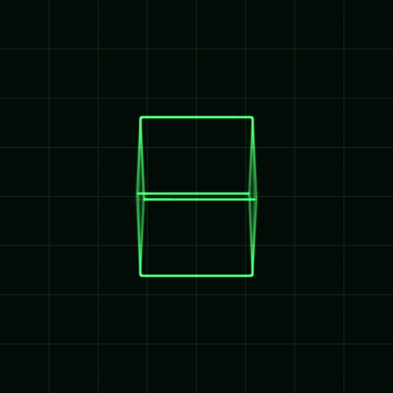
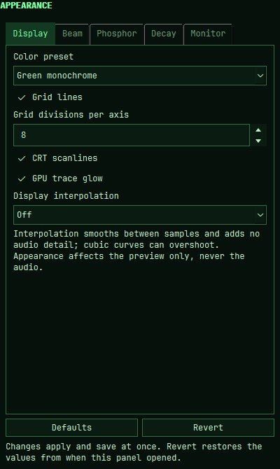
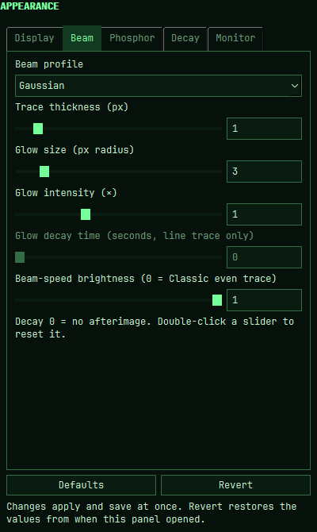
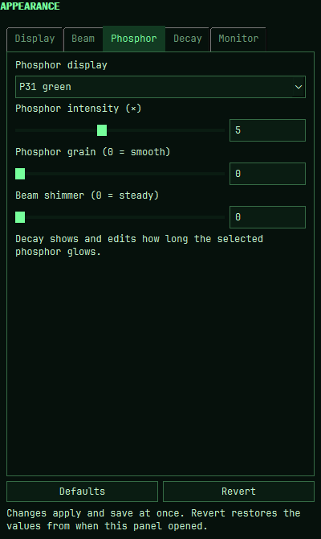
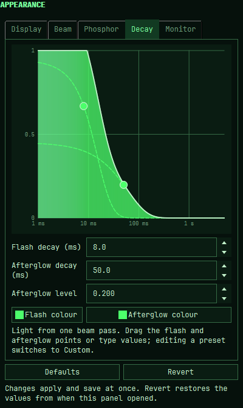
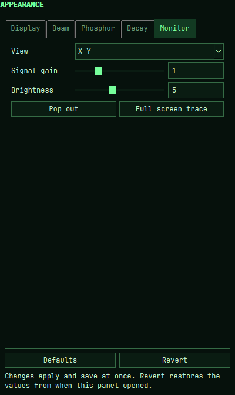
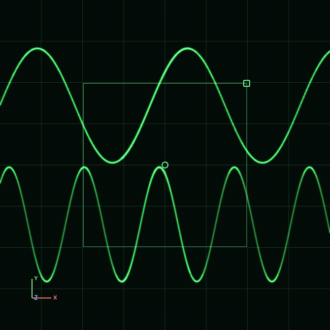
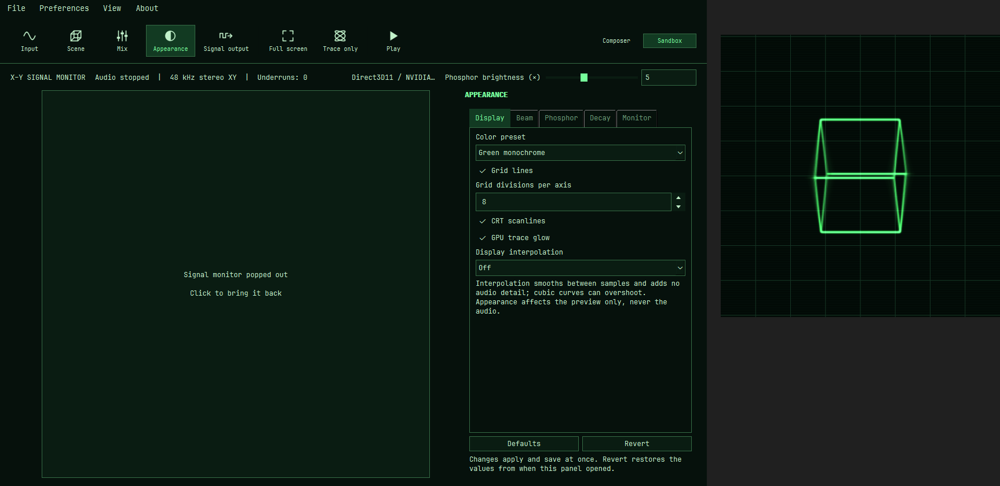

# 10. Display and monitor

[Exporting video](09-mix-output-and-export.md#98-exporting-video) uses the current Appearance.

The signal monitor is phosphor's built-in oscilloscope. It shows the same stereo signal you
hear, drawn by a simulated electron beam on a simulated phosphor screen. Everything in this
chapter changes **only the picture**, never the audio: the **Appearance** panel (colours,
grid, beam, phosphor and decay), the **Monitor** tab (X–Y or time view, display gain), the
pop-out window and the full-screen views. Settings that change the actual signal are in
[Mix, signal output and export](09-mix-output-and-export.md).

## 10.1 The monitor

The monitor sits left of the side panel. In normal editing it is square and centred; the
grid divides it into equal parts on both axes, and the full scale of the signal (±1) reaches
near the edges.

- The heading above it names the view: **X–Y SIGNAL MONITOR**, **X(t), Y(t) TIME VIEW**, or
  **RASTER CRT · 60 Hz** for a video file.
- In the Sandbox, each object shows a **centre handle** (a small circle) and the selected
  object a **corner handle** (a small square). Drag a centre to move an object; drag the
  selected corner to resize it. See [Objects and scenes](04-objects-and-scenes.md).
- A small X/Y/Z axis marker in the lower left shows the current view's orientation.
- The **Phosphor brightness (×)** slider above the monitor is the same setting as
  **Appearance › Phosphor › Phosphor intensity (×)** and **Appearance › Monitor ›
  Brightness**; it is saved as soon as it settles.

*A cube on the P31 green phosphor: bright lines where the beam moves slowly, faint where it moves fast.*

## 10.2 Appearance

Open **Appearance** in the application bar. The side panel applies and saves every change at
once; **Defaults** restores the factory settings and **Revert** restores the values from
when the panel was opened. **Preferences › Appearance…** opens the same settings as a dialog
that previews changes and keeps them only on **OK** or **Apply** (**Cancel** restores them;
**Restore Defaults** resets them).

*Appearance › Display.*

### Display

| Control | Choices / range | What it does |
|---|---|---|
| **Style** | Classic | Choose Classic for controls in the scope palette or Modern for rounded controls with the system font and blue accents. The scope keeps its colour preset, phosphor and glow. phosphor remembers your choice on this computer. |
| **Mode** | System | Appears under Style when Modern is selected. System follows changes to the operating system’s appearance while phosphor is running. Choose Dark or Light to keep that appearance. |
| **Display rate** | Match monitor (default), 60 Hz | Match monitor follows the screen showing the scope, including the pop-out. Choose 60 Hz for comparison or slower machines; it prepares a new frame every 1/60 second on a precise timer. Phosphor brightness, flash/afterglow balance, fade and shimmer are normalized to the 60 Hz look at any rate. The status bar shows the measured fps: new frames that actually reached the screen. |
| **Color preset** | OLED white, Green monochrome, Amber, Cyan, macOS Graphite | Sets the colours of the monitor, grid and controls. The preset also supplies the trace colour for Palette colour phosphor and the line trace. OLED white uses pure black. macOS Graphite uses charcoal surfaces and muted blue accents. |
| **Grid lines** | on / off | The measuring grid on the monitor. |
| **Grid divisions per axis** | 2–64 | How many squares the grid has across and down. |
| **CRT scanlines** | on / off | Faint horizontal lines like a CRT's raster. |
| **GPU trace glow** | on / off | The soft halo around the trace on the line trace. |
| **Display interpolation** | Off, Cubic 4x, Cubic 8x | Draws smooth curves between samples on the monitor. It adds no audio detail, and cubic curves can overshoot sharp corners. |

### Beam

*Appearance › Beam.*

| Control | Range (default) | What it does |
|---|---|---|
| **Beam profile** | Hard edge, Gaussian | A hard-edged line, or a beam whose brightness falls off smoothly from its centre like a real electron beam. |
| **Trace thickness (px)** | 0.5–6 (1) | The width of the beam, in pixels at a scope short side of 720 logical pixels. |
| **Glow size (px radius)** | 0–36 (12) | How far the glow (bloom) spreads, in pixels at a scope short side of 720 logical pixels. |
| **Glow intensity (×)** | 0–3 (1) | How strong that glow is. |
| **Glow decay time (seconds, line trace only)** | 0–2 (0) | An afterimage for the plain line trace (phosphor **Off**). 0 = none. |
| **Beam-speed brightness (0 = Classic even trace)** | 0–1 (1) | At 1, the trace is brighter where the beam moves slowly and dimmer where it moves fast, as on a real scope. At 0, every part is equally bright. |

Thickness, glow, brightness, grain and shimmer follow the scope's size. Resizing the
window, full screen, the pop-out monitor and video export all look the same in
proportion, at any display scaling. The pixel values above apply when the scope's
short side is 720 pixels; a larger scope draws them proportionally larger.

Double-click any slider to reset it.

### Phosphor

*Appearance › Phosphor.*

**Phosphor display** chooses how the screen glows after the beam passes:

| Phosphor | Look |
|---|---|
| **Off (line trace)** | No phosphor: the last 40 ms of signal drawn as a line (with optional Glow decay). |
| **Palette colour** | A short glow in the colour preset's trace colour. |
| **P31 green** | The default phosphor. It gives the classic oscilloscope trace a quick green flash and a short green afterglow. |
| **P1 yellow-green** | A slightly longer, warmer afterglow. |
| **P7 blue / long yellow** | A blue flash that fades into a long yellow afterglow, as on radar screens. |
| **Custom** | Your own decay, edited in the **Decay** tab. |

| Control | Range (default) | What it does |
|---|---|---|
| **Phosphor intensity (×)** | 0.1–64 (5) | Overall brightness of the phosphor picture (the brightness slider above the monitor). |
| **Phosphor grain (0 = smooth)** | 0–1 (0) | A fixed fine texture, like the grain of a real phosphor coating. |
| **Beam shimmer (0 = steady)** | 0–1 (0) | A slight flicker in the beam's brightness. |

### Decay

*Appearance › Decay: the decay plot with the flash and afterglow points.*

The plot shows the light from one pass of the beam over time: a bright **flash** that fades
quickly, then a dimmer **afterglow** that fades slowly. Drag the flash and afterglow points,
or type values:

| Field | Range |
|---|---|
| **Flash decay (ms)** | 1–1000 |
| **Afterglow decay (ms)** | 1–5000 |
| **Afterglow level** | 0–1 (relative to the flash) |

The two colour buttons choose the flash and afterglow colours. Editing a preset switches the
phosphor to **Custom**.

## 10.3 Appearance › Monitor

*Appearance › Monitor: the view, display gain, brightness, time-view controls and the pop-out.*

| Control | Range (default) | What it does |
|---|---|---|
| **View** | X–Y, Time: X(t), Y(t) | X–Y draws the picture. Time draws both channels against time, like a dual-trace scope. Not available for **Video file** input. |
| **Signal gain** | 0–32× (1) | Scales the monitor's picture for every input. Display only: the audio is never changed. Double-click to reset. |
| **Brightness** | 0.1–64 (5) | The phosphor brightness (the same setting as above the monitor). |
| **Separation** | 0–1 (0) | Time view: moves the X trace up and the Y trace down from the centre line, so they do not overlap. |
| **Window (ms)** | 0.1–2000 (20) | Time view: how much time one sweep across the screen shows. |
| **Trigger** | X, Y, Both; Rising, Falling | Time view: each sweep starts when the trigger channel crosses zero in the chosen direction, so a repeating wave stands still. Without a crossing the sweep free-runs. **Both** gives each trace its own trigger: both stand still even at unrelated frequencies, but their timing can no longer be compared. |
| **Pop out** | | Moves the monitor into its own window (see below). |
| **Full screen trace** | | Shows the trace alone, full screen on one screen. |

### The time view

*Time: X(t) above and Y(t) below, separated by 0.4, a 20 ms window, triggered on X rising.*

The time view works for every input except video:

- **Generated scenes** (Sandbox, stopped or playing): the signal the scene makes, sample by
  sample.
- **Composer**: the song while it plays; when stopped, the 40 ms at the playhead, repeated.
- **System audio**: the captured audio.

To see a waveform stand still, choose a **Window (ms)** of a few periods (at 110 Hz one
period is about 9 ms, so 20–40 ms shows two to four) and trigger on the channel with the
clearest zero crossings.

## 10.4 Pop-out monitor

Move your mouse to the monitor's **top-right corner**: two buttons appear.

- **Pop out** (a square with an arrow) moves the monitor into its own window. Move it,
  resize it, or put it on another screen. While it is out, the main viewport shows **Signal
  monitor popped out — Click to bring it back**.
- **Full screen** (four corners) shows the trace alone on one screen.

The pop-out window has its own corner buttons: **Return** (back into the main window) and
**Full screen** / **Exit full screen**. Closing the pop-out window also brings the monitor
back.

*The main window with the monitor popped out (left), and the pop-out window (right).*

- The pop-out is a **view only**: object handles appear only in the main window, so move
  and resize objects there (or with Position and Size).
- The phosphor afterglow restarts when the monitor moves between windows.
- **Trace only** (View menu) brings the monitor back into the main window first.
- phosphor remembers where the pop-out was and whether it was open, and reopens it there
  next time. If that screen is gone, the window is moved back onto a screen.

## 10.5 Full screen, Trace only and the full-screen trace

There are three ways to make the picture bigger:

| View | How | What you see |
|---|---|---|
| **Full screen** (View menu, application bar) | Control-Command-F / F11 | The whole app window, full screen, with all its controls. |
| **Trace only** (View menu, application bar) | Shift-Command-F / Ctrl+Shift+F | Only the monitor, filling the window's screen: menus, panels, status and editing overlays are hidden, and the mouse pointer is hidden over it. |
| **Full screen trace** (monitor corner, Appearance › Monitor) | | The pop-out, borderless, filling one screen. The main window stays usable, on another screen if you have one. |

**Escape** leaves any of them and restores the previous window exactly. On a Mac, the
full-screen trace covers the menu bar and the Dock and runs up to the top edge around the
camera notch; it does not create a separate macOS Space.

## 10.6 Video file monitor

With **Input › Monitor input › Video file (phosphor CRT)**, the monitor becomes a raster CRT:
the video is drawn as 60 Hz fields of scanlines into the same phosphor, so decay, beam blur,
glow and grain apply. Choose the number of scan lines in the Input panel; the picture is
letterboxed in the square monitor. The time view is not available for video. See
[Sources and input](03-sources-and-input.md).

## 10.7 Tips

- **A dim or invisible trace**: raise **Phosphor intensity**, or the scene's **Mix › Output
  level**. Very fast lines are dim by design (Beam-speed brightness); set it to 0 for an even
  trace.
- **Smeared motion**: shorten the decay (a faster phosphor, or a smaller Afterglow level).
- **Matching a real scope**: Hard edge or Gaussian beam at thickness 1–2, P31 green, Grid on,
  8 divisions.
- **Recording a video of the monitor**: use the full-screen trace on a second screen at a
  steady size; the phosphor responds to the display's frame rate.
- Appearance never changes exported or played audio.
