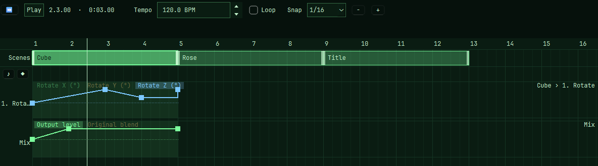
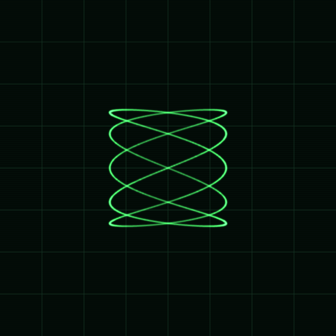
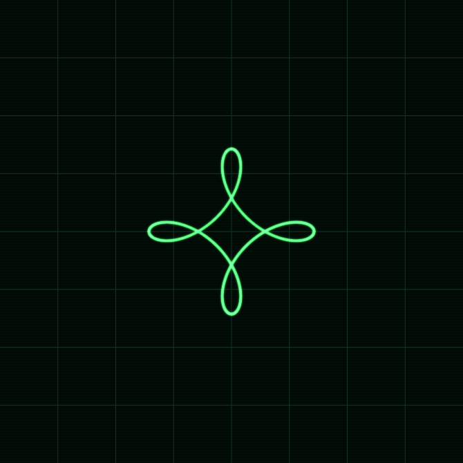
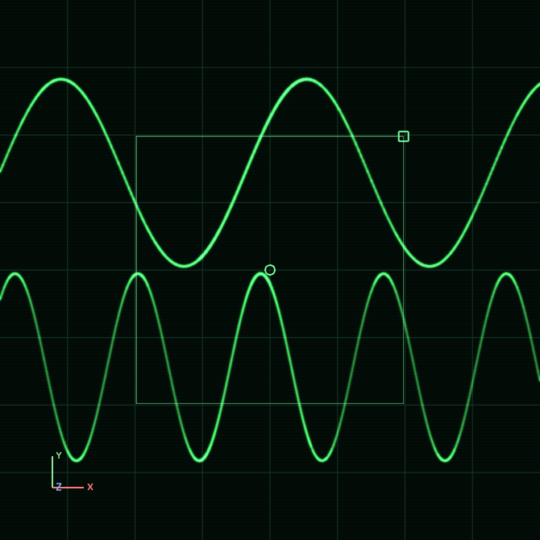
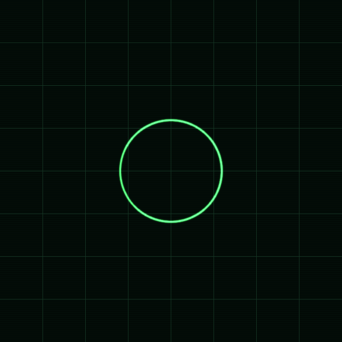

# 11. Cookbook

These recipes combine scenes, notes, expressions and automation into musical visuals. Start with a new clip or Sandbox scene for each recipe, then bring the useful results into your project.

## 11.1 Before you start

For Composer recipes, select **Composer**, select a clip, and add an object through **Scene › Objects › Add object**. Draw a sustained note in the **♪** note roll across the part you want to hear; without a note, even a populated clip is silent. Use **Length** to give the clip enough bars. Four bars are 16 beats. Set **Mix › Listening mode** to **Fully shaped audio** to hear the drawing.

For an expression, right-click its field, choose **Time varying…**, type the expression and press Enter. For a lane, set the stated base value first, right-click **Automate**, then edit its nodes in the **◆** transform roll. A node's **Linear to next** or **Hold to next** menu controls the following segment. The listed beat numbers are relative to the clip start, not song position. Hold **Command / Ctrl** to override reference-line snapping when needed.

All lane values below are gains in −1…1: they multiply the field's base value or expression. A missing lane has gain 1; a lane holds its first gain before its first node and its last gain after its last node. There are at most 256 nodes per lane, two at any one beat, and beats must lie in 0…100,000. The shortened spec keys identify a field on the recipe's selected object; transform indices start at zero. Actual engine lane addresses also include the object index, as described by `lane_access.py`. See [Composer](08-composer.md), [Parametric equations](06-parametric-equations.md) and [Transforms](07-transforms.md).

*Gain lanes shape the selected clip's numbers.*

## 11.2 A cube that turns once per beat

1. Add **Cube** and open **Scene › Transform**.
2. Choose **Add › Rotate**. Set **Z (°)** to the expression `360*p`.
3. Play the clip and change **Tempo**: the cube still completes one revolution per beat. Rotate expressions can exceed the static ±180° slider range.
<!-- example: {"id":"cook-beat-turn","kind":"transform","object":"Cube","steps":[{"transform":"Rotate","fields":{"z":"360*p"}}]} -->

## 11.3 Draw a scene on over four bars

1. Use a four-bar clip containing a Cube and a sustained note.
2. In **Scene › Objects › Path**, set **Start** to 0 and **Trace** to 1.
3. Right-click **Trace › Automate**. Set gain 0 at beat 0 and gain 1 at beat 16, with **Linear to next** on the first node.
4. Play: the route grows from hidden to complete. The partial route keeps its share of each note cycle; its return travel may remain visible.
<!-- example: {"id":"cook-draw-base","kind":"path","object":"Cube","start":"0","trace":"1"} -->
<!-- example: {"id":"cook-draw-lane","kind":"lane","key":"path:path_trace","points":[[0,0,"linear"],[16,1,"hold"]]} -->

## 11.4 Fade a clip in and out

1. Select a four-bar clip and open **Mix**.
2. Set **Output level** to 0.8, then right-click it and choose **Automate**.
3. Set gains 0 at beat 0, 1 at beat 2, 1 at beat 14 and 0 at beat 16. Use Linear segments.
4. Keep **Original blend** at zero if you want the whole audible output to follow this drawing fade. Lower Output level also shrinks the actual X–Y signal.
<!-- example: {"id":"cook-fade","kind":"lane","key":"mix:drawing_gain","points":[[0,0,"linear"],[2,1,"linear"],[14,1,"linear"],[16,0,"hold"]]} -->

## 11.5 Snap to a new pose on the drop

1. Add **Rotate** to a Cube and set **Z (°)** to static 90.
2. Right-click **Z (°) › Automate**.
3. Set beat 0 gain 0 with **Hold to next**, then beat 8 gain 1 with **Hold to next**. The cube snaps by 90° at the drop.
4. For an instantaneous jump after a ramp, a lane may instead have two nodes at beat 8: the earlier node ends the ramp at 0 and the later node sets 1. Segment drags can create these jump pairs; three nodes at a beat are refused.
<!-- example: {"id":"cook-drop-pose","kind":"transform","object":"Cube","steps":[{"transform":"Rotate","fields":{"z":90}}]} -->
<!-- example: {"id":"cook-drop-hold","kind":"lane","object":"Cube","steps":[{"transform":"Rotate","fields":{"z":90}}],"key":"transform:0:z","points":[[0,0,"hold"],[8,1,"hold"],[16,1,"hold"]]} -->
<!-- example: {"id":"cook-drop-pair","kind":"lane","object":"Cube","steps":[{"transform":"Rotate","fields":{"z":90}}],"key":"transform:0:z","points":[[0,-0.5,"linear"],[8,0,"linear"],[8,1,"hold"],[16,1,"hold"]]} -->

## 11.6 Pulse the size on every beat

1. Add **Scale** to a Cube.
2. Set each of **X (×)**, **Y (×)** and **Z (×)** to `0.7+0.2*cos(tau*p)`.
3. Play. All axes pulse together between 0.5 and 0.9, once per beat. Use final **Size** for overall framing.
<!-- example: {"id":"cook-size-pulse","kind":"transform","object":"Cube","steps":[{"transform":"Scale","fields":{"x":"0.7+0.2*cos(tau*p)","y":"0.7+0.2*cos(tau*p)","z":"0.7+0.2*cos(tau*p)"}}]} -->

## 11.7 Change a Lissajous ratio over a section

1. Add **Parametric equation**. Click **Add variable**, name it `a`, set **min** 1, **max** 5 and **value** 5.
2. Enter X `0.7*sin(a*tau*s)` and Y `0.7*sin(2*tau*s)`.
3. Right-click variable **value › Automate**. Set hold gains 0.4 at beat 0, 0.6 at beat 4, 0.8 at beat 8 and 1 at beat 12.
4. Play: the X:Y ratios are 2:2, 3:2, 4:2 and 5:2. Hold segments preserve integer ratios; ramps produce open intermediate curves with visible return travel.

*The equation at its base ratio of 5:2.*
<!-- example: {"id":"cook-ratio","kind":"equation","x":"0.7*sin(a*tau*s)","y":"0.7*sin(2*tau*s)","variables":[{"name":"a","value":5,"low":1,"high":5}]} -->
<!-- example: {"id":"cook-ratio-lane","kind":"lane","key":"variable:a","x":"0.7*sin(a*tau*s)","y":"0.7*sin(2*tau*s)","variables":[{"name":"a","value":5,"low":1,"high":5}],"points":[[0,0.4,"hold"],[4,0.6,"hold"],[8,0.8,"hold"],[12,1,"hold"],[16,1,"hold"]]} -->

## 11.8 Scroll a text message

1. Add **Text**. Enter a short message in **Text to trace** and press Enter.
2. Open **Transform**, choose **Add › Translate**, and set **X** to `1.5-3*(p%8)/8`.
3. Set final **Size** small enough to frame your message. Translation is also multiplied by Size, so adjust the 1.5 and 3 constants if you need more travel.
4. Play: the message travels left over eight beats, then resets to the right. Use a shorter message if strokes become dim or crowded.
<!-- example: {"id":"cook-scroll","kind":"transform","object":"Text","steps":[{"transform":"Translate","fields":{"x":"1.5-3*(p%8)/8"}}]} -->

## 11.9 Make a half-beat strobe

1. Select a clip and set **Mix › Output level** to 0.8; keep **Original blend** at zero.
2. Choose **Output level › Automate** and **Snap › 1/8**.
3. Set gains 1, 0, 1, 0, 1 at beats 0, 0.5, 1, 1.5, 2. Set **Hold to next** on each node.
4. Extend the pattern by selecting its nodes, **Command-C / Ctrl+C**, moving the playhead, clicking the same lane and using **Command-V / Ctrl+V**. A zero output level collapses the signal to the centre; it is not hardware beam blanking.
<!-- example: {"id":"cook-strobe","kind":"lane","key":"mix:drawing_gain","points":[[0,1,"hold"],[0.5,0,"hold"],[1,1,"hold"],[1.5,0,"hold"],[2,1,"hold"]]} -->

## 11.10 Build up rotation vibrato

1. Add **Rotate** to a Cube and set **Z (°)** to `30*sin(4*tau*p)`.
2. Right-click that expression and choose **Automate**.
3. Set gain 0 at beat 0, 1 at beat 8, and 1 at beat 16, using a Linear first segment.
4. Play: the four-cycles-per-beat wobble grows from still to ±30°. The lane multiplies the expression; it does not replace its angle.
<!-- example: {"id":"cook-vibrato","kind":"transform","object":"Cube","steps":[{"transform":"Rotate","fields":{"z":"30*sin(4*tau*p)"}}]} -->
<!-- example: {"id":"cook-vibrato-lane","kind":"lane","object":"Cube","steps":[{"transform":"Rotate","fields":{"z":"30*sin(4*tau*p)"}}],"key":"transform:0:z","points":[[0,0,"linear"],[8,1,"hold"],[16,1,"hold"]]} -->

## 11.11 Alternate two objects

1. Add two objects, for example **Cube** and **Parametric equation** (its default circle is sufficient). Give them modest Size and separate positions.
2. Select the Cube in **Objects**, set **Path › Trace** to 1, and automate it with hold gains 1 at beat 0, 0 at beat 1, 1 at beat 2, 0 at beat 3 and 1 at beat 4.
3. Select the equation object and automate its Trace with the complementary gains 0, 1, 0, 1, 0 at the same beats.
4. Play. Zero Trace hides that object's route. Repeat the pattern for a longer section. Each lane belongs to its own object, even though the shortened spec keys match.
<!-- example: {"id":"cook-alternate-cube","kind":"lane","key":"path:path_trace","points":[[0,1,"hold"],[1,0,"hold"],[2,1,"hold"],[3,0,"hold"],[4,1,"hold"]]} -->
<!-- example: {"id":"cook-alternate-circle","kind":"lane","key":"path:path_trace","points":[[0,0,"hold"],[1,1,"hold"],[2,0,"hold"],[3,1,"hold"],[4,0,"hold"]]} -->

## 11.12 Evolve a spirograph

1. Add **Parametric equation** and a variable `a`, value 0.2, min 0.05, max 0.3.
2. Right-click its **value › Time varying…** and enter `0.175+0.125*sin(tau*p/16)`.
3. Enter X `0.45*cos(tau*s)+a*cos(3*tau*s)` and Y `0.45*sin(tau*s)-a*sin(3*tau*s)`.
4. Play a four-bar section. The counter-rotating harmonic's radius evolves over 16 beats without changing its integer winding ratio.

*A snapshot of the changing harmonic radius.*
<!-- example: {"id":"cook-spirograph","kind":"equation","x":"0.45*cos(tau*s)+a*cos(3*tau*s)","y":"0.45*sin(tau*s)-a*sin(3*tau*s)","variables":[{"name":"a","value":0.2,"low":0.05,"high":0.3,"expression":"0.175+0.125*sin(tau*p/16)"}]} -->

## 11.13 Arrange three clips and repeat the chorus

1. Start with a four-bar clip and build an intro scene. Draw notes across its four bars.
2. Click **Add clip** for a second four-bar clip. Build a contrasting verse scene and draw its notes.
3. Click **Add clip** again for a third clip. Build the chorus and draw its notes. The new clips are empty until you add objects.
4. Click the chorus clip last, then **Command-C / Ctrl+C**. Click the ruler at its end and use **Command-V / Ctrl+V**. The copied scene, transforms, variables and mix lanes become another clip.
5. Copy its notes separately: switch to **♪**, Shift-click the chorus notes, copy, move the playhead to the repeat and paste. Notes live in the song roll, rather than inside the copied clip.
6. Use **File › Save project** to save the arrangement. Clips cannot overlap; leave room for the repeat before another clip.

## 11.14 Export a loop for a video soundtrack

1. Build a four-bar Composer project containing only the intended loop, with notes covering it.
2. Use beat-periodic expressions whose periods divide 16, such as the four-beat orbit below. **Shift-drag** the ruler across the clip and enable **Loop** to audition the join.
3. Check **Mix › Output level**, **Original blend** and **Listening mode**, because these affect the exported song.
4. Choose **File › Export song WAV…** and save the stereo WAV. This exports the whole song, not merely the transport Loop selection; use a project of the intended length.
5. Import the WAV into your video editor. This command exports audio; it does not produce a movie. For a picture recording workflow, see [Mix, output and export](09-mix-output-and-export.md).
<!-- example: {"id":"cook-loop-orbit","kind":"transform","object":"Cube","steps":[{"transform":"Motion path","fields":{"x":"0.2*cos(tau*p/4)","y":"0.2*sin(tau*p/4)","z":0}}]} -->

## 11.15 Monitor system audio in time view

1. Switch to **Sandbox** and open **Input**.
2. Choose **System audio (visualization)** and select the available capture device. On macOS, grant System Audio Recording permission when requested; the capture backend is Core Audio, not microphone input.
3. Open **Appearance › Monitor** and set **View** to **Time: X(t), Y(t)**.
4. Start capture with the application bar's **Play** control (shown as **Start** in system-audio mode), and play audio in another application.
5. Adjust the time-view controls and **Signal gain** for a readable display. Signal gain affects the display only. This input does not process, record, export or play back captured audio through phosphor.

*Both captured channels displayed against time.*

## 11.16 Perform live MIDI and record it

1. Switch to **Sandbox**, add the objects you want to perform, and open **Input** with **Generated scene / MIDI** selected.
2. Choose **Live MIDI** as the source. Select **MIDI input device**; **Refresh** searches for devices again.
3. Set **MIDI channel**, **Note decay** and **MIDI gain (×)**. Start with gain 1 and **Sustained** for held shapes, or **Plucked** for decaying notes.
4. Click **Play** and test your controller. Choose **Panic** if notes remain sounding unexpectedly.
5. Click **Record…** and choose a Performance WAV destination. Recording requires connected MIDI and running Live MIDI audio; it writes stereo WAV, MIDI and scene metadata.
6. Perform, then click **Stop recording**. Use the recording rather than static WAV export for this live source. See [Sources and input](03-sources-and-input.md) for controller behaviour.

## 11.17 Build a perspective tunnel

1. Add **Parametric equation** with X `0.6*cos(tau*s)` and Y `0.6*sin(tau*s)`.
2. Add **Translate** and set **Z** to `-4+4*((p/4)%1)`, then add **Perspective** with **Camera distance** 3.
3. Duplicate the object twice. On the second copy use Z `-4+4*((p/4+1/3)%1)`; on the third use `-4+4*((p/4+2/3)%1)`. Keep Perspective after Translate on each.
4. Play: the three rings approach from negative Z and reset at z=0. Their staggered depth makes a tunnel. Each reset is deliberately visible; add more copies for greater density at the cost of samples per object.

*The untransformed circle used by each tunnel layer.*
<!-- example: {"id":"cook-tunnel-ring","kind":"equation","x":"0.6*cos(tau*s)","y":"0.6*sin(tau*s)"} -->
<!-- example: {"id":"cook-tunnel-a","kind":"transform","object":"Parametric equation","x":"0.6*cos(tau*s)","y":"0.6*sin(tau*s)","steps":[{"transform":"Translate","fields":{"z":"-4+4*((p/4)%1)"}},{"transform":"Perspective","fields":{"distance":3}}]} -->
<!-- example: {"id":"cook-tunnel-b","kind":"transform","object":"Parametric equation","x":"0.6*cos(tau*s)","y":"0.6*sin(tau*s)","steps":[{"transform":"Translate","fields":{"z":"-4+4*((p/4+1/3)%1)"}},{"transform":"Perspective","fields":{"distance":3}}]} -->
<!-- example: {"id":"cook-tunnel-c","kind":"transform","object":"Parametric equation","x":"0.6*cos(tau*s)","y":"0.6*sin(tau*s)","steps":[{"transform":"Translate","fields":{"z":"-4+4*((p/4+2/3)%1)"}},{"transform":"Perspective","fields":{"distance":3}}]} -->

## 11.18 Build up a noise glitch, then cut clean

1. Add **Noise** to a Cube. Choose Colour **White**, Rate **Sample** and set **Intensity** to 0.08.
2. Right-click **Intensity › Automate**. Set gain 0 at beat 0 and gain 1 at beat 8, with a Linear segment.
3. Add a node at beat 9 with gain 0; set the beat-8 node to **Hold to next**. Leave gain 0 to beat 16.
4. Play: the line grows noisy through the build, holds for one beat, then returns cleanly. Intensity changes the audio signal as well as the image; lower its base value for a subtler effect. Speed and Detail can also be automated when Rate is Wobble.
<!-- example: {"id":"cook-glitch","kind":"transform","object":"Cube","steps":[{"transform":"Noise","noise":{"colour":"White","rate":"Sample"},"fields":{"intensity":0.08}}]} -->
<!-- example: {"id":"cook-glitch-lane","kind":"lane","key":"transform:0:intensity","steps":[{"transform":"Noise","noise":{"colour":"White","rate":"Sample"},"fields":{"intensity":0.08}}],"points":[[0,0,"linear"],[8,1,"hold"],[9,0,"hold"],[16,0,"hold"]]} -->
