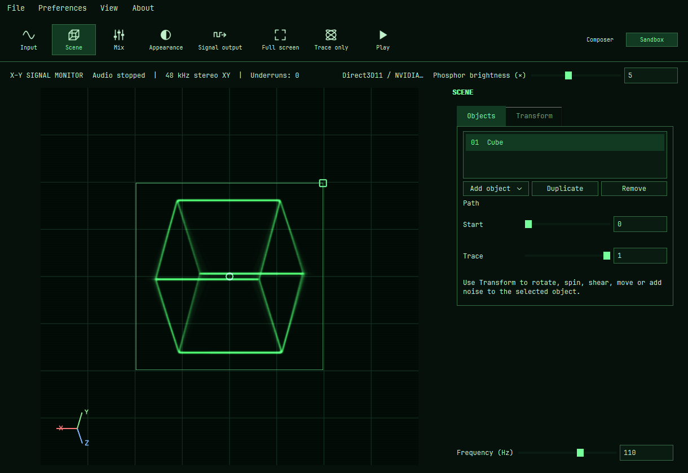

# phosphor user manual

phosphor turns drawings into sound you can see: it makes stereo audio in which the left
channel is X and the right channel is Y, so an oscilloscope in X–Y mode draws the picture
while you hear it. You build scenes from 3D solids, text, equations, your own drawings and
imported models; move them with transforms and expressions; play them from scales, MIDI
files, a steady tone or a live MIDI keyboard; and arrange them into songs with automation
in Composer. A simulated phosphor oscilloscope shows the result on screen.

This manual describes **phosphor 0.49.8-dev** (November 14, 2026) on Windows and macOS.


*The Sandbox: a cube on the signal monitor, with the Scene panel open.*

## Contents

| Chapter | What it covers |
|---|---|
| [1. Introduction](01-introduction.md) | What phosphor does, connecting an oscilloscope, running the app, the two workspaces, a first sound in five minutes |
| [2. The interface](02-interface.md) | The window, menus, application bar, status strip, side panels, view modes, preferences, help |
| [3. Sources and input](03-sources-and-input.md) | Scale, MIDI file, Single tone, Live MIDI and recording; system audio and video monitoring |
| [4. Objects and scenes](04-objects-and-scenes.md) | Every object type, placement, the path window, several objects, travel, imports, inspecting one cycle, Sandbox undo |
| [5. The shape builder](05-shape-builder.md) | Drawing your own shapes: tools, snapping, selection, styles, text, motion guides |
| [6. Parametric equations](06-parametric-equations.md) | Equation objects, the expression language, variables, presets, and a gallery of 23 equations |
| [7. Transforms](07-transforms.md) | The transform stack, every transform and field, expressions of t, p, s, x, y, z |
| [8. Composer](08-composer.md) | Songs: clips, the note roll, automation lanes, copy and paste, projects and export |
| [9. Mix, signal output and export](09-mix-output-and-export.md) | Levels and listening modes, signal calibration, WAV export |
| [10. Display and monitor](10-display-and-monitor.md) | Appearance, the phosphor, the time view, the pop-out monitor, full-screen views |
| [11. Cookbook](11-cookbook.md) | Step-by-step recipes: beat-synced motion, draw-ons, fades, drops, strobes, morphs and more |
| [12. Reference](12-reference.md) | Shortcuts, limits, files and settings, glossary, troubleshooting |

**New to phosphor?** Read [1. Introduction](01-introduction.md), then try a few recipes from
the [Cookbook](11-cookbook.md). **Making a song?** Go to [8. Composer](08-composer.md).

## Conventions

- **Bold** names are what you see on screen: buttons, menus, fields (**Add object**,
  **Scene › Transform**). › separates menu levels or a panel and its tab.
- `Code style` is text you type: expressions (`sin(tau*s)`), file names (`.scene.json`).
- Keys are written for both systems, macOS first: **Command / Ctrl**, ⌘C / Ctrl+C.
- *Beats* are quarter notes; a bar has four. *Gain* in automation multiplies a number.

## Examples in this manual

Every equation, expression, path window and automation lane in this manual is checked by
the app's tests (`tests/unit/test_manual_examples.py`): each is built exactly as written
and rendered, and must be valid and draw something. Under each example the source holds a
hidden line such as

```text
<!-- example: {"id": "rose3", "kind": "equation", "x": "...", "y": "..."} -->
```

with `kind` one of `equation` (`x`, `y`, optional `variables` with `name`, `value`, `low`,
`high`, `expression`), `transform` (`object`, `steps` with `transform` and `fields`), `path`
(`object`, `start`, `trace`) or `lane` (`key` such as `mix:drawing_gain`,
`transform:<step>:<field>`, `path:path_trace`, `shape:shape_size`, `variable:<name>`;
`points` as `[beat, gain, "linear"|"hold"]`; and the object's `steps` or equation for
context).

The pictures are screenshots of the real app, made by `tools/manual_screenshots.py` (run it
from the app folder with the display awake; it uses the default appearance
with the Green monochrome palette and never plays audio). The equation gallery images
(`images/eq-<id>.png`) are rendered from the same hidden examples, so they always match
the text.
